# Лабораторная работа №10

## Тема работы

**Текстовой редактор vi**

---

# Цель работы

Познакомиться с текстовым редактором `vi` в операционной системе Linux и получить практические навыки его использования.

В процессе выполнения лабораторной работы необходимо изучить:

- режимы работы редактора `vi`;
- создание и редактирование текстовых файлов;
- команды сохранения и выхода;
- основные команды перемещения и редактирования текста;
- работу с Bash-скриптами в редакторе `vi`.

---

# Оборудование и программное обеспечение

В ходе выполнения лабораторной работы использовались:

- операционная система Fedora Linux;
- терминал Bash;
- текстовый редактор `vi`;
- командная оболочка Linux.

---

# Теоретические сведения

Редактор `vi` является стандартным текстовым редактором Linux, предназначенным для создания и изменения текстовых файлов.

Редактор имеет три основных режима работы.

## Командный режим

Используется для выполнения команд управления текстом:

- перемещение курсора;
- удаление текста;
- копирование;
- вставка;
- поиск;
- отмена изменений.

---

## Режим вставки

Используется для ввода текста.

Переход в режим вставки выполняется командами:

```bash
i
```

или

```bash
a
```

или

```bash
o
```

Возврат в командный режим выполняется клавишей:

```bash
Esc
```

---

## Режим последней строки

Используется для выполнения команд сохранения и выхода.

Переход:

```bash
:
```

Основные команды:

```bash
:w
```

Сохранение файла.

```bash
:q
```

Выход из редактора.

```bash
:wq
```

Сохранение и выход.

```bash
:q!
```

Выход без сохранения изменений.

---

# Ход выполнения работы

## 1. Проверка установки редактора vi

Для проверки наличия редактора была выполнена команда:

```bash
vi --version
```

В результате была получена информация о версии установленного редактора.

### Результат

Редактор `vi` успешно установлен и готов к использованию.

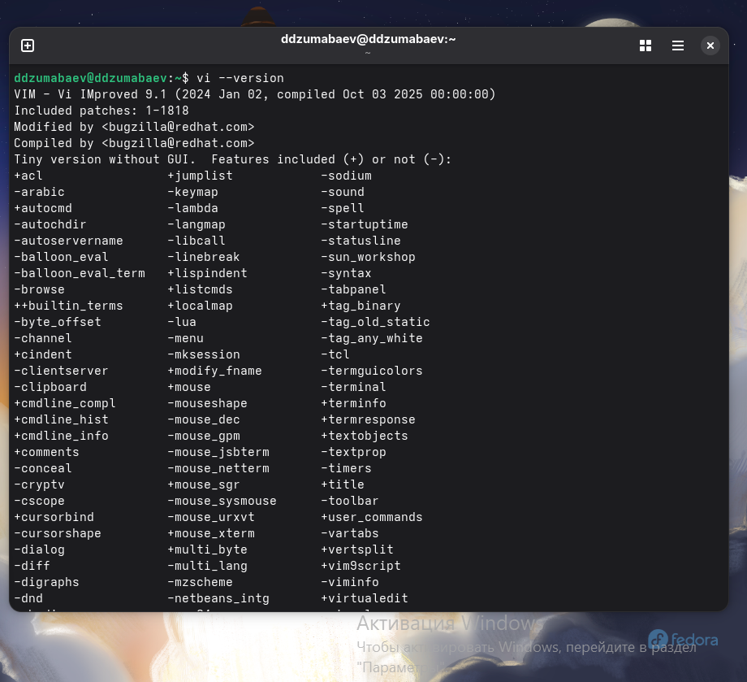

---

# 2. Создание рабочего каталога

Согласно заданию был создан рабочий каталог:

```bash
mkdir -p ~/work/os/lab06
```

После создания выполнен переход в каталог:

```bash
cd ~/work/os/lab06
```

Проверка текущего расположения:

```bash
pwd
```

### Результат

Рабочий каталог:

```text
/home/ddzumabaev/work/os/lab06
```

был успешно создан.

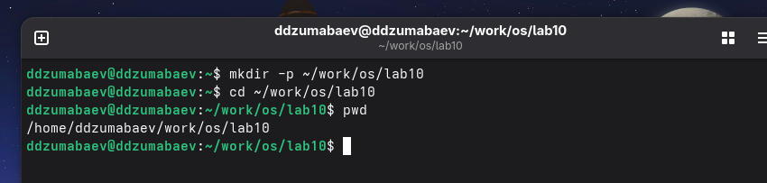

---

# 3. Создание файла hello.sh

В рабочем каталоге был открыт редактор `vi`:

```bash
vi hello.sh
```

После открытия файла выполнен переход в режим вставки:

```bash
i
```

В файл была добавлена программа Bash:

```bash
#!/bin/bash

HELL=Hello

function hello {
    local HELLO=World
    echo $HELLO
}

echo $HELLO
hello
```

После завершения ввода выполнен возврат в командный режим:

```bash
Esc
```

---

# 4. Сохранение файла

Для сохранения и выхода из редактора использована команда:

```bash
:wq
```

Файл был успешно сохранён.

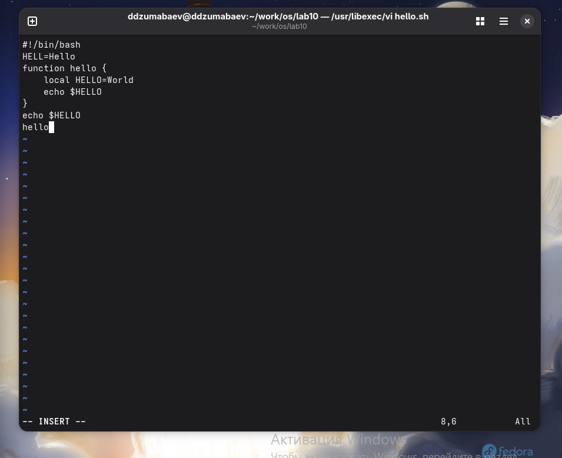

---

# 5. Проверка созданного файла

Содержимое каталога было просмотрено командой:

```bash
ls -l
```

Для просмотра содержимого файла использована команда:

```bash
cat hello.sh
```

### Результат

Созданный файл `hello.sh` содержит написанную Bash-программу.

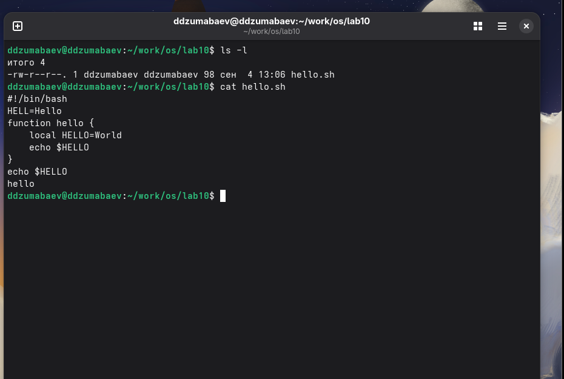

---

# 6. Изменение прав доступа файла

Для возможности запуска скрипта файл был сделан исполняемым:

```bash
chmod +x hello.sh
```

Проверка прав доступа:

```bash
ls -l hello.sh
```

В результате у файла появился параметр выполнения:

```text
-rwxr-xr-x
```

### Результат

Файл получил право выполнения.
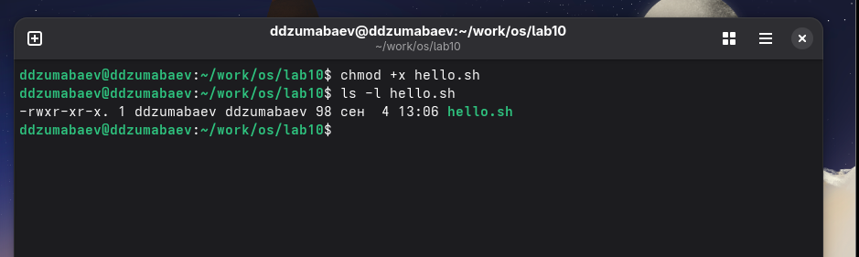

---

# 7. Запуск программы

Для запуска созданного скрипта выполнена команда:

```bash
./hello.sh
```

### Результат выполнения

Программа успешно запустилась и вывела результат работы переменных.

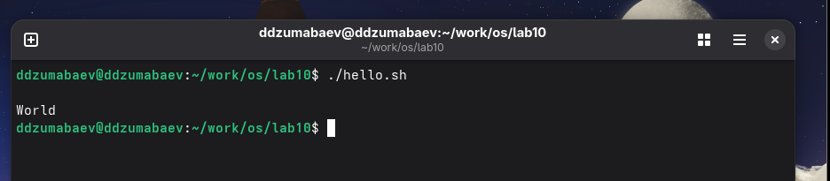

---

# 8. Редактирование файла hello.sh

Файл был повторно открыт в редакторе:

```bash
vi ~/work/os/lab06/hello.sh
```

---

## Изменение переменной HELL

Строка:

```bash
HELL=Hello
```

была изменена на:

```bash
HELLO=Hello
```

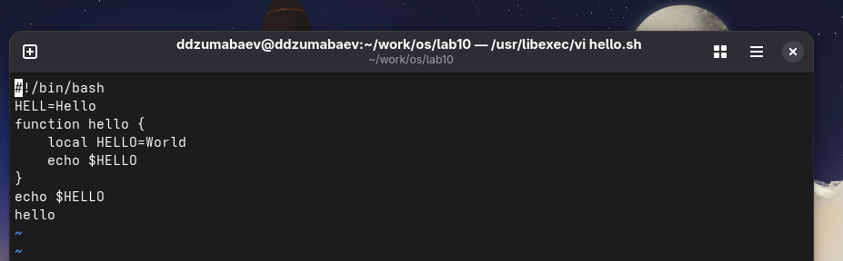

---

## Удаление и восстановление слова local

В строке:

```bash
local HELLO=World
```

было выполнено удаление слова:

```bash
local
```

После этого слово было добавлено обратно с помощью режима вставки.

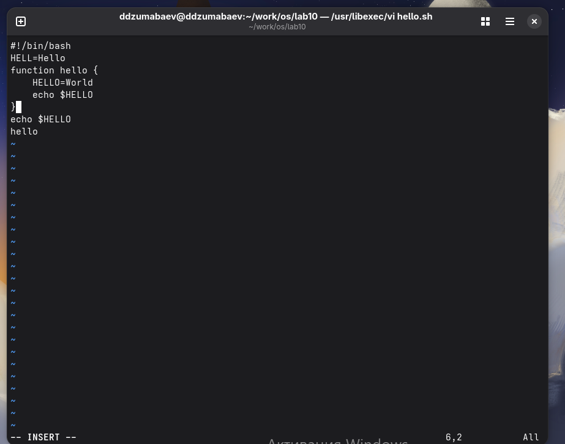

---

# 9. Добавление новой строки

Для перехода в конец файла использована команда:

```bash
G
```

После этого была добавлена новая строка:

```bash
echo $HELLO
```

Для создания новой строки использована команда:

```bash
o
```

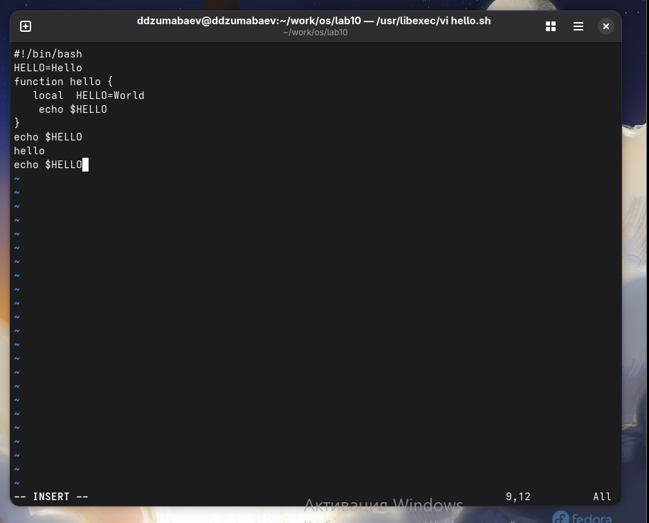

---

# 10. Удаление строки

Последняя добавленная строка была удалена командой:

```bash
dd
```

Команда `dd` удаляет текущую строку в редакторе `vi`.

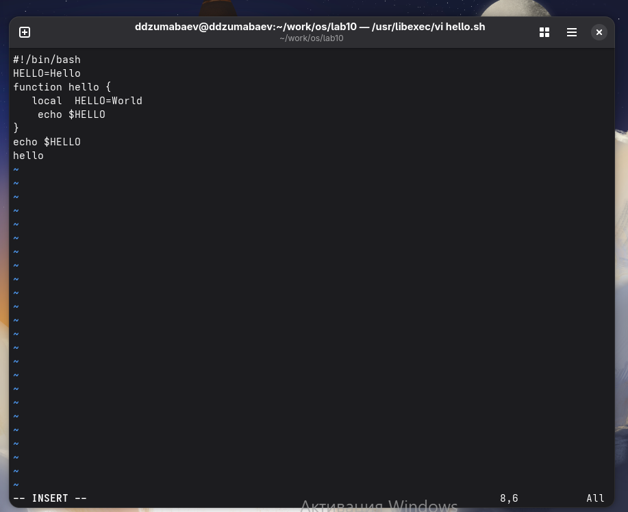

---

# 11. Отмена изменений

Для отмены последнего действия использована команда:

```bash
u
```

Удалённая строка была восстановлена.

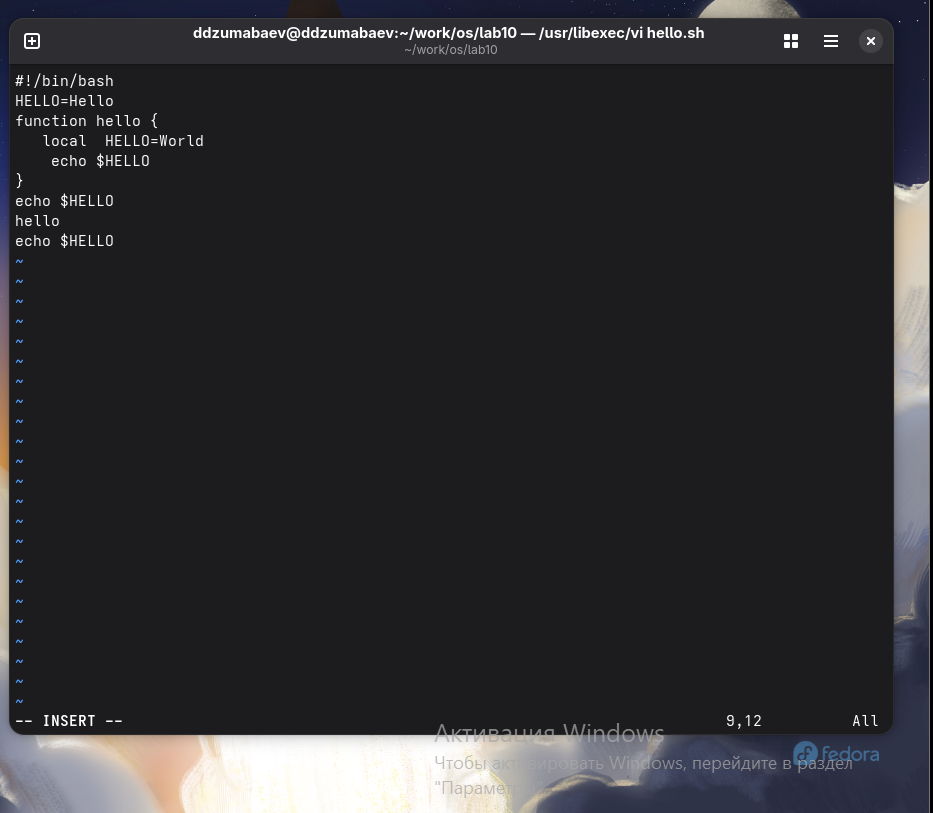

---

# 12. Финальная проверка файла

После сохранения изменений выполнены команды:

```bash
cat hello.sh
```

Проверка прав:

```bash
ls -l hello.sh
```

Запуск программы:

```bash
./hello.sh
```

### Результат

Файл был успешно отредактирован, сохранён и выполнен.

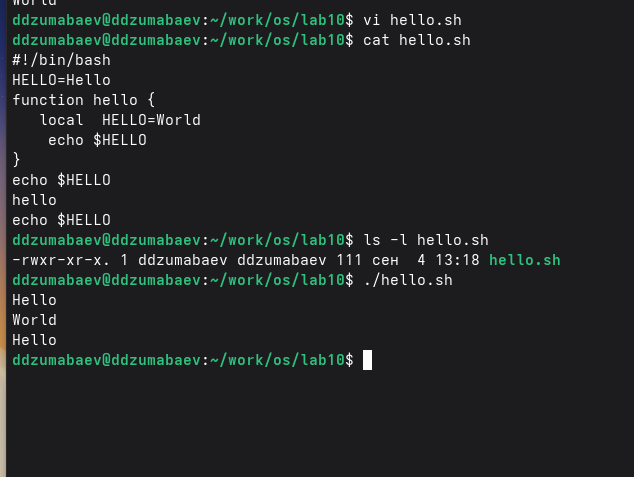

---

(Продолжение отчёта: **вывод и ответы на контрольные вопросы**)

# Вывод

В ходе выполнения лабораторной работы был изучен текстовый редактор `vi` в операционной системе Linux.

Были рассмотрены основные режимы работы редактора:

- командный режим;
- режим вставки;
- режим последней строки.

В процессе выполнения работы были получены практические навыки создания и редактирования файлов с помощью `vi`. Был создан Bash-скрипт `hello.sh`, выполнено его редактирование, сохранение и запуск.

Были изучены основные команды управления текстом:

- переход между режимами;
- добавление и удаление строк;
- отмена изменений;
- сохранение файлов;
- выход из редактора.

Также были закреплены навыки работы с правами доступа Linux. Для запуска созданного скрипта использовалась команда:

```bash
chmod +x hello.sh
```

После изменения прав доступа файл был успешно выполнен.

Таким образом, цель лабораторной работы была достигнута. Были получены базовые навыки работы с редактором `vi`, создания и изменения текстовых файлов, а также управления Bash-скриптами в Linux.

---

# Ответы на контрольные вопросы

## 1. Какие режимы работы имеет редактор vi?

Редактор `vi` имеет три основных режима работы:

1. **Командный режим** — используется для перемещения по файлу, удаления, копирования, поиска и выполнения команд управления текстом.

2. **Режим вставки** — предназначен для непосредственного ввода и изменения текста.

3. **Режим последней строки** — используется для выполнения команд сохранения, выхода и настройки редактора.

---

## 2. Как перейти в режим вставки?

Для перехода в режим вставки используются команды:

```bash
i
```

Вставка текста перед курсором.

```bash
a
```

Вставка текста после курсора.

```bash
o
```

Создание новой строки ниже текущей и переход в режим вставки.

---

## 3. Как выйти из режима вставки?

Для возврата из режима вставки в командный режим необходимо нажать:

```bash
Esc
```

После этого снова становятся доступны команды управления редактором.

---

## 4. Как сохранить файл в редакторе vi?

Для сохранения файла используется команда:

```bash
:w
```

Команда вводится в режиме последней строки.

---

## 5. Как сохранить файл и выйти из vi?

Для сохранения изменений и выхода используется:

```bash
:wq
```

Также можно использовать:

```bash
ZZ
```

Эта команда выполняет сохранение и выход из редактора.

---

## 6. Как выйти из vi без сохранения изменений?

Для выхода без сохранения используется команда:

```bash
:q!
```

Она принудительно закрывает редактор и отменяет изменения.

---

## 7. Как удалить строку в vi?

Для удаления текущей строки используется команда:

```bash
dd
```

Она удаляет строку, на которой находится курсор.

---

## 8. Как отменить последнее действие в vi?

Для отмены последнего изменения используется команда:

```bash
u
```

Команда выполняет операцию отмены (undo).

---

## 9. Как перейти в конец файла?

Для перехода к последней строке файла используется команда:

```bash
G
```

После выполнения курсор перемещается в конец документа.

---

## 10. Как сделать файл исполняемым в Linux?

Для добавления права выполнения используется команда:

```bash
chmod +x имя_файла
```

Например:

```bash
chmod +x hello.sh
```

После этого файл можно запускать как программу.

---

## 11. Что такое Bash-скрипт?

Bash-скрипт — это текстовый файл, содержащий набор команд оболочки Linux, которые выполняются последовательно.

В начале скрипта обычно указывается:

```bash
#!/bin/bash
```

Эта строка определяет интерпретатор, который будет использоваться для выполнения файла.

---

## 12. Для чего используется команда cat?

Команда:

```bash
cat
```

используется для вывода содержимого текстовых файлов в терминал.

Пример:

```bash
cat hello.sh
```

---

## 13. Для чего используется команда chmod?

Команда:

```bash
chmod
```

предназначена для изменения прав доступа файлов и каталогов.

С её помощью можно назначать права:

- чтения (`r`);
- записи (`w`);
- выполнения (`x`).

Пример:

```bash
chmod 755 script.sh
```

---

# Приложение А. Используемые команды

В ходе выполнения лабораторной работы были использованы следующие команды:

| Команда | Назначение |
|---|---|
| `vi` | запуск текстового редактора |
| `i` | переход в режим вставки |
| `Esc` | возврат в командный режим |
| `:wq` | сохранение и выход |
| `:q!` | выход без сохранения |
| `dd` | удаление строки |
| `u` | отмена действия |
| `G` | переход в конец файла |
| `cat` | просмотр содержимого файла |
| `ls` | просмотр содержимого каталога |
| `chmod` | изменение прав доступа |
| `./` | запуск исполняемого файла |

---

# Итог

В результате выполнения лабораторной работы были изучены возможности текстового редактора `vi` и получены практические навыки работы с ним. Был создан и изменён Bash-скрипт, освоены основные команды редактирования текста, сохранения файлов и управления правами доступа в Linux.

Все поставленные задачи лабораторной работы были выполнены.
