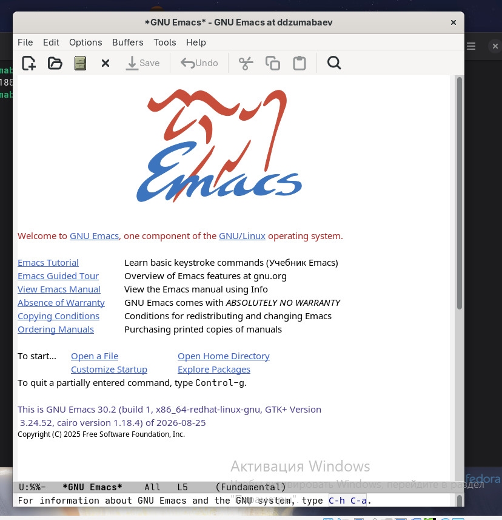
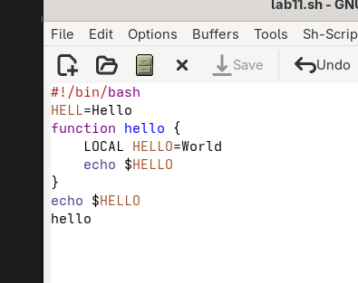
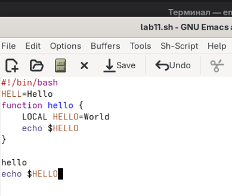
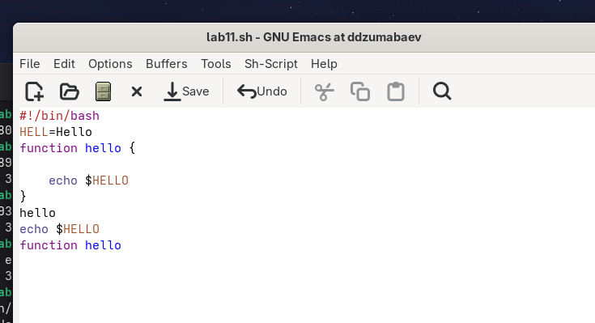
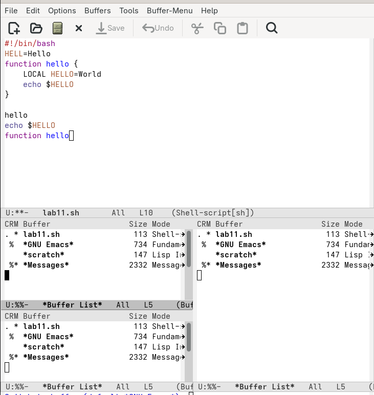
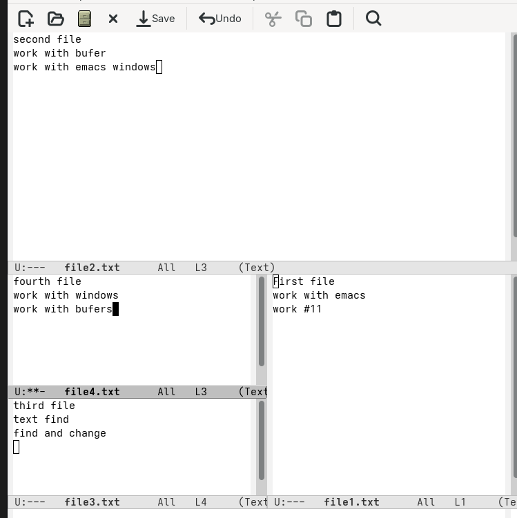
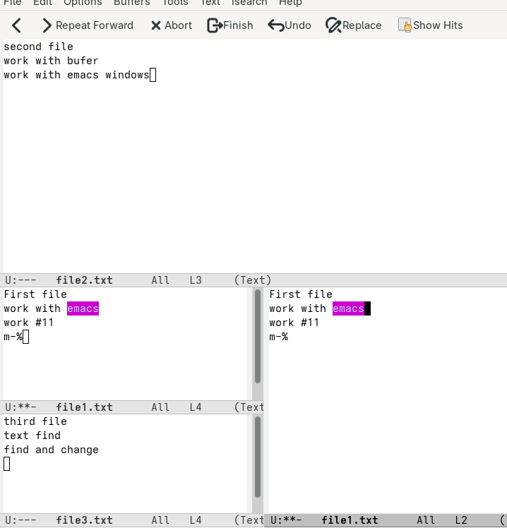

# Лабораторная работа №11

## Текстовой редактор Emacs

**Дисциплина:** Архитектура компьютера и операционные системы

**Выполнил:** Damir Jumabaev

**Группа:** НКАбд-02-25

**2026 г.**

---

# Цель работы

## Основные задачи

- Изучить текстовой редактор Emacs
- Освоить создание и редактирование файлов
- Изучить основные команды перемещения по тексту
- Научиться работать с буферами
- Научиться работать с окнами Emacs
- Освоить поиск текста
- Освоить поиск и замену текста
- Изучить дополнительные режимы поиска

---

# Запуск Emacs

Для запуска текстового редактора использовалась команда:

```bash
emacs
````

При необходимости редактор можно запустить в фоновом режиме:

```bash
emacs &
```

После запуска открылось главное окно редактора Emacs.

---



---

# Создание файла

Для создания файла использовалась комбинация:

```text
Ctrl + X
Ctrl + F
```

В качестве имени файла был указан:

```text
lab07.sh
```

После открытия файла в него был введён исходный текст программы.

Сохранение файла выполнялось комбинацией:

```text
Ctrl + X
Ctrl + S
```

---



---

# Редактирование текста

Для удаления строки использовалась команда:

```text
Ctrl + K
```

Команда удаляет текст от положения курсора до конца строки.

Для перехода в конец буфера использовалась комбинация:

```text
Alt + >
```

Для вставки ранее удалённого текста:

```text
Ctrl + Y
```

Таким образом была выполнена операция вырезания и последующей вставки строки.

---



---

# Копирование области текста

Для выделения области текста использовалась команда:

```text
Ctrl + Space
```

После перемещения курсора выделенный фрагмент был скопирован:

```text
Alt + W
```

Для вставки скопированного текста использовалась команда:

```text
Ctrl + Y
```

Также была проверена возможность отмены выполненного действия:

```text
Ctrl + /
```

---



---

# Перемещение курсора

В Emacs используются следующие команды навигации:

| Комбинация | Назначение    |
| ---------- | ------------- |
| `Ctrl + A` | начало строки |
| `Ctrl + E` | конец строки  |
| `Alt + <`  | начало буфера |
| `Alt + >`  | конец буфера  |

Данные команды позволяют быстро перемещаться по тексту без использования мыши.

---

# Работа с буферами

Для просмотра списка активных буферов использовалась комбинация:

```text
Ctrl + X
Ctrl + B
```

Для перехода между окнами:

```text
Ctrl + X
O
```

Для переключения на определённый буфер:

```text
Ctrl + X
B
```

Для закрытия текущего окна:

```text
Ctrl + X
0
```

Буферы позволяют одновременно работать с несколькими открытыми файлами.

---



---

# Работа с окнами

Для разделения окна по вертикали использовалась команда:

```text
Ctrl + X
3
```

Для горизонтального разделения:

```text
Ctrl + X
2
```

В результате окно Emacs было разделено на четыре области.

Каждое окно может отображать отдельный буфер.

---


---

# Работа с несколькими файлами

В созданных окнах были открыты различные файлы.

Пример содержимого первого файла:

```text
Это первый файл.
Работа с Emacs.
Лабораторная работа №11.
```

Пример содержимого второго файла:

```text
Это второй файл.
Работа с буферами.
Работа с окнами.
```

Одновременная работа с несколькими окнами позволяет редактировать несколько файлов.

---



---

# Поиск текста

Для поиска текста использовалась комбинация:

```text
Ctrl + S
```

После запуска поиска вводилось искомое слово:

```text
Emacs
```

Для перехода к следующему найденному совпадению повторно использовалась команда:

```text
Ctrl + S
```

Для завершения поиска:

```text
Ctrl + G
```

---



---

# Поиск и замена

Для выполнения поиска с заменой использовалась команда:

```text
Alt + %
```

Сначала указывалось слово для поиска:

```text
Emacs
```

Затем вводилось новое значение:

```text
EDITOR
```

Для замены всех найденных совпадений использовалась команда:

```text
!
```

Таким образом, функция поиска и замены позволяет быстро изменить повторяющиеся фрагменты текста.

---


---

# Дополнительный режим поиска

Также был проверен дополнительный режим:

```text
Alt + S
O
```

Данная команда используется для поиска строк, содержащих заданный текст.

В отличие от обычного поиска `Ctrl + S`, результаты отображаются в отдельном списке, что позволяет быстро просматривать найденные строки.


---

# Основные команды Emacs

В ходе лабораторной работы были изучены:

```text
Ctrl + X Ctrl + F  — открыть файл
Ctrl + X Ctrl + S  — сохранить файл
Ctrl + K           — удалить строку
Ctrl + Y           — вставить текст
Ctrl + Space       — начать выделение
Alt + W            — копировать область
Ctrl + W           — вырезать область
Ctrl + /           — отменить действие
Ctrl + A           — начало строки
Ctrl + E           — конец строки
Alt + <            — начало буфера
Alt + >            — конец буфера
Ctrl + X Ctrl + B  — список буферов
Ctrl + X B         — переключение буфера
Ctrl + X O         — переключение окна
Ctrl + X 2         — горизонтальное разделение
Ctrl + X 3         — вертикальное разделение
Ctrl + S           — поиск
Alt + %            — поиск и замена
Alt + S O          — поиск строк
```

---

# Результаты работы

В ходе лабораторной работы были получены практические навыки:

* создания и редактирования файлов в Emacs;
* перемещения по тексту с помощью клавиатуры;
* выделения, копирования и удаления текста;
* отмены выполненных действий;
* работы с буферами;
* разделения рабочего пространства на окна;
* одновременной работы с несколькими файлами;
* поиска текста;
* поиска и замены;
* использования дополнительных режимов поиска.

Практические задания выполнялись в **Fedora Linux**.

---

# Заключение

В ходе лабораторной работы №11 был изучен текстовой редактор Emacs.

На практике были рассмотрены основные возможности редактора:

```text
создание файла
      ↓
редактирование текста
      ↓
работа с буферами
      ↓
работа с окнами
      ↓
поиск текста
      ↓
поиск и замена
```

Были освоены основные клавиатурные команды Emacs, позволяющие эффективно редактировать текст и работать с несколькими файлами.

Полученные навыки являются основой для дальнейшего использования Emacs при работе в операционной системе Linux.

## Работа выполнена.

