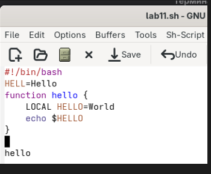
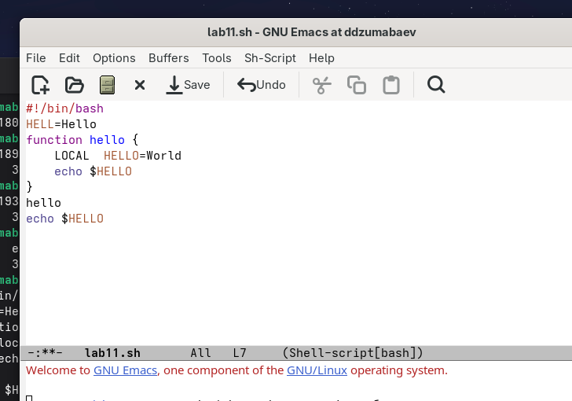
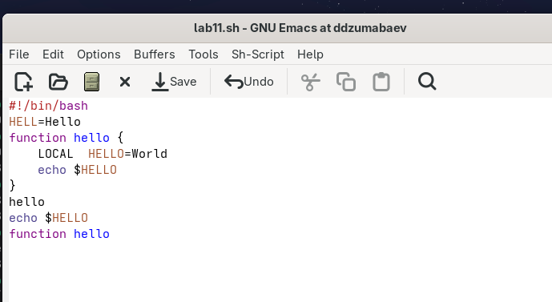
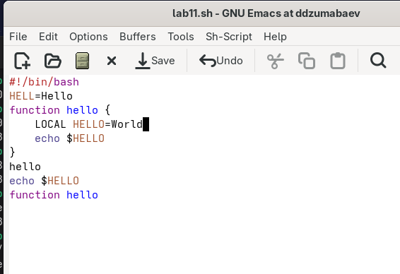
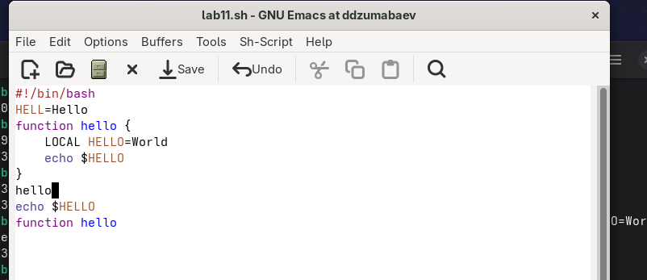
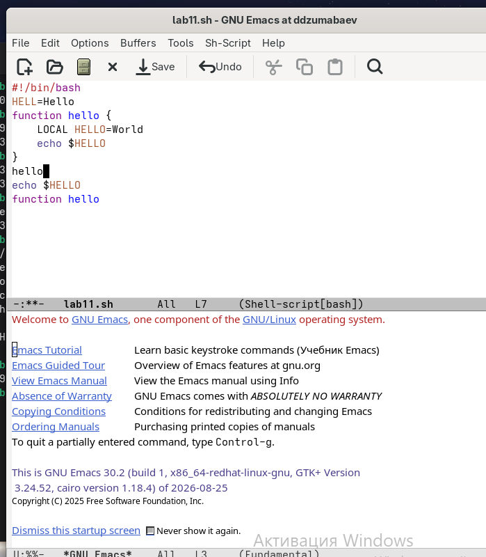
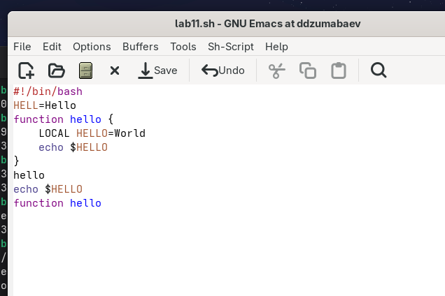
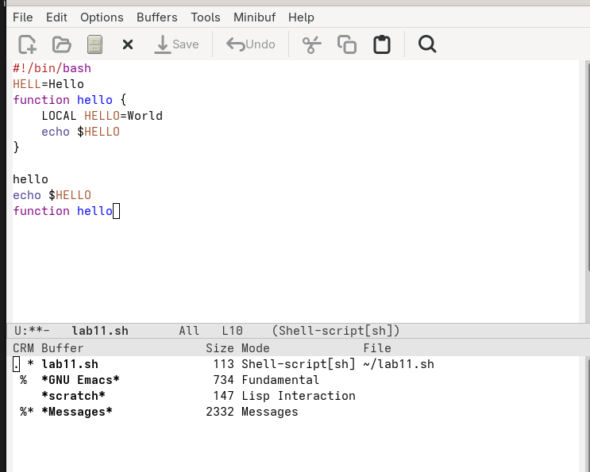

# Лабораторная работа №11

## Текстовой редактор Emacs

**Выполнил:** Дамир Джумабаев
**Группа:** НКАбд-02-25

---

# 1. Цель работы

Познакомиться с операционной системой Linux и получить практические навыки работы с текстовым редактором Emacs.

В ходе работы необходимо освоить основные возможности редактора Emacs: создание и сохранение файлов, редактирование текста, перемещение курсора, работу с буферами и окнами, поиск и замену текста.

Цель работы соответствует формулировке, приведённой в методических указаниях.

---

# 2. Теоретические сведения

## 2.1. Общая характеристика Emacs

Emacs представляет собой мощный экранный текстовый редактор, написанный на языке высокого уровня Elisp.

Работа с Emacs может выполняться как с помощью элементов графического меню, так и посредством комбинаций клавиш.

Для запуска редактора из командной строки используется команда:

```bash
emacs
```

Также Emacs можно запустить в фоновом режиме относительно консоли:

```bash
emacs &
```

Для выхода из редактора используется комбинация:

```text
C-x C-c
```

где `C` обозначает клавишу `Ctrl`, а `M` — клавишу `Meta`, роль которой на обычной клавиатуре может выполнять `Alt` или `Esc`.

---

## 2.2. Основные понятия Emacs

В методических указаниях рассматриваются несколько основных понятий.

**Буфер** — объект, представляющий некоторый текст. Буфер может содержать текст файла, результаты компиляции программы, встроенную справочную информацию и другие данные.

**Фрейм** соответствует окну в обычном понимании. Каждый фрейм содержит область вывода и одно или несколько окон Emacs.

**Окно** — прямоугольная область фрейма, отображающая один из буферов.

**Область вывода** используется для отображения сообщений и запросов дополнительной информации.

**Минибуфер** используется для ввода дополнительной информации и отображается в области вывода.

**Точка вставки** — положение, в котором выполняется вставка или удаление данных в буфере.

---

## 2.3. Обозначение комбинаций клавиш

В Emacs широко используются префиксные клавиши.

Обозначение:

```text
C-x
```

означает нажатие `Ctrl+x`.

Обозначение:

```text
M-x
```

означает нажатие `Meta+x`. На обычной клавиатуре вместо `Meta` обычно используется `Alt` или `Esc`.

Префикс `C-x` используется для основных команд редактора, например открытия, сохранения и закрытия файлов.

Префикс `C-c` используется для вызова функций, зависящих от текущего режима.

---

## 2.4. Основные команды редактирования

Для работы с текстом используются следующие комбинации:

| Комбинация | Действие                                          |
| ---------- | ------------------------------------------------- |
| `C-d`      | удаление символа                                  |
| `M-d`      | удаление следующего слова                         |
| `C-k`      | удаление текста от курсора до конца строки        |
| `M-k`      | удаление текста до конца предложения              |
| `M-\`      | удаление лишних пробелов и табуляции              |
| `C-q`      | вставка символа, соответствующего нажатой клавише |
| `M-q`      | выравнивание текста текущего абзаца               |

Для работы с выделенной областью используются:

| Комбинация | Действие                                           |
| ---------- | -------------------------------------------------- |
| `C-space`  | начало выделения                                   |
| `C-w`      | удаление выделенной области                        |
| `M-w`      | копирование выделенной области                     |
| `C-y`      | вставка текста из списка удалений                  |
| `M-y`      | последовательная вставка текста из списка удалений |

Эти комбинации приведены в таблицах 9.2 и 9.3 методических указаний.

---

# 3. Ход выполнения лабораторной работы

## 3.1. Запуск Emacs

Для запуска редактора в терминале была выполнена команда:

```bash
emacs
```

После выполнения команды открылось главное окно текстового редактора Emacs.


---

## 3.2. Создание файла `lab07.sh`

Для создания файла использовалась комбинация:

```text
C-x C-f
```

После этого было введено имя:

```text
lab07.sh
```

В созданный буфер был введён исходный текст из задания:

```bash
#!/bin/bash
HELL=Hello
function hello {
LOCAL HELLO=World
echo $HELLO
}
echo $HELLO
hello
```

Итоговый вариант файла содержит восемь строк.

Данный фрагмент непосредственно указан в последовательности выполнения лабораторной работы.


---

## 3.3. Сохранение файла

После ввода текста файл был сохранён с помощью комбинации:

```text
C-x C-s
```

После выполнения команды изменения были записаны в файл `lab07.sh`.

Комбинация `C-x C-s` предназначена для сохранения текста текущего буфера.

---

# 4. Редактирование текста

## 4.1. Вырезание строки

Для выполнения первого упражнения была выбрана строка текста.

С помощью комбинации:

```text
C-k
```


был удалён текст от текущего положения курсора до конца строки.

В соответствии с заданием целая строка была вырезана одной командой.

---

## 4.2. Вставка строки в конец файла

После вырезания строки курсор был перемещён в конец файла.

Для вставки ранее удалённого текста использовалась комбинация:

```text
C-y
```

Таким образом, вырезанная строка была помещена в конец файла.


---

## 4.3. Выделение области текста

Для выделения части текста использовалась комбинация:

```text
C-space
```

После нажатия комбинации началось выделение текста от текущего положения курсора.

Курсор был перемещён, в результате чего была выделена необходимая область.

---

## 4.4. Копирование выделенной области

Выделенная область была скопирована с помощью:

```text
M-w
```

Скопированный текст был помещён в список удалений Emacs.

После перемещения курсора в конец файла использовалась команда:

```text
C-y
```

что позволило вставить скопированный фрагмент.



---

## 4.5. Удаление выделенной области

После повторного выделения необходимого фрагмента была выполнена команда:

```text
C-w
```

Выделенная область была удалена.

Для отмены последнего действия использовалась комбинация:

```text
C-/
```

После выполнения команды состояние текста было восстановлено.

Эти действия полностью соответствуют пунктам 5.3–5.7 последовательности выполнения лабораторной работы.




---

# 5. Перемещение курсора

В лабораторной работе были изучены основные команды перемещения курсора.

## 5.1. Переход в начало строки

Использовалась комбинация:

```text
C-a
```

Она перемещает курсор в начало текущей строки.

---

## 5.2. Переход в конец строки

Для перехода в конец текущей строки использовалась:

```text
C-e
```

---

## 5.3. Переход в начало буфера

Для перехода в начало всего буфера использовалась:

```text
M-<
```

---

## 5.4. Переход в конец буфера

Для перехода в конец буфера использовалась:

```text
M->
```

Таким образом, были изучены команды перемещения курсора внутри строки и всего буфера.

Эти четыре операции прямо предусмотрены пунктами 6.1–6.4 методических указаний.


---

# 6. Работа с буферами

## 6.1. Просмотр списка активных буферов

Для отображения списка активных буферов была использована комбинация:

```text
C-x C-b
```

После выполнения команды в новом окне появился список открытых буферов.

Команда `C-x C-b` предназначена для отображения списка открытых буферов в новом окне.




---

## 6.2. Переключение между буферами

После появления списка буферов выполнялся переход в открывшееся окно с помощью:

```text
C-x o
```

Затем был выбран другой буфер.

После этого дополнительное окно было закрыто:

```text
C-x 0
```

При этом сам буфер не удаляется.

Для дальнейшего переключения между буферами без вывода их списка использовалась команда:

```text
C-x b
```

Эта последовательность соответствует пунктам 7.1–7.4 лабораторной работы.

---

# 7. Управление окнами

## 7.1. Разделение фрейма

Для выполнения следующего задания фрейм был разделён на четыре части.

Сначала окно было разделено по вертикали:

```text
C-x 3
```

После этого каждое из получившихся окон было разделено по горизонтали:

```text
C-x 2
```

В результате был получен фрейм, содержащий четыре окна.

Именно такая последовательность указана в пункте 8.1 методических указаний.


---

## 7.2. Работа с четырьмя буферами

В каждом из четырёх созданных окон был открыт отдельный буфер.

В буферы был введён небольшой текст.

Таким образом, одновременно были использованы четыре окна, отображающие разные буферы.


**Рисунок 9 – Четыре окна Emacs с разными буферами.**

---

# 8. Поиск текста

## 8.1. Прямой поиск

Для перехода в режим поиска использовалась комбинация:

```text
C-s
```

После этого был введён искомый текст.

Emacs выполнил поиск в прямом направлении и переместил курсор к найденному совпадению.

Комбинация `C-s` предназначена для поиска текста в прямом направлении.

---

## 8.2. Переход между результатами поиска

Для перехода к следующему найденному совпадению повторно нажималась комбинация:

```text
C-s
```

Таким образом, выполнялось последовательное перемещение между найденными результатами.

---

## 8.3. Выход из режима поиска

Для завершения поиска использовалась комбинация:

```text
C-g
```


---

# 9. Поиск и замена

Для выполнения поиска с заменой использовалась комбинация:

```text
M-%
```

После запуска команды было введено выражение, которое необходимо найти.

Затем нажата клавиша `Enter`.

После этого было указано новое значение для замены.

После отображения найденных совпадений для подтверждения замены всех найденных вариантов использовалась клавиша:

```text
!
```

Комбинация `M-%` предназначена для поиска текста и его замены с запросом исходного и нового текста.


---

# 10. Дополнительный режим поиска

В последнем пункте практической части был испытан другой режим поиска.

Для его запуска использовалась комбинация:

```text
M-s o
```

Этот режим отличается от обычного `C-s` тем, что предназначен для отображения списка совпадений с поисковым запросом.

При обычном `C-s` поиск выполняется непосредственно в тексте и курсор перемещается между найденными совпадениями.

В режиме `M-s o` результаты поиска представлены в отдельном интерфейсе списка совпадений, что позволяет удобнее просматривать найденные позиции и переходить к нужному результату.

Пункт 9.5 методических указаний непосредственно требует попробовать `M-s o` и объяснить отличие от обычного режима поиска.


---

# 11. Листинг файла `lab07.sh`

В ходе лабораторной работы был создан файл `lab07.sh`.

Исходное содержимое файла:

```bash
#!/bin/bash

HELL=Hello

function hello {
    LOCAL HELLO=World
    echo $HELLO
}

echo $HELLO
hello
```

Файл использовался для выполнения операций редактирования текста в Emacs.

---

# 12. Основные изученные комбинации клавиш

В результате выполнения лабораторной работы были изучены следующие команды:

| Комбинация | Назначение                     |
| ---------- | ------------------------------ |
| `C-x C-f`  | открыть файл                   |
| `C-x C-s`  | сохранить файл                 |
| `C-k`      | удалить текст до конца строки  |
| `C-space`  | начать выделение               |
| `M-w`      | скопировать выделенную область |
| `C-w`      | удалить выделенную область     |
| `C-y`      | вставить текст                 |
| `C-/`      | отменить последнее действие    |
| `C-a`      | перейти в начало строки        |
| `C-e`      | перейти в конец строки         |
| `M-<`      | перейти в начало буфера        |
| `M->`      | перейти в конец буфера         |
| `C-x C-b`  | показать список буферов        |
| `C-x b`    | переключиться на буфер         |
| `C-x o`    | перейти в другое окно          |
| `C-x 0`    | закрыть текущее окно           |
| `C-x 2`    | разделить окно по горизонтали  |
| `C-x 3`    | разделить окно по вертикали    |
| `C-s`      | поиск вперёд                   |
| `C-r`      | поиск назад                    |
| `M-%`      | поиск и замена                 |
| `M-s o`    | дополнительный режим поиска    |

Перечисленные команды соответствуют основным комбинациям, приведённым в методических указаниях.

---

# 13. Ответы на контрольные вопросы

## 1. Кратко охарактеризуйте редактор Emacs.

Emacs — мощный экранный текстовый редактор, написанный на языке высокого уровня Elisp.

Редактор предоставляет средства создания и редактирования текстовых файлов, работы с буферами и окнами, поиска и замены текста, а также расширения функциональности с помощью различных режимов и команд.

---

## 2. Какие особенности Emacs могут сделать его сложным для освоения новичком?

Основной сложностью является большое количество комбинаций клавиш и команд.

В Emacs используются префиксы `C-` и `M-`, а многие операции выполняются последовательностями нескольких клавиш.

Кроме того, редактор имеет понятия буферов, окон, фреймов, режимов и минибуфера, которые необходимо освоить.

---

## 3. Что такое буфер и окно в терминологии Emacs?

**Буфер** — объект, представляющий некоторый текст или другую информацию, с которой работает Emacs.

**Окно** — прямоугольная область фрейма, отображающая один из буферов.

Один буфер может отображаться в окне, а расположение окон внутри фрейма можно изменять. Эти определения приведены в теоретической части методички.

---

## 4. Можно ли открыть больше 10 буферов в одном окне?

Да.

Количество буферов не ограничивается десятью. Буферы являются отдельными объектами Emacs, а окно в каждый момент отображает один выбранный буфер.

Поэтому можно иметь большое количество открытых буферов и переключаться между ними.

---

## 5. Какие буферы создаются по умолчанию при запуске Emacs?

При запуске Emacs создаётся основной буфер, в котором отображается начальная информация редактора. Также в процессе работы появляются служебные буферы, например буферы сообщений и справочной информации.

Конкретный набор служебных буферов может зависеть от версии Emacs и загруженной конфигурации.

---

## 6. Какие клавиши нужно нажать, чтобы ввести комбинации `C-c |` и `C-c C-|`?

Для ввода:

```text
C-c |
```

необходимо удерживать `Ctrl`, нажать `c`, отпустить клавиши и затем нажать `|`.

Для:

```text
C-c C-|
```

после `C-c` необходимо снова удерживать `Ctrl` и нажать клавишу, соответствующую символу `|`.

То есть запись с префиксом `C-` означает, что соответствующая клавиша нажимается вместе с `Ctrl`.

---

## 7. Как поделить текущее окно на две части?

Для горизонтального разделения используется:

```text
C-x 2
```

Для вертикального разделения используется:

```text
C-x 3
```

В таблице основных команд Emacs `C-x 2` определена как разделение окна по горизонтали.

---

## 8. В каком файле хранятся настройки редактора Emacs?

Пользовательские настройки Emacs обычно хранятся в конфигурационном файле пользователя.

Традиционным вариантом является:

```text
~/.emacs
```

Также может использоваться:

```text
~/.emacs.d/init.el
```

В современных конфигурациях возможны и другие варианты расположения файла и каталога настроек.

---

## 9. Какую функцию выполняет клавиша и можно ли её переназначить?

В Emacs клавиши связаны с командами редактора.

Комбинация клавиш вызывает определённую функцию, а пользователь может изменить соответствие клавиш и команд с помощью настроек Emacs и языка Elisp.

Таким образом, клавиатурные сочетания в Emacs могут быть переназначены.

---

## 10. Какой редактор показался удобнее — vi или Emacs?

В рамках данной лабораторной работы более удобным показался **Emacs**.

Основным преимуществом является большое количество встроенных возможностей: работа с несколькими буферами, разделение рабочего пространства на окна, поиск и замена текста, встроенная справка и возможность расширения функциональности.

При этом vi имеет более простую модель режимов и может быть удобнее для быстрого редактирования файлов из терминала.

---

# 14. Результаты работы

В ходе лабораторной работы были освоены основные возможности текстового редактора Emacs.

Были выполнены следующие действия:

1. Запущен редактор Emacs.
2. Создан файл `lab07.sh`.
3. В файл введён исходный текст из задания.
4. Выполнено сохранение файла.
5. Изучены операции вырезания, копирования и вставки текста.
6. Выполнена отмена последнего действия.
7. Изучены команды перемещения курсора.
8. Изучена работа с буферами.
9. Выполнено переключение между буферами.
10. Фрейм разделён на четыре окна.
11. В четырёх окнах открыты различные буферы.
12. Выполнен поиск текста.
13. Выполнен поиск и замена.
14. Испытан дополнительный режим поиска `M-s o`.

Таким образом, основные практические задания лабораторной работы были выполнены.

---

# 15. Вывод

В ходе выполнения лабораторной работы была изучена работа с текстовым редактором Emacs в операционной системе Linux.

Были получены практические навыки создания и сохранения файлов, редактирования текста с помощью комбинаций клавиш, выделения, копирования, удаления и восстановления текста.

Также были изучены буферы и окна Emacs, способы разделения рабочего пространства, переключения между буферами, поиска и замены текста.

В результате была освоена базовая работа с редактором Emacs и изучены основные комбинации клавиш, необходимые для эффективного редактирования текста.
