# Лабораторная работа №12

## Программирование в командном процессоре ОС UNIX. Командные файлы

---

# Титульный лист

**Российский университет дружбы народов**

**Лабораторная работа №12**

**Тема: «Программирование в командном процессоре ОС UNIX. Командные файлы»**

Выполнил:  
**Дамир Джумабаев**

Группа:  
**НКАбд-02-25**

---

# 1. Цель работы

Целью лабораторной работы является изучение программирования в командном процессоре ОС UNIX и получение практических навыков создания и использования командных файлов.

В ходе работы необходимо:

- создать командный файл для резервного копирования самого себя;
- научиться обрабатывать произвольное количество аргументов;
- создать собственный аналог команды `ls`;
- разработать командный файл для подсчёта файлов заданного расширения;
- проверить работу созданных командных файлов.

---

# 2. Используемые средства

В ходе выполнения лабораторной работы использовались:

- операционная система Fedora Linux;
- терминал;
- командный процессор Bash;
- архиватор `tar`;
- текстовый редактор `nano`.

---

# 3. Подготовка рабочей директории

Для выполнения лабораторной работы была создана отдельная рабочая директория.

Для этого была выполнена команда:

```bash
mkdir -p ~/lab12/backup
````

После этого выполнен переход в созданный каталог:

```bash
cd ~/lab12
```

Для проверки текущего расположения использовалась команда:

```bash
pwd
```

Таким образом, рабочая директория лабораторной работы была успешно создана.

---

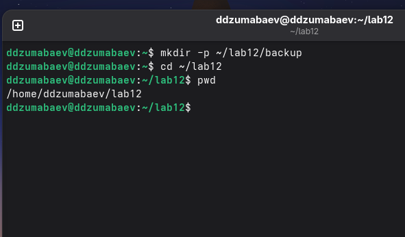

---

# 5. Задание №1. Создание резервной копии командного файла

В первом задании необходимо создать командный файл, который при запуске создаёт резервную копию самого себя в каталоге `backup`.

Для архивации был выбран архиватор `tar`.

Был создан файл:

```text
backup.sh
```

Для создания файла использовался текстовый редактор:

```bash
nano backup.sh
```

В файл был помещён следующий программный код:

```bash
#!/bin/bash

BACKUP_DIR="$HOME/lab12/backup"
SCRIPT_NAME="$(basename "$0")"

mkdir -p "$BACKUP_DIR"

tar -czf "$BACKUP_DIR/${SCRIPT_NAME}_backup.tar.gz" "$0"

echo "Резервная копия создана:"
echo "$BACKUP_DIR/${SCRIPT_NAME}_backup.tar.gz"
```

В начале скрипта задаётся путь к каталогу резервных копий:

```bash
BACKUP_DIR="$HOME/lab12/backup"
```

Название самого выполняемого скрипта определяется с помощью:

```bash
SCRIPT_NAME="$(basename "$0")"
```

После этого создаётся каталог для резервной копии:

```bash
mkdir -p "$BACKUP_DIR"
```

Архив создаётся командой:

```bash
tar -czf "$BACKUP_DIR/${SCRIPT_NAME}_backup.tar.gz" "$0"
```

---

# 6. Права на выполнение `backup.sh`

Для запуска командного файла необходимо было предоставить ему право на выполнение.

Для этого была выполнена команда:

```bash
chmod +x backup.sh
```

После этого права файла были проверены:

```bash
ls -l backup.sh
```

В результате в правах файла появился признак выполнения `x`.

---

# 7. Скриншот прав на выполнение

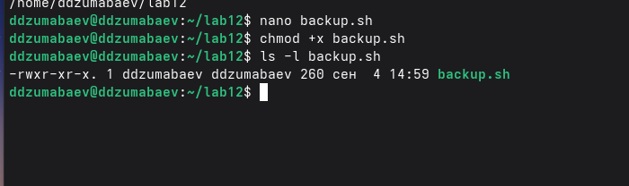

---

# 8. Запуск резервного копирования

После предоставления прав на выполнение был запущен созданный скрипт:

```bash
./backup.sh
```

В результате программа сообщила о создании резервной копии.

Для проверки содержимого каталога `backup` была выполнена команда:

```bash
ls -lh backup
```

В каталоге появился архив:

```text
backup.sh_backup.tar.gz
```

Таким образом, скрипт успешно создал резервную копию самого себя.

---

# 9. Скриншот результата резервного копирования

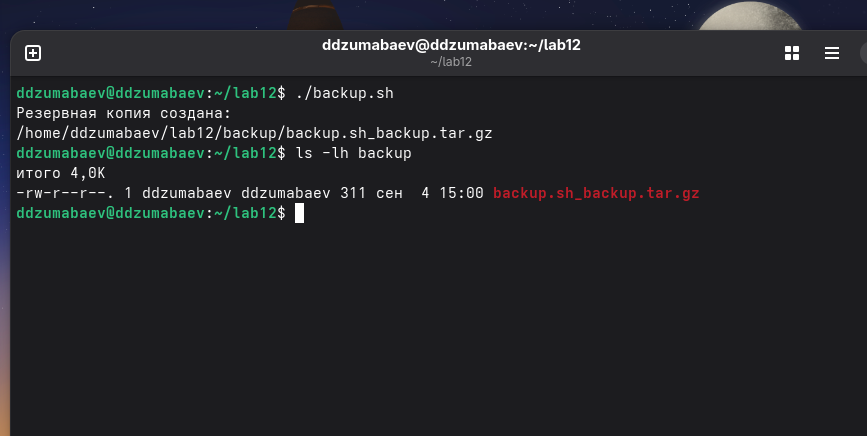

---

# 10. Проверка содержимого архива

Для проверки содержимого созданного архива была использована команда:

```bash
tar -tzf backup/backup.sh_backup.tar.gz
```

Команда выводит список файлов, находящихся внутри архива.

В результате в архиве был обнаружен файл:

```text
./backup.sh
```

Это подтверждает, что резервная копия командного файла была создана корректно.

---

# 11. Скриншот содержимого архива

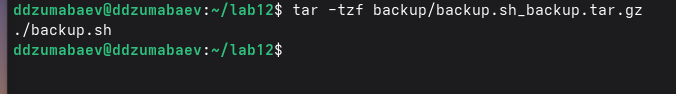

---

# 12. Задание №2. Обработка произвольного количества аргументов

Во втором задании необходимо создать командный файл, способный обрабатывать произвольное количество переданных ему аргументов.

Для этого был создан файл:

```text
args.sh
```

Файл создавался командой:

```bash
nano args.sh
```

В него был помещён следующий код:

```bash
#!/bin/bash

echo "Количество аргументов: $#"

number=1

for argument in "$@"
do
    echo "Аргумент $number: $argument"
    ((number++))
done
```

Переменная:

```bash
$#
```

используется для получения количества переданных аргументов.

Конструкция:

```bash
"$@"
```

позволяет последовательно обработать все переданные аргументы.

Переменная `number` используется для нумерации аргументов.

---

# 13. Предоставление прав и проверка `args.sh`

Для предоставления права на выполнение была использована команда:

```bash
chmod +x args.sh
```

После этого скрипт был запущен с несколькими аргументами:

```bash
./args.sh one two three four five
```

Результат показал количество переданных аргументов и значение каждого аргумента.

Пример результата:

```text
Количество аргументов: 5
Аргумент 1: one
Аргумент 2: two
Аргумент 3: three
Аргумент 4: four
Аргумент 5: five
```

---

# 14. Скриншот обработки аргументов

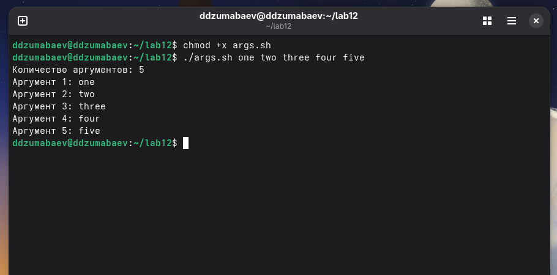

---

# 15. Проверка более десяти аргументов

Для проверки возможности обработки большого количества аргументов скрипт был запущен с пятнадцатью аргументами:

```bash
./args.sh one two three four five six seven eight nine ten eleven twelve thirteen fourteen fifteen
```

Скрипт успешно обработал все переданные аргументы.

В результате были выведены аргументы с номерами от 1 до 15.

Это подтверждает, что командный файл способен обрабатывать количество аргументов, превышающее десять.

---

# 16. Скриншот обработки более десяти аргументов

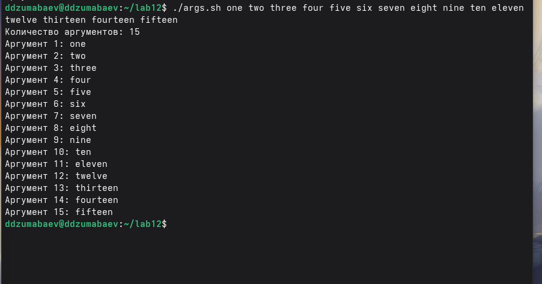

---

# 17. Задание №3. Создание аналога команды `ls`

В третьем задании необходимо создать командный файл, выполняющий функции, аналогичные команде `ls`.

При этом в созданном скрипте не используются команды:

```text
ls
dir
```

Был создан файл:

```text
myls.sh
```

Для его создания использовалась команда:

```bash
nano myls.sh
```

В файл был помещён следующий код:

```bash
#!/bin/bash

DIRECTORY="${1:-.}"

if [ ! -d "$DIRECTORY" ]
then
    echo "Ошибка: каталог '$DIRECTORY' не существует."
    exit 1
fi

echo "Каталог: $DIRECTORY"
echo "Содержимое:"
echo

for file in "$DIRECTORY"/*
do
    [ -e "$file" ] || continue

    NAME=$(basename "$file")

    if [ -d "$file" ]
    then
        TYPE="каталог"
    else
        TYPE="файл"
    fi

    if [ -r "$file" ]
    then
        READ="r"
    else
        READ="-"
    fi

    if [ -w "$file" ]
    then
        WRITE="w"
    else
        WRITE="-"
    fi

    if [ -x "$file" ]
    then
        EXECUTE="x"
    else
        EXECUTE="-"
    fi

    echo "$NAME | $TYPE | права: $READ$WRITE$EXECUTE"
done
```

---

# 18. Анализ работы `myls.sh`

В начале скрипта определяется каталог, переданный в качестве аргумента:

```bash
DIRECTORY="${1:-.}"
```

Если аргумент не указан, используется текущий каталог.

Проверка существования каталога выполняется условием:

```bash
if [ ! -d "$DIRECTORY" ]
```

Для перебора объектов каталога используется цикл:

```bash
for file in "$DIRECTORY"/*
```

Для определения типа объекта используются проверки:

```bash
[ -d "$file" ]
```

и:

```bash
[ -f "$file" ]
```

Проверка прав доступа осуществляется с помощью:

```bash
[ -r "$file" ]
[ -w "$file" ]
[ -x "$file" ]
```

Таким образом, скрипт выводит имя объекта, его тип и доступные права.

---

# 19. Проверка аналога `ls`

После создания файла ему было предоставлено право на выполнение:

```bash
chmod +x myls.sh
```

Для проверки скрипта был выполнен запуск:

```bash
./myls.sh .
```

В результате программа вывела содержимое текущего каталога.

Для каждого объекта отображалась информация о типе и правах доступа.

---

# 20. Скриншот работы аналога `ls`

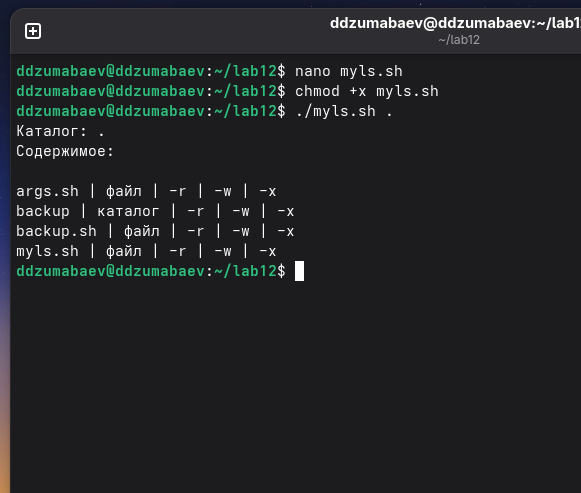

---

# 21. Проверка работы с другим каталогом

Для проверки обработки аргумента с названием каталога был выполнен запуск:

```bash
./myls.sh backup
```

Скрипт обработал каталог `backup` и вывел находящиеся в нём объекты.

Это подтверждает, что каталог может передаваться командному файлу в качестве аргумента.

---

# 22. Скриншот работы с другим каталогом

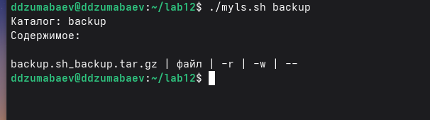

---

# 23. Задание №4. Подсчёт файлов заданного расширения

В четвёртом задании необходимо создать командный файл, которому передаются два аргумента:

1. расширение файла;
2. путь к каталогу.

Скрипт должен определить количество файлов указанного типа в заданном каталоге.

---

# 24. Создание тестовых файлов

Для проверки работы программы были созданы тестовые файлы:

```bash
touch test1.txt
touch test2.txt
touch test3.txt
touch test.doc
touch test.jpg
```

После этого для просмотра созданных файлов была использована команда:

```bash
find . -maxdepth 1 -type f
```

В рабочем каталоге появились файлы с различными расширениями:

```text
test1.txt
test2.txt
test3.txt
test.doc
test.jpg
```

---

# 25. Скриншот тестовых файлов

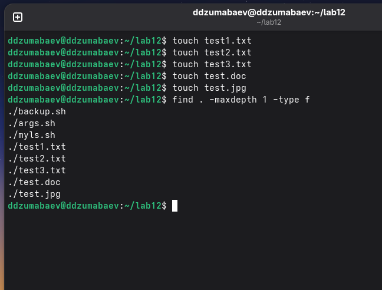

---

# 26. Создание `count.sh`

Был создан командный файл:

```text
count.sh
```

Для создания использовалась команда:

```bash
nano count.sh
```

В файл был помещён следующий код:

```bash
#!/bin/bash

EXTENSION="$1"
DIRECTORY="$2"

if [ -z "$EXTENSION" ] || [ -z "$DIRECTORY" ]
then
    echo "Использование: $0 <расширение> <каталог>"
    exit 1
fi

if [ ! -d "$DIRECTORY" ]
then
    echo "Ошибка: каталог '$DIRECTORY' не существует."
    exit 1
fi

COUNT=0

for file in "$DIRECTORY"/*."$EXTENSION"
do
    if [ -f "$file" ]
    then
        ((COUNT++))
    fi
done

echo "Каталог: $DIRECTORY"
echo "Расширение: .$EXTENSION"
echo "Количество файлов: $COUNT"
```

---

# 27. Анализ работы `count.sh`

Расширение файла получает первый аргумент:

```bash
EXTENSION="$1"
```

Каталог получает второй аргумент:

```bash
DIRECTORY="$2"
```

Проверка наличия аргументов выполняется условием:

```bash
if [ -z "$EXTENSION" ] || [ -z "$DIRECTORY" ]
```

Проверка существования каталога:

```bash
if [ ! -d "$DIRECTORY" ]
```

Для подсчёта файлов используется переменная:

```bash
COUNT=0
```

Каждый найденный файл увеличивает её значение:

```bash
((COUNT++))
```

В конце выводится количество найденных файлов.

---

# 28. Проверка подсчёта TXT-файлов

После предоставления прав:

```bash
chmod +x count.sh
```

была выполнена команда:

```bash
./count.sh txt .
```

Так как в рабочем каталоге были созданы три файла с расширением `.txt`, результатом стало:

```text
Каталог: .
Расширение: .txt
Количество файлов: 3
```

Таким образом, скрипт правильно определил количество файлов заданного расширения.

---

# 29. Скриншот подсчёта TXT-файлов

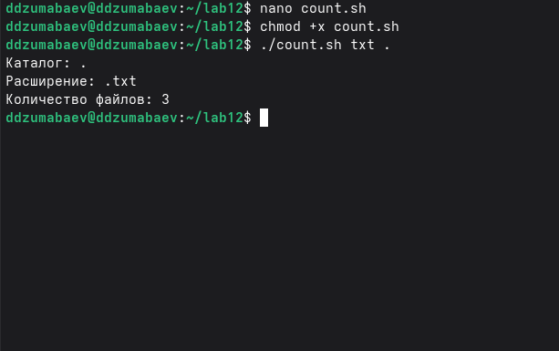

---

# 30. Проверка других расширений

Для дополнительной проверки были выполнены команды:

```bash
./count.sh doc .
```

и:

```bash
./count.sh jpg .
```

Для расширения `.doc` был найден один файл:

```text
Количество файлов: 1
```

Для расширения `.jpg` также был найден один файл:

```text
Количество файлов: 1
```

Это подтверждает корректную работу скрипта с различными расширениями.

---

# 31. Скриншот проверки других расширений

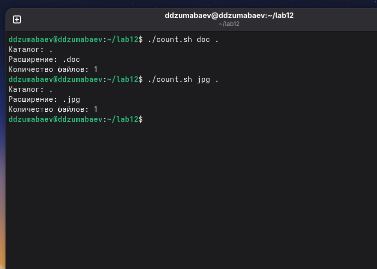

---

# 32. Проверка обработки ошибочного ввода

Для проверки обработки неправильного ввода была выполнена команда:

```bash
./count.sh
```

Так как необходимые аргументы отсутствуют, скрипт выводит сообщение:

```text
Использование: ./count.sh <расширение> <каталог>
```

Также была выполнена проверка несуществующего каталога:

```bash
./count.sh txt /does/not/exist
```

Скрипт сообщает:

```text
Ошибка: каталог '/does/not/exist' не существует.
```

Таким образом, в программе предусмотрена обработка ошибочных параметров.

---

# 33. Скриншот проверки ошибок

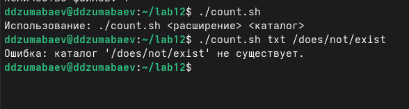

---

# 34. Финальная проверка файлов

Для проверки результата лабораторной работы была выполнена команда:

```bash
cd ~/lab12
find . -maxdepth 2 -type f -print
```

В результате были обнаружены созданные командные файлы и тестовые данные:

```text
./backup.sh
./args.sh
./myls.sh
./count.sh
./backup/backup.sh_backup.tar.gz
./test1.txt
./test2.txt
./test3.txt
./test.doc
./test.jpg
```

Таким образом, все четыре командных файла были созданы и находятся в рабочем каталоге лабораторной работы.

---

# 35. Скриншот структуры лабораторной работы

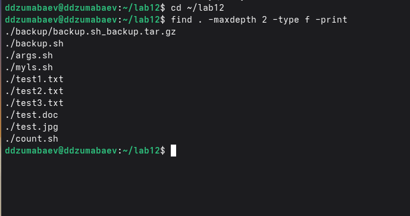

---

# 36. Результаты выполнения работы

В ходе лабораторной работы были созданы и протестированы четыре командных файла:

```text
backup.sh
args.sh
myls.sh
count.sh
```

Файл `backup.sh` создаёт архивную резервную копию самого себя.

Файл `args.sh` обрабатывает произвольное количество аргументов, включая количество аргументов больше десяти.

Файл `myls.sh` выводит содержимое указанного каталога и информацию о типах объектов и правах доступа без использования команд `ls` и `dir`.

Файл `count.sh` подсчитывает количество файлов указанного расширения в заданном каталоге.

---

# 37. Вывод

В ходе лабораторной работы были изучены основы программирования в командном процессоре Bash.

Были получены практические навыки:

* создания командных файлов;
* предоставления файловам права на выполнение;
* работы с аргументами командной строки;
* использования переменных Bash;
* использования условных конструкций;
* использования циклов;
* проверки существования файлов и каталогов;
* определения прав доступа;
* создания архивов;
* обработки ошибок;
* подсчёта файлов заданного типа.

В результате были разработаны четыре работающих командных файла, которые были проверены на различных входных данных.
