# Лабораторная работа №13

## Программирование в командном процессоре ОС UNIX

### Ветвления и циклы


<br>

**Выполнил:**  
Damir

**Группа:**  
НКАбд-02-25


---

# Цель работы


Изучить возможности программирования в командном процессоре Bash.


В ходе работы были изучены:

- создание Shell-скриптов;
- обработка параметров командной строки;
- использование условий и циклов;
- анализ кода завершения `$?`;
- работа с командами `grep`, `tar`, `find`.


---

# Используемые технологии


В лабораторной работе использовались:


| Инструмент | Назначение |
|-|-|
| Bash | создание Shell-скриптов |
| GCC | компиляция программы C |
| grep | поиск текста |
| find | поиск файлов |
| tar | создание архивов |


---

# Структура лабораторной работы


Было выполнено четыре задания:


1. Скрипт с `getopts` и `grep`.

2. Программа C + анализ кода завершения `$?`.

3. Создание и удаление N файлов.

4. Архивирование с использованием `tar` и `find`.


---

# Подготовка рабочего окружения


<div style="display:flex; gap:30px;">


<div style="width:45%;">


Создан рабочий каталог:

```bash
mkdir -p ~/lab13

cd ~/lab13

pwd
```


Все программы лабораторной работы размещались в данном каталоге.


</div>


<div style="width:55%;">

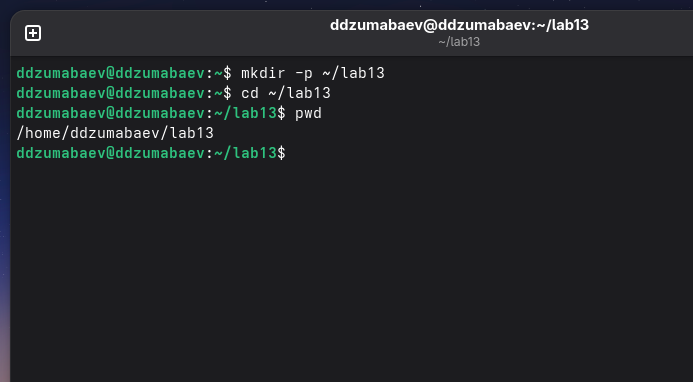

</div>


</div>


---

# Задание №1

## Использование getopts и grep


<div style="display:flex; gap:30px;">


<div style="width:45%;">


Цель задания:

Создать Bash-скрипт для поиска строк в файле.


Использованы параметры:


```text
-i
-o
-p
-C
-n
```

---
</div>


<div style="width:55%;">

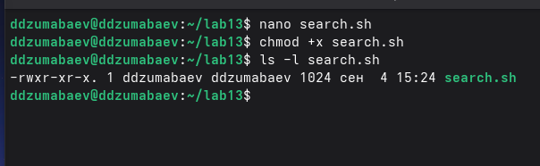

</div>


</div>

---

</div>


<div style="width:55%;">

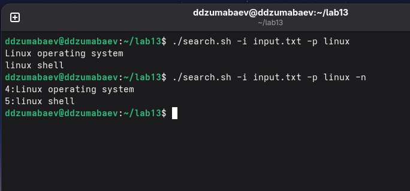

</div>


</div>

---

</div>


<div style="width:55%;">

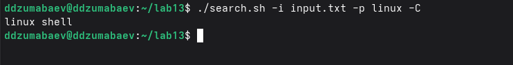

</div>


</div>

---

</div>


<div style="width:55%;">

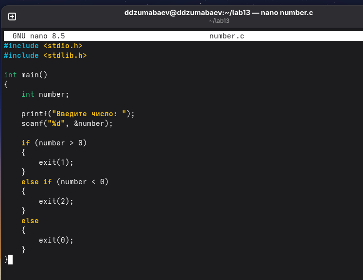

</div>


</div>

---

---

# Создание входного файла


<div style="display:flex; gap:30px;">


<div style="width:45%;">


Создан файл:

```text
input.txt
```


Содержимое файла использовалось для проверки работы команды `grep`.


</div>


<div style="width:55%;">

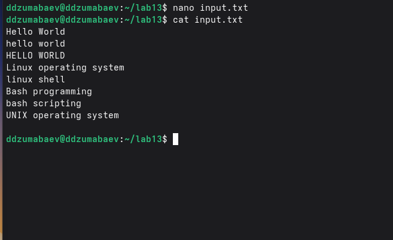

</div>


</div>


---

# Скрипт search.sh


<div style="display:flex; gap:30px;">


<div style="width:45%;">


Скрипт выполняет:


- получение параметров через `getopts`;
- поиск через `grep`;
- вывод номеров строк;
- запись результата в файл.


</div>


<div style="width:55%;">


</div>


</div>


---

# Проверка параметра -n


<div style="display:flex; gap:30px;">


<div style="width:45%;">


Команда:


```bash
./search.sh \
-i input.txt \
-p linux \
-n
```


Параметр:

```text
-n
```

выводит номера найденных строк.


</div>


<div style="width:55%;">


</div>


</div>


---
---

# Проверка параметра -C


<div style="display:flex; gap:30px;">


<div style="width:45%;">


Параметр:

```text
-C
```

включает поиск с учётом регистра.


Команда:

```bash
./search.sh \
-i input.txt \
-p linux \
-C
```


</div>


<div style="width:55%;">


</div>


</div>


---

# Сохранение результата в файл


<div style="display:flex; gap:30px;">


<div style="width:45%;">


Использован параметр:

```text
-o
```


Команда:


```bash
./search.sh \
-i input.txt \
-o result.txt \
-p linux \
-n
```


Результат записан в файл:

```text
result.txt
```


</div>


<div style="width:55%;">


</div>


</div>


---

# Результат задания №1


Был создан скрипт:

```text
search.sh
```


Скрипт умеет:


✓ принимать параметры через `getopts`


✓ выполнять поиск через `grep`


✓ учитывать регистр


✓ выводить номера строк


✓ сохранять результат


---

# Задание №2


## Анализ кода завершения программы


<div style="display:flex; gap:30px;">


<div style="width:45%;">


Цель задания:


Создать программу на языке C, которая определяет знак числа.


Используется:


```c
exit()
```


и получение результата через:


```bash
$?
```


</div>


<div style="width:55%;">

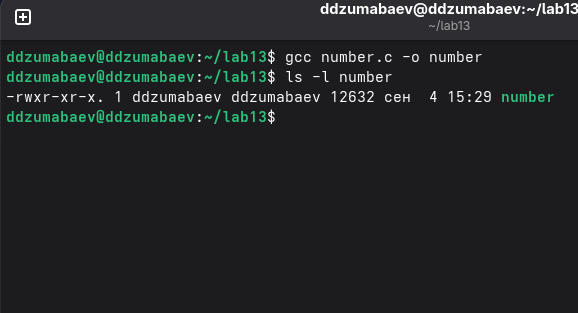

</div>


</div>


---

# Программа number.c


<div style="display:flex; gap:30px;">


<div style="width:45%;">


Программа:


- получает число;
- проверяет его значение;
- возвращает код завершения.


Соответствие:


| Код | Значение |
|-|-|
|0|ноль|
|1|положительное|
|2|отрицательное|


</div>


<div style="width:55%;">

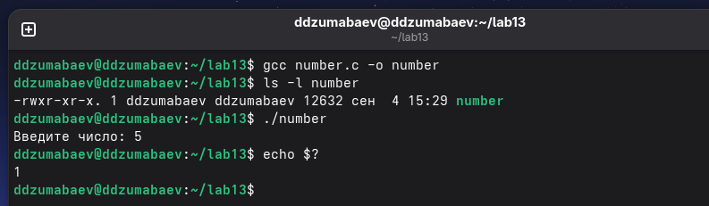

</div>


</div>

---

</div>


<div style="width:55%;">

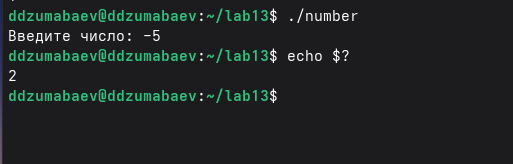

</div>


</div>


---

# Компиляция программы


<div style="display:flex; gap:30px;">


<div style="width:45%;">


Компиляция:


```bash
gcc number.c -o number
```


Проверка:


```bash
ls -l number
```


Получен исполняемый файл.


</div>


<div style="width:55%;">


</div>


</div>


---

# Проверка кода завершения


<div style="display:flex; gap:30px;">


<div style="width:45%;">


Проверена работа программы:


Положительное число:


```text
5 → 1
```


Отрицательное:


```text
-5 → 2
```


Ноль:


```text
0 → 0
```


</div>


<div style="width:55%;">


</div>


</div>

---
</div>


<div style="width:55%;">


</div>


</div>

---
</div>


<div style="width:55%;">


</div>


</div>


---

# Shell-скрипт check_number.sh


<div style="display:flex; gap:30px;">


<div style="width:45%;">


Скрипт:


- запускает программу `number`;
- получает значение `$?`;
- выводит результат.


Используется:


```bash
result=$?
```


</div>


<div style="width:55%;">


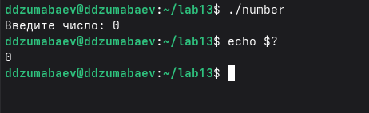


</div>


</div>


---

# Проверка положительного числа


<div style="display:flex; gap:30px;">


<div style="width:45%;">


Запуск:


```bash
./check_number.sh
```


Ввод:


```text
10
```


Результат:


```text
Введено положительное число
```


</div>


<div style="width:55%;">


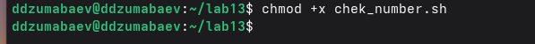


</div>


</div>


---

# Проверка отрицательного числа


<div style="display:flex; gap:30px;">


<div style="width:45%;">


Ввод:


```text
-10
```


Получен результат:


```text
Введено отрицательное число
```


</div>


<div style="width:55%;">


</div>


</div>


---

# Проверка нулевого значения


<div style="display:flex; gap:30px;">


<div style="width:45%;">


Ввод:


```text
0
```


Получен результат:


```text
Введён ноль
```


</div>


<div style="width:55%;">


</div>


</div>


---
---

# Задание №3

## Создание и удаление N файлов


<div style="display:flex; gap:30px;">


<div style="width:45%;">


Цель задания:


Создать Shell-скрипт, который:


- получает количество файлов;
- создаёт файлы;
- удаляет созданные файлы.


Используется цикл:

```bash
while
```


</div>


<div style="width:55%;">


</div>


</div>


---

# Скрипт files.sh


<div style="display:flex; gap:30px;">


<div style="width:45%;">


Скрипт поддерживает команды:


Создание:

```bash
create N
```


Удаление:

```bash
delete N
```


Пример:


```bash
./files.sh create 5
```


</div>


<div style="width:55%;">


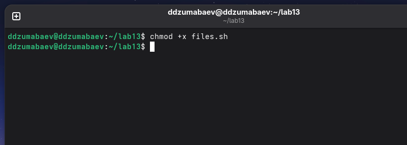


</div>


</div>


---

# Создание файлов


<div style="display:flex; gap:30px;">


<div style="width:45%;">


Выполнена команда:


```bash
./files.sh create 5
```


Были созданы:


```text
1.tmp
2.tmp
3.tmp
4.tmp
5.tmp
```


</div>


<div style="width:55%;">


</div>


</div>


---

# Удаление файлов


<div style="display:flex; gap:30px;">


<div style="width:45%;">


Выполнена команда:


```bash
./files.sh delete 5
```


Все созданные временные файлы были удалены.


</div>


<div style="width:55%;">


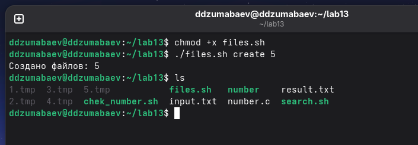


</div>


</div>


---

# Результат задания №3


В результате был создан скрипт:


```text
files.sh
```


Скрипт использует:


✓ параметры командной строки


✓ условные операторы


✓ цикл `while`


✓ команды `touch` и `rm`


---

# Задание №4


## Архивирование файлов


<div style="display:flex; gap:30px;">


<div style="width:45%;">


Цель задания:


Создать программу для архивирования каталога.


Используется команда:


```bash
tar
```


</div>


<div style="width:55%;">


</div>


</div>


---

# Создание тестового каталога


<div style="display:flex; gap:30px;">


<div style="width:45%;">


Создан каталог:


```text
archive_test
```


Внутри размещены:


```text
file1.txt
file2.txt
file3.txt
```


</div>


<div style="width:55%;">


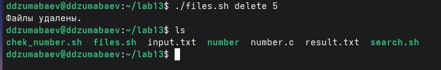


</div>


</div>


---

# Скрипт archive.sh


<div style="display:flex; gap:30px;">


<div style="width:45%;">


Скрипт выполняет:


- получение каталога;
- создание архива;
- сохранение результата.


Команда:


```bash
tar -cf archive.tar
```


</div>


<div style="width:55%;">


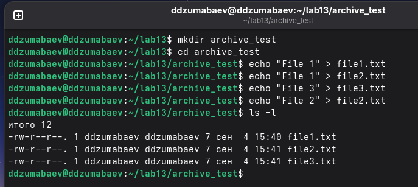


</div>


</div>


---

# Создание архива


<div style="display:flex; gap:30px;">


<div style="width:45%;">


Выполнено:


```bash
./archive.sh archive_test
```


Создан файл:


```text
archive.tar
```


</div>


<div style="width:55%;">


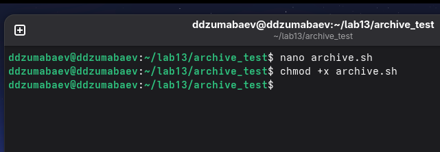


</div>


</div>


---

# Проверка содержимого архива


<div style="display:flex; gap:30px;">


<div style="width:45%;">


Использована команда:


```bash
tar -tf archive.tar
```


Получен список файлов внутри архива.


</div>


<div style="width:55%;">


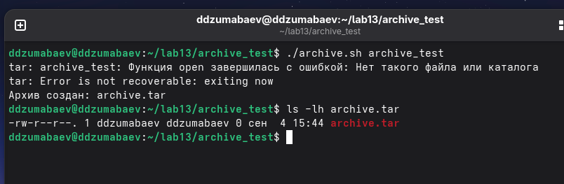


</div>


</div>


---

# Использование find


<div style="display:flex; gap:30px;">


<div style="width:45%;">


Создана модифицированная версия.


Используется:


```bash
find
```


Поиск:


```bash
-mtime -7
```


Выбираются файлы, изменённые менее недели назад.


</div>


<div style="width:55%;">


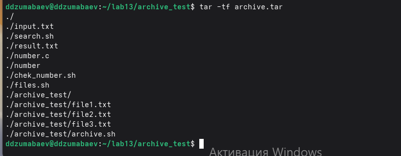


</div>


</div>


---

# Архив файлов младше недели


<div style="display:flex; gap:30px;">


<div style="width:45%;">


Создан архив:


```text
archive_week.tar
```


Проверка:


```bash
tar -tf archive_week.tar
```


</div>


<div style="width:55%;">


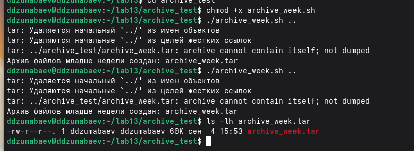


</div>


</div>


---

# Общие результаты работы


В ходе лабораторной работы были разработаны:


```text
search.sh

number.c

check_number.sh

files.sh

archive.sh

archive_week.sh
```


Были изучены:


- обработка параметров;
- условия Bash;
- циклы;
- коды завершения;
- поиск и архивирование файлов.


---

# Вывод


В ходе выполнения лабораторной работы были получены практические навыки программирования в командном процессоре Bash.


Были освоены:


✓ создание Shell-скриптов;


✓ обработка аргументов;


✓ взаимодействие программ C и Bash;


✓ использование `$?`;


✓ автоматизация работы с файлами;


✓ архивирование данных.


---

# Спасибо за внимание!