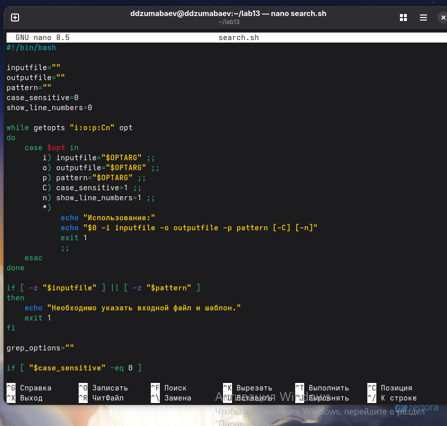
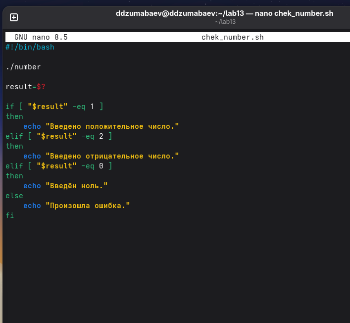
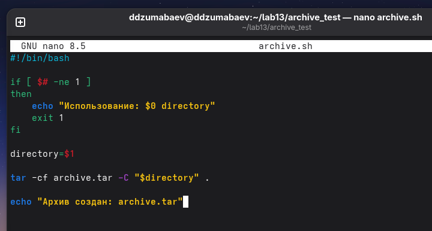
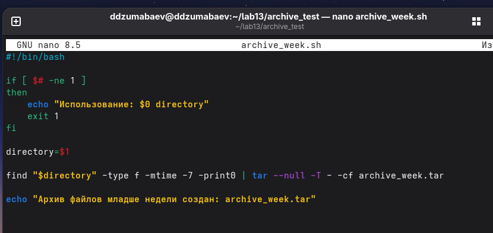

# Министерство науки и высшего образования Российской Федерации

## Российский университет дружбы народов имени Патриса Лумумбы

### Кафедра информационных технологий


# ОТЧЕТ

## по лабораторной работе №13

# «Программирование в командном процессоре ОС UNIX. Ветвления и циклы»


**Выполнил:**  
студент группы НКАбд-02-25

**Джумабаев Дамир**


Москва  
2026


# Содержание


# 1. Цель работы

Изучить возможности программирования в командном процессоре операционной системы UNIX/Linux.

Получить практические навыки создания и использования shell-скриптов, работы с параметрами командной строки, условными операторами, циклами, кодами завершения программ, а также научиться взаимодействовать между программами на языках C и Bash.

В процессе выполнения лабораторной работы необходимо освоить:

- использование параметров командной строки;
- обработку параметров с помощью `getopts`;
- поиск информации при помощи команды `grep`;
- анализ кода завершения программы `$?`;
- создание циклических конструкций в Bash;
- работу с командами `tar` и `find`.

---

# 2. Теоретические сведения


## 2.1 Командный процессор Shell

Shell — это командный интерпретатор операционной системы UNIX/Linux, который обеспечивает взаимодействие пользователя с системой.

Пользователь вводит команды в терминале, после чего Shell анализирует их и запускает соответствующие программы.

Кроме выполнения отдельных команд Shell позволяет создавать сценарии (скрипты), которые представляют собой последовательность команд, выполняемых автоматически.

Основные возможности Shell:

- выполнение команд операционной системы;
- работа с файлами и каталогами;
- использование переменных;
- выполнение условий;
- организация циклов;
- автоматизация повторяющихся операций.


В современных Linux-системах наиболее распространённым командным процессором является Bash (Bourne Again Shell).

---

# 2.2 Shell-скрипты

Shell-скрипт — это текстовый файл, содержащий набор команд, которые выполняются интерпретатором Shell.

Обычно скрипт начинается со специальной строки:

```bash
#!/bin/bash
```

Она называется **shebang** и указывает системе, какой интерпретатор необходимо использовать для выполнения файла.

Пример простого скрипта:

```bash
#!/bin/bash

echo "Hello Linux"
```

Для запуска скрипта необходимо предоставить ему права на выполнение:

```bash
chmod +x script.sh
```

После этого программа запускается командой:

```bash
./script.sh
```

---

# 2.3 Переменные в Bash

В Bash используются переменные для хранения различных данных.

Создание переменной:

```bash
name="Linux"
```

Использование значения переменной выполняется через символ `$`:

```bash
echo $name
```

Результат:

```text
Linux
```

Также Bash предоставляет специальные системные переменные.

Например:

| Переменная | Назначение |
|-|-|
| `$0` | имя выполняемого скрипта |
| `$1`, `$2` | параметры командной строки |
| `$#` | количество аргументов |
| `$?` | код завершения последней команды |

---

# 2.4 Параметры командной строки

При запуске программы пользователь может передавать ей дополнительные значения.

Например:

```bash
./script.sh file.txt
```

Внутри программы значение можно получить:

```bash
$1
```

где `$1` — первый аргумент командной строки.

Пример:

```bash
echo "Имя файла: $1"
```

Если выполнить:

```bash
./script.sh test.txt
```

получим:

```text
Имя файла: test.txt
```

---

# 2.5 Обработка параметров с помощью getopts

Команда `getopts` используется в Bash для удобной обработки параметров командной строки.

Она позволяет создавать программы с ключами вида:

```bash
-i input.txt
-o result.txt
-p pattern
```

Например:

```bash
while getopts "i:o:p:" opt
do
    case $opt in
        i) input=$OPTARG ;;
        o) output=$OPTARG ;;
        p) pattern=$OPTARG ;;
    esac
done
```

В данном примере:

- `-i` задаёт входной файл;
- `-o` задаёт выходной файл;
- `-p` задаёт шаблон поиска.

---

# 2.6 Команда grep

Команда `grep` используется для поиска строк в текстовых файлах.

Общий вид:

```bash
grep [параметры] шаблон файл
```

Пример:

```bash
grep Linux input.txt
```

Команда найдёт все строки, содержащие слово `Linux`.

Основные параметры:

| Параметр | Назначение |
|-|-|
| `-i` | игнорировать регистр символов |
| `-n` | показывать номера строк |
| `-v` | выводить строки, не содержащие шаблон |

Пример:

```bash
grep -in linux input.txt
```

---

# 2.7 Условные конструкции Bash

Для проверки условий в Bash используется конструкция:

```bash
if
then
else
fi
```

Пример:

```bash
if [ $number -gt 0 ]

then

echo "Положительное число"

else

echo "Отрицательное число"

fi
```

Основные операторы сравнения:

| Оператор | Значение |
|-|-|
| `-eq` | равно |
| `-ne` | не равно |
| `-gt` | больше |
| `-lt` | меньше |
| `-ge` | больше или равно |
| `-le` | меньше или равно |

---

# 2.8 Код завершения программы

Каждая программа после выполнения возвращает специальное значение — код завершения.

Этот код показывает результат работы программы.

В Bash он хранится в переменной:

```bash
$?
```

Например:

```bash
ls
echo $?
```

Если команда выполнилась успешно:

```text
0
```

Если произошла ошибка — другое значение.

В языке C код завершения задаётся функцией:

```c
exit()
```

Например:

```c
exit(1);
```

После завершения программы Shell может получить это значение через:

```bash
echo $?
```

---

# 2.9 Циклы в Bash

Циклы позволяют многократно выполнять один и тот же набор команд.

Наиболее распространённый цикл:

```bash
while
do
done
```

Пример:

```bash
i=1

while [ $i -le 5 ]

do

echo $i

i=$((i+1))

done
```

Результат:

```text
1
2
3
4
5
```

Циклы используются для обработки большого количества файлов и автоматического выполнения повторяющихся действий.

---

# 2.10 Архивирование файлов

В Linux для создания архивов используется команда `tar`.

Создание архива:

```bash
tar -cf archive.tar directory
```

Просмотр содержимого:

```bash
tar -tf archive.tar
```

Основные параметры:

| Параметр | Назначение |
|-|-|
| `-c` | создать архив |
| `-f` | указать имя архива |
| `-t` | показать содержимое |
| `-x` | извлечь файлы |

---

# 2.11 Команда find

Команда `find` используется для поиска файлов по различным параметрам.

Пример:

```bash
find directory -type f
```

Поиск файлов, изменённых за последние 7 дней:

```bash
find directory -type f -mtime -7
```

Параметр:

```text
-mtime -7
```

означает поиск файлов, изменённых менее недели назад.

---

# 3. Выполнение лабораторной работы


## 3.1 Задание №1. Создание Shell-скрипта с использованием getopts и grep

### Постановка задачи

В первом задании необходимо разработать командный файл Bash, который выполняет поиск информации в текстовом файле.

Скрипт должен:

- получать параметры командной строки;
- использовать механизм обработки параметров `getopts`;
- выполнять поиск с помощью команды `grep`;
- поддерживать дополнительные параметры:
  - различие регистра;
  - вывод номеров строк;
  - сохранение результата в файл.


Используемые параметры программы:

| Параметр | Назначение |
|-|-|
| `-i` | входной файл |
| `-o` | выходной файл |
| `-p` | шаблон поиска |
| `-C` | учитывать регистр символов |
| `-n` | выводить номера строк |


---

## Создание рабочего каталога

Для выполнения лабораторной работы был создан отдельный каталог:

```bash
mkdir -p ~/lab13
```

После этого выполнен переход в созданный каталог:

```bash
cd ~/lab13
```

Проверка текущего расположения:

```bash
pwd
```

Результат:

```text
/home/username/lab13
```


---

# Создание входного файла

Для проверки работы программы был создан текстовый файл `input.txt`.

Создание файла:

```bash
nano input.txt
```

В файл были добавлены следующие данные:

```text
Hello World
hello world
HELLO WORLD
Linux operating system
linux shell
Bash programming
bash scripting
UNIX operating system
```


Проверка содержимого файла:

```bash
cat input.txt
```

Получен следующий результат:

```text
Hello World
hello world
HELLO WORLD
Linux operating system
linux shell
Bash programming
bash scripting
UNIX operating system
```


---

# Создание скрипта search.sh

Был создан Bash-скрипт:

```bash
nano search.sh
```

Программа получает параметры командной строки и выполняет поиск с помощью команды `grep`.


Код программы:

```bash
#!/bin/bash

inputfile=""
outputfile=""
pattern=""

case_sensitive=0
show_line_numbers=0


while getopts "i:o:p:Cn" opt
do
    case $opt in

        i)
            inputfile="$OPTARG"
            ;;

        o)
            outputfile="$OPTARG"
            ;;

        p)
            pattern="$OPTARG"
            ;;

        C)
            case_sensitive=1
            ;;

        n)
            show_line_numbers=1
            ;;

        *)
            echo "Использование:"
            echo "$0 -i inputfile -o outputfile -p pattern [-C] [-n]"
            exit 1
            ;;

    esac
done


if [ -z "$inputfile" ] || [ -z "$pattern" ]

then

    echo "Необходимо указать файл и шаблон поиска."
    exit 1

fi


grep_options=""


if [ "$case_sensitive" -eq 0 ]

then

    grep_options="$grep_options -i"

fi


if [ "$show_line_numbers" -eq 1 ]

then

    grep_options="$grep_options -n"

fi


if [ -n "$outputfile" ]

then

    grep $grep_options "$pattern" "$inputfile" > "$outputfile"

else

    grep $grep_options "$pattern" "$inputfile"

fi
```


---

# Разрешение выполнения скрипта

После создания файла были изменены права доступа:

```bash
chmod +x search.sh
```

Проверка прав:

```bash
ls -l search.sh
```

Результат:

```text
-rwxr-xr-x search.sh
```




---

# Проверка поиска без учёта регистра

Запуск программы:

```bash
./search.sh -i input.txt -p linux
```


Так как параметр `-C` не указан, поиск выполняется без учёта регистра.

Результат:

```text
Linux operating system
linux shell
```


---

# Проверка вывода номеров строк

Для отображения номеров строк используется параметр:

```bash
-n
```

Выполнена команда:

```bash
./search.sh -i input.txt -p linux -n
```


Результат:

```text
4:Linux operating system
5:linux shell
```


---

# Проверка параметра -C

Параметр:

```bash
-C
```

включает поиск с учётом регистра символов.


Выполнена команда:

```bash
./search.sh -i input.txt -p linux -C
```


Результат:

```text
linux shell
```


Так как поиск учитывает регистр, строка:

```text
Linux operating system
```

не была найдена.


---

# Запись результата в файл

Для сохранения результата используется параметр:

```bash
-o
```


Выполнена команда:

```bash
./search.sh -i input.txt -o result.txt -p linux -n
```


После этого проверено содержимое созданного файла:

```bash
cat result.txt
```


Результат:

```text
4:Linux operating system
5:linux shell
```


---

# Результат выполнения задания №1

В ходе выполнения первого задания был разработан Bash-скрипт `search.sh`, который:

- принимает параметры через `getopts`;
- выполняет поиск с помощью `grep`;
- поддерживает поиск с учётом и без учёта регистра;
- выводит номера строк;
- сохраняет результаты в отдельный файл.


Созданные файлы:

```text
input.txt
search.sh
result.txt
```

---


# 3.2 Задание №2. Анализ кода завершения программы


## Постановка задачи

Во втором задании необходимо создать программу на языке C, которая определяет знак введённого числа.

Программа должна:

- получить число от пользователя;
- определить его значение:
  - положительное;
  - отрицательное;
  - равное нулю;
- завершить работу с помощью функции `exit()`;
- передать результат выполнения в Shell через код завершения `$?`.

Соответствие кодов завершения:

| Код | Значение |
|-|-|
| `0` | число равно нулю |
| `1` | число положительное |
| `2` | число отрицательное |


---

# Создание программы на языке C

Был создан файл:

```bash
nano number.c
```

В программу добавлен следующий код:

```c
#include <stdio.h>
#include <stdlib.h>


int main()
{

    int number;


    printf("Введите число: ");
    scanf("%d", &number);


    if (number > 0)
    {
        exit(1);
    }

    else if (number < 0)
    {
        exit(2);
    }

    else
    {
        exit(0);
    }

}
```


Программа получает число и завершает выполнение с определённым кодом.

---

# Компиляция программы

Для получения исполняемого файла была выполнена команда:

```bash
gcc number.c -o number
```


Проверка созданного файла:

```bash
ls -l number
```


Результат:

```text
-rwxr-xr-x number
```


---

# Проверка кода завершения программы


## Проверка положительного числа


Запуск программы:

```bash
./number
```

Введено:

```text
5
```


Проверка результата:

```bash
echo $?
```


Получен результат:

```text
1
```


Это означает, что программа определила число как положительное.


---

## Проверка отрицательного числа


Запуск программы:

```bash
./number
```


Введено:

```text
-5
```


Проверка:

```bash
echo $?
```


Результат:

```text
2
```


---

## Проверка нулевого значения


Запуск программы:

```bash
./number
```


Введено:

```text
0
```


Проверка:

```bash
echo $?
```


Результат:

```text
0
```


---


---

# Создание Shell-скрипта для анализа результата


Для автоматической обработки кода завершения был создан файл:

```bash
nano check_number.sh
```


Код программы:

```bash
#!/bin/bash


./number


result=$?


if [ "$result" -eq 1 ]

then

    echo "Введено положительное число."


elif [ "$result" -eq 2 ]

then

    echo "Введено отрицательное число."


elif [ "$result" -eq 0 ]

then

    echo "Введён ноль."


else

    echo "Произошла ошибка."

fi
```


Скрипт запускает программу `number`, получает значение `$?` и выводит соответствующее сообщение.


---

# Разрешение выполнения скрипта


Выполнена команда:

```bash
chmod +x check_number.sh
```



---

# Проверка работы скрипта


Запуск:

```bash
./check_number.sh
```


Ввод:

```text
10
```


Результат:

```text
Введено положительное число.
```


---

# Проверка отрицательного числа


Выполнена команда:

```bash
./check_number.sh
```


Ввод:

```text
-10
```


Результат:

```text
Введено отрицательное число.
```


---

# Проверка нулевого значения


Выполнена команда:

```bash
./check_number.sh
```


Ввод:

```text
0
```


Результат:

```text
Введён ноль.
```


---

# Результат выполнения задания №2


В результате выполнения задания была создана система взаимодействия программы на языке C и Shell-скрипта.

Созданные файлы:

```text
number.c
number
check_number.sh
```


Было изучено:

- использование функции `exit()`;
- получение результата через `$?`;
- обработка различных вариантов выполнения программы.


---


# 3.3 Задание №3. Создание и удаление N файлов


## Постановка задачи


Необходимо разработать Shell-скрипт, который:

- получает количество файлов `N`;
- создаёт указанное количество файлов;
- удаляет созданные файлы по команде пользователя.


Пример:

```bash
./files.sh create 5
```

создаёт:

```text
1.tmp
2.tmp
3.tmp
4.tmp
5.tmp
```


---

# Создание скрипта files.sh


Был создан файл:

```bash
nano files.sh
```


Код программы:


```bash
#!/bin/bash


if [ $# -ne 2 ]

then

    echo "Использование: $0 create|delete N"
    exit 1

fi


action=$1
count=$2


if [ "$action" = "create" ]

then

    i=1


    while [ "$i" -le "$count" ]

    do

        touch "$i.tmp"

        i=$((i+1))

    done


    echo "Создано файлов: $count"


elif [ "$action" = "delete" ]

then

    i=1


    while [ "$i" -le "$count" ]

    do

        rm -f "$i.tmp"

        i=$((i+1))

    done


    echo "Файлы удалены."


else

    echo "Неизвестная команда."

fi
```


---

# Разрешение выполнения


Изменение прав доступа:

```bash
chmod +x files.sh
```


---

# Создание файлов


Для создания пяти файлов выполнена команда:

```bash
./files.sh create 5
```


Проверка результата:

```bash
ls
```


Получены файлы:

```text
1.tmp
2.tmp
3.tmp
4.tmp
5.tmp
```


---

# Удаление файлов


Для удаления созданных файлов выполнена команда:

```bash
./files.sh delete 5
```


Проверка:

```bash
ls
```


Файлы:

```text
1.tmp
2.tmp
3.tmp
4.tmp
5.tmp
```

были удалены.


---

# Результат выполнения задания №3


В ходе выполнения задания был разработан скрипт `files.sh`, который позволяет автоматически создавать и удалять заданное количество файлов.

Использованы:

- параметры командной строки;
- условные операторы;
- цикл `while`;
- команды `touch` и `rm`.


Созданный файл:

```text
files.sh
```
\newpage


# 3.4 Задание №4. Архивирование файлов с использованием tar и find


## Постановка задачи


В четвёртом задании необходимо разработать Shell-скрипт для создания архива указанного каталога.

Первая версия программы должна:

- получать имя каталога;
- создавать архив с помощью команды `tar`.


Вторая версия должна быть модифицирована:

- выполнять поиск файлов с помощью команды `find`;
- добавлять в архив только файлы, которые были изменены менее недели назад.


---

# Создание тестового каталога


Для проверки работы программы был создан каталог:

```bash
mkdir archive_test
```


Внутри каталога были созданы тестовые файлы:

```bash
echo "File 1" > file1.txt

echo "File 2" > file2.txt

echo "File 3" > file3.txt
```


Проверка содержимого каталога:

```bash
ls -l archive_test
```


Результат:

```text
file1.txt
file2.txt
file3.txt
```


---

# Создание скрипта archive.sh


Был создан файл:

```bash
nano archive.sh
```


Код программы:


```bash
#!/bin/bash


if [ $# -ne 1 ]

then

    echo "Использование: $0 directory"

    exit 1

fi


directory=$1


tar -cf archive.tar -C "$directory" .


echo "Архив создан: archive.tar"
```


Скрипт получает имя каталога и создаёт архив с помощью команды `tar`.


---

# Разрешение выполнения скрипта


Выполнена команда:

```bash
chmod +x archive.sh
```



---

# Создание архива


Запуск программы:

```bash
./archive.sh archive_test
```


Проверка созданного архива:

```bash
ls -lh archive.tar
```


Получен файл:

```text
archive.tar
```


---

# Просмотр содержимого архива


Для просмотра файлов внутри архива использована команда:

```bash
tar -tf archive.tar
```


Результат:

```text
./
./file1.txt
./file2.txt
./file3.txt
```


---

# Создание версии скрипта с использованием find


Для выполнения второй части задания был создан файл:

```bash
nano archive_week.sh
```


Код программы:


```bash
#!/bin/bash


if [ $# -ne 1 ]

then

    echo "Использование: $0 directory"

    exit 1

fi


directory=$1


find "$directory" -type f -mtime -7 -print0 | \
tar --null -T - -cf archive_week.tar


echo "Архив файлов младше недели создан."
```


В данной версии используется команда:

```bash
find
```

которая выполняет поиск только обычных файлов:

```bash
-type f
```

изменённых за последние 7 дней:

```bash
-mtime -7
```


---

# Создание архива файлов младше недели


Запуск программы:

```bash
./archive_week.sh archive_test
```


Проверка результата:

```bash
ls -lh archive_week.tar
```


Получен архив:

```text
archive_week.tar
```



---

# Проверка содержимого второго архива


Использована команда:

```bash
tar -tf archive_week.tar
```


Результат:

```text
./file1.txt
./file2.txt
./file3.txt
```


---

# Результат выполнения задания №4


В ходе выполнения задания были изучены:

- создание архивов с помощью `tar`;
- просмотр содержимого архивов;
- поиск файлов при помощи `find`;
- фильтрация файлов по времени изменения.


Созданные файлы:

```text
archive.sh

archive_week.sh

archive.tar

archive_week.tar
```


# 4. Результаты выполнения лабораторной работы


В ходе выполнения лабораторной работы были разработаны несколько программных сценариев Bash и одна программа на языке C.


Были выполнены следующие задачи:

1. Создан Shell-скрипт с обработкой параметров через `getopts` и поиском данных через `grep`.

2. Разработана программа на языке C, определяющая знак числа и передающая результат через код завершения.

3. Создан скрипт автоматического создания и удаления файлов с использованием циклов Bash.

4. Разработаны скрипты архивирования данных с использованием `tar` и фильтрации файлов через `find`.


Получены практические навыки:

- написания Bash-скриптов;
- обработки аргументов командной строки;
- использования условий и циклов;
- взаимодействия программ различных языков;
- автоматизации операций в Linux.


---

# 5. Вывод


В результате выполнения лабораторной работы были изучены основные возможности командного процессора Bash.

Были получены навыки создания сценариев командной строки, обработки параметров, использования условных операторов и циклов.

Также была рассмотрена передача результатов работы программ через код завершения `$?`, что позволяет организовать взаимодействие между программами.

Использование команд `grep`, `find` и `tar` позволило освоить методы поиска, обработки и архивирования данных в операционной системе Linux.

Поставленная цель лабораторной работы достигнута.


---

# 6. Ответы на контрольные вопросы


## 1. Что такое Shell?


Shell — это командный интерпретатор операционных систем UNIX/Linux, который обеспечивает выполнение команд пользователя и позволяет создавать сценарии автоматизации.


---

## 2. Для чего используются Shell-скрипты?


Shell-скрипты используются для автоматизации последовательности команд, выполнения повторяющихся операций и управления системными процессами.


---

## 3. Что такое переменная `$?`?


Переменная `$?` содержит код завершения последней выполненной команды или программы.

Значение:

```text
0
```

обычно означает успешное выполнение.


---

## 4. Для чего используется команда grep?


Команда `grep` используется для поиска строк в текстовых файлах по заданному шаблону.


---

## 5. Для чего используется команда find?


Команда `find` используется для поиска файлов и каталогов по различным критериям:

- имени;
- типу;
- времени изменения;
- размеру.


---

## 6. Для чего предназначена команда tar?


Команда `tar` используется для создания, просмотра и распаковки архивов в Linux.


---

## 7. Для чего используются циклы в Bash?


Циклы позволяют многократно выполнять набор команд, что удобно при обработке большого количества файлов или данных.


---

# 7. Список использованных источников


1. Bash Reference Manual.  
   GNU Project.


2. Руководство пользователя Linux:

```bash
man bash
```


3. Справочная информация команд:

```bash
man grep

man find

man tar
```


4. Материалы лабораторной работы №13.


---

# Конец отчёта