# Лабораторная работа №12
## Программирование в командном процессоре ОС UNIX. Расширенное программирование

**Дисциплина:** Архитектура компьютера и операционные системы

**Выполнил:** Джумабаев Дамир  
**Группа:** НКАбд-02-25

**Университет:** Российский университет дружбы народов (РУДН)

**Год:** 2026

---

## Цель работы

Изучить основы программирования в оболочке ОС UNIX. Научиться создавать более сложные командные файлы с использованием логических управляющих конструкций, циклов, переменных, аргументов командной строки и механизмов взаимодействия процессов.

## Задачи

1. Реализовать упрощенный механизм семафоров.
2. Обеспечить взаимодействие трёх и более процессов.
3. Реализовать команду `man` с помощью командного файла.
4. Использовать встроенную переменную `$RANDOM` для генерации случайной последовательности букв латинского алфавита.

## Теоретическая часть

Командный процессор (shell) ОС UNIX — это программа, обеспечивающая интерфейс между пользователем и ядром системы. Он обрабатывает команды, вводимые пользователем, и выполняет их. 

В Bash реализованы следующие основные конструкции:
- **Условные операторы** (`if`, `elif`, `else`) — позволяют выполнять действия в зависимости от условий.
- **Циклы** (`for`, `while`) — позволяют многократно повторять набор команд.
- **Переменные** — хранят данные, которые могут быть использованы в скрипте.
- **Аргументы командной строки** (`$1`, `$2`, `$#`) — позволяют передавать данные в скрипт при его запуске.
- **Фоновые процессы** (`&`) — позволяют запускать скрипты параллельно, не блокируя основную терминал.
- **Механизм блокировки ресурсов** — используется для предотвращения одновременного доступа нескольких процессов к одному ресурсу.

---

## 1. Выполнение задания №1: Реализация механизма семафоров

### 1.1. Постановка задачи
Необходимо реализовать командный файл, который в течение некоторого времени \(t_1\) дожидается освобождения ресурса, выдавая об этом сообщение. Дождавшись освобождения, процесс использует ресурс в течение времени \(t_2 < t_1\), также выдавая информацию об этом. Запустить файл в фоновом режиме и обеспечить взаимодействие трёх и более процессов.

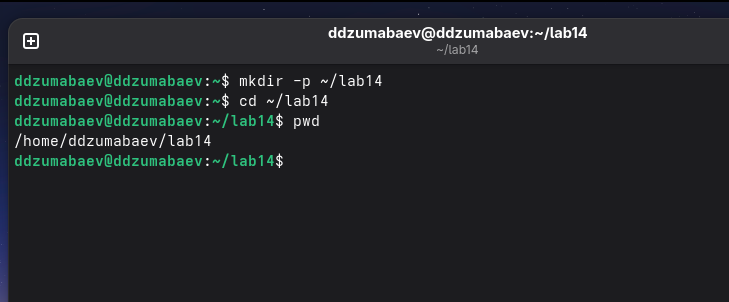

### 1.2. Листинг скрипта `semaphore.sh`
Для реализации механизма семафора используется файл блокировки (`lockfile`). Если файл существует, процесс ожидает. Если файла нет, процесс создает его, захватывает ресурс и работает с ним.

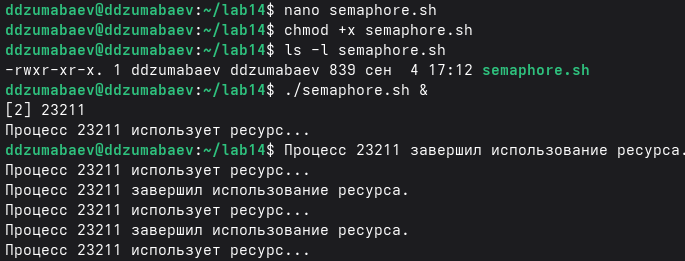

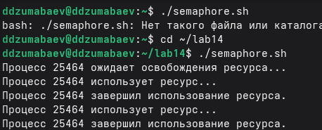

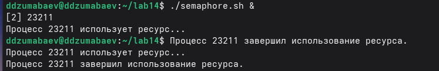
```
# Файл блокировки
LOCKFILE="/tmp/lab14_semaphore.lock"

# Время ожидания (t1) и использования (t2)
T1=2
T2=5

echo "[$$] Процесс запущен."

while true
do
    # Попытка создать файл блокировки (noclobber предотвращает перезапись)
    if ( set -o noclobber; echo "$$" > "$LOCKFILE" ) 2>/dev/null
    then
        # Перехват сигналов для корректного удаления блокировки при завершении
        trap 'rm -f "$LOCKFILE"; exit' INT TERM EXIT

        echo "[$$] Ресурс свободен."
        echo "[$$] Процесс $$ захватил ресурс."

        # Используем ресурс в течение T2 секунд
        sleep "$T2"

        echo "[$$] Процесс $$ освобождает ресурс."

        # Освобождаем ресурс
        rm -f "$LOCKFILE"
        trap - INT TERM EXIT

        break
    else
        # Если ресурс занят, ждём T1 секунд и пробуем снова
        echo "[$$] Ресурс занят. Процесс $$ ждёт..."
        sleep "$T1"
    fi
done

echo "[$$] Работа завершена."
1.3. Запуск нескольких процессов
Для проверки работы семафора были запущены три экземпляра скрипта в фоновом режиме:

./semaphore.sh &
./semaphore.sh &
./semaphore.sh &
wait
1.4. Результаты работы
В результате выполнения скриптов, один процесс захватывает ресурс, остальные ожидают его освобождения. После завершения работы первого процесса, ресурс переходит следующему процессу. Пример вывода:

text
[11802] Процесс запущен.
[11802] Ресурс свободен.
[11802] Процесс 11802 захватил ресурс.
[11803] Процесс запущен.
[11803] Ресурс занят. Процесс 11803 ждёт...
[11804] Процесс запущен.
[11804] Ресурс занят. Процесс 11804 ждёт...
[11802] Процесс 11802 освобождает ресурс.
[11803] Ресурс свободен.
[11803] Процесс 11803 захватил ресурс.

```
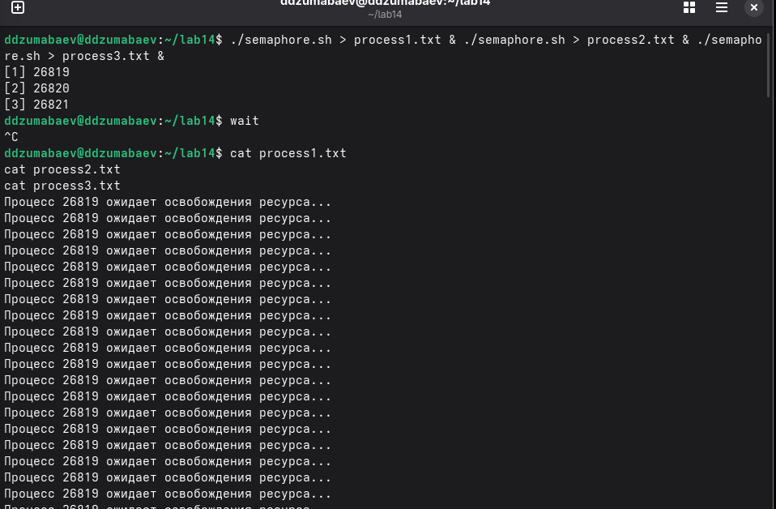

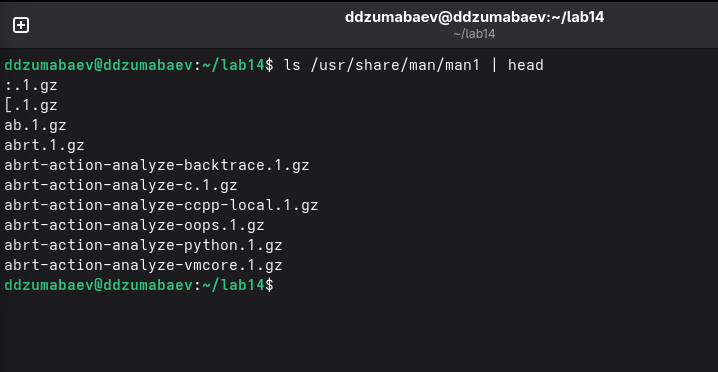

2. Выполнение задания №2: Реализация собственной команды man
2.1. Постановка задачи
Необходимо реализовать команду man с помощью командного файла. Изучить содержимое каталога /usr/share/man/man1. Командный файл должен получать в виде аргумента командной строки название команды и в виде результата выдавать справку об этой команде, или сообщение об отсутствии справки, если соответствующего файла нет в каталоге man1.

2.2. Листинг скрипта my_man.sh
Для реализации данной задачи скрипт принимает имя команды, формирует путь к файлу справки в каталоге /usr/share/man/man1/ и, если файл существует, открывает его с помощью less (предварительно распаковав с помощью zcat). Если файла нет, выводится сообщение об ошибке.

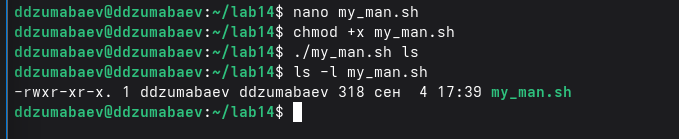

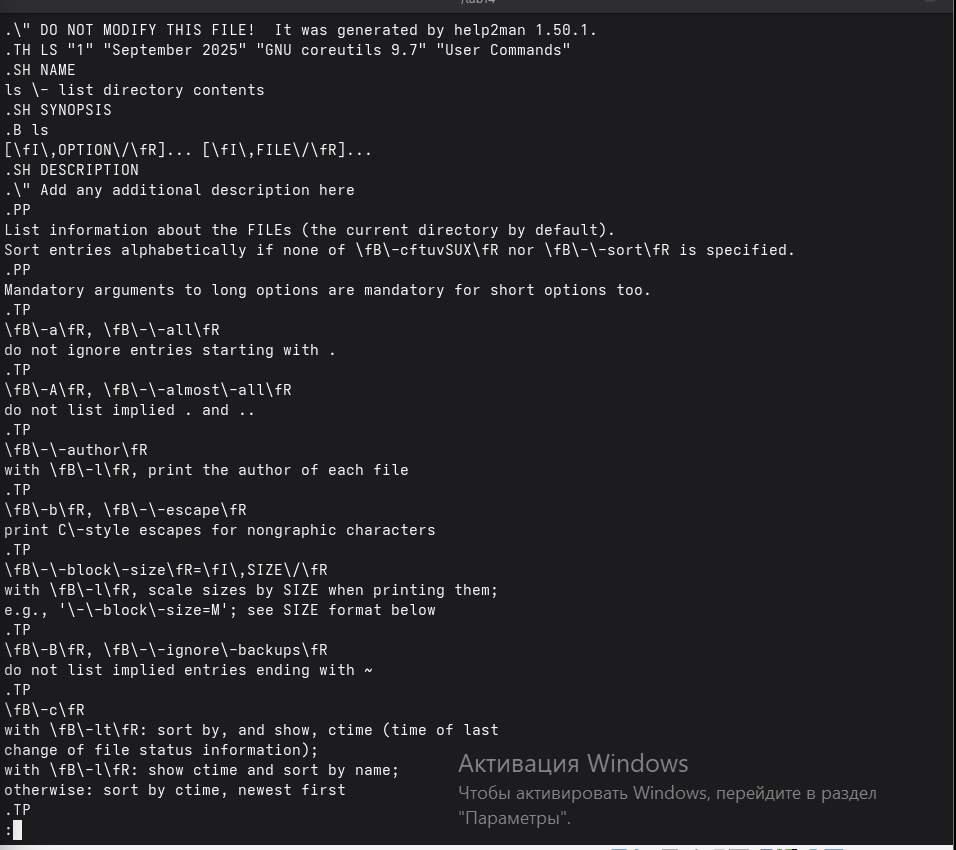


```bash
#!/bin/bash

# Проверка наличия аргумента
if [ $# -ne 1 ]
then
    echo "Использование: $0 команда"
    exit 1
fi

COMMAND="$1"
MANFILE="/usr/share/man/man1/${COMMAND}.1.gz"

# Проверка существования файла справки
if [ -f "$MANFILE" ]
then
    echo "Справка по команде: $COMMAND"
    zcat "$MANFILE" | less
else
    echo "Справка для команды '$COMMAND' не найдена."
    exit 1
fi
2.3. Запуск и результаты работы
Скрипт был проверен на существующей команде ls, а также на несуществующей команде. Примеры запуска:

bash
./my_man.sh ls
./my_man.sh pwd
./my_man.sh qwerty
Результат выполнения для несуществующей команды:

text
Справка для команды 'qwerty' не найдена..
```
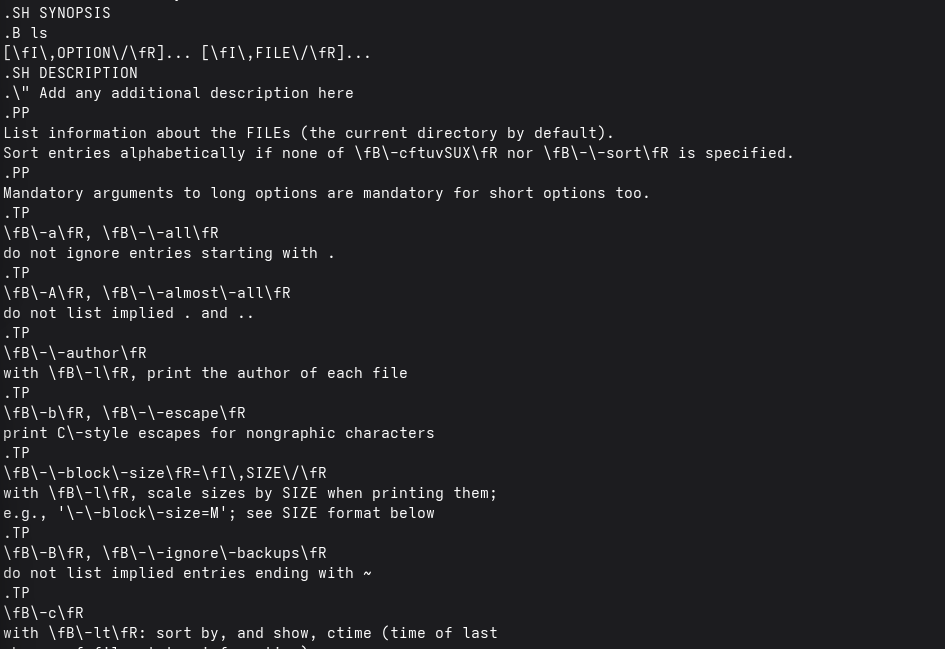

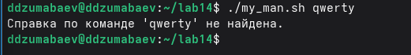

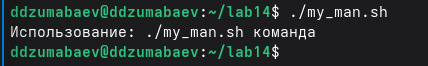

---

3. Выполнение задания №3: Генерация случайной последовательности букв
3.1. Постановка задачи
Используя встроенную переменную $RANDOM, необходимо написать командный файл, генерирующий случайную последовательность букв латинского алфавита. Учесть, что $RANDOM выдает псевдослучайные числа в диапазоне от 0 до 32767.

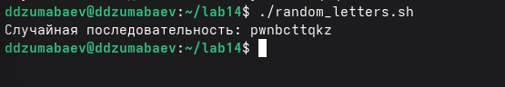

3.2. Листинг скрипта random_letters.sh
Для получения случайной буквы используется остаток от деления значения $RANDOM на 26 (количество букв в алфавите), что дает число от 0 до 25. Далее это число преобразуется в ASCII-код буквы и выводится на экран.

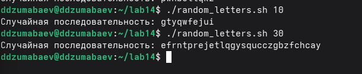

bash
#!/bin/bash

# Длина последовательности по умолчанию
LENGTH=${1:-20}

for ((i=0; i<LENGTH; i++))
do
    # Получаем случайное число от 0 до 25
    NUMBER=$((RANDOM % 26))
    # Преобразуем число в ASCII-код буквы (97 - код 'a')
    LETTER=$(printf "\\$(printf '%03o' $((NUMBER + 97)))")
    printf "%s" "$LETTER"
done

echo
3.3. Запуск и результаты работы
Скрипт был запущен с параметрами по умолчанию и с заданной длиной последовательности. Примеры запуска:

bash
./random_letters.sh
./random_letters.sh 10
./random_letters.sh 30
Пример результата:

text
qjxmavkzplrntwqecbhs


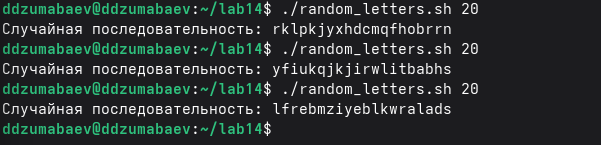

4. Проверка синтаксиса разработанных скриптов
Для проверки корректности синтаксиса всех трех скриптов была использована команда bash -n, которая проверяет файл на наличие ошибок, не выполняя его.

bash
bash -n semaphore.sh
bash -n my_man.sh
bash -n random_letters.sh
Так как ошибок в скриптах не обнаружено, команды не выводят никаких сообщений, что свидетельствует о корректности написанного кода.

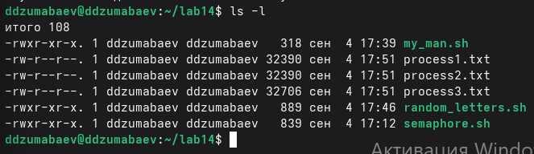

Вывод
В ходе лабораторной работы были изучены расширенные возможности программирования в командном процессоре ОС UNIX (Bash). Были получены практические навыки работы с:

циклами (while, for);

условными конструкциями (if, elif, else);

переменными и аргументами командной строки;

фоновыми процессами;

файлами блокировки;

справочными страницами (man);

генерацией псевдослучайных значений ($RANDOM).

Реализованы три командных файла: semaphore.sh (механизм семафоров), my_man.sh (собственная реализация команды man) и random_letters.sh (генератор случайных букв). Цель лабораторной работы достигнута.

text

---
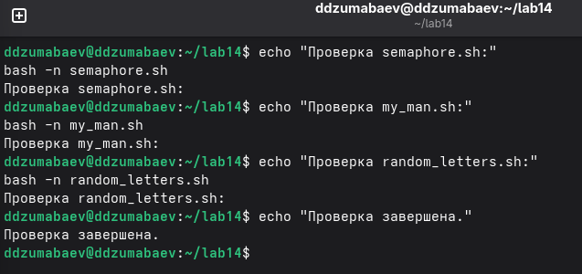
