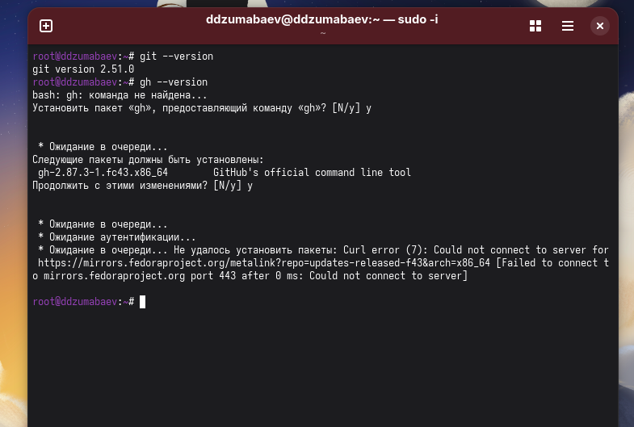
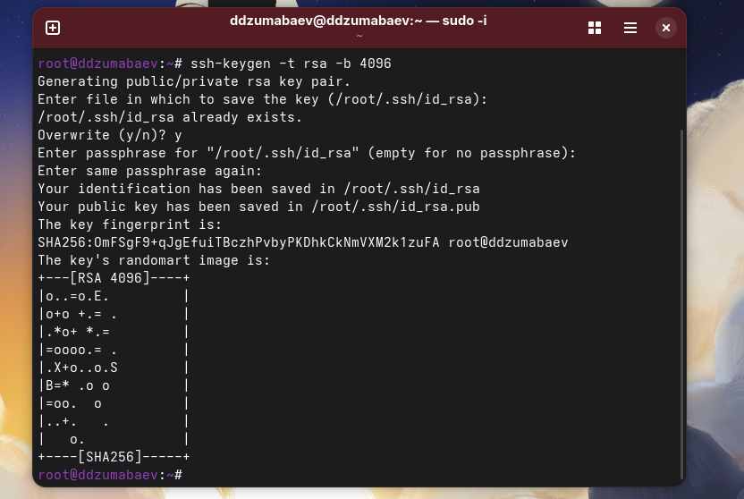
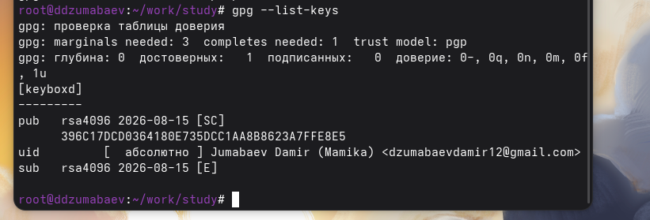
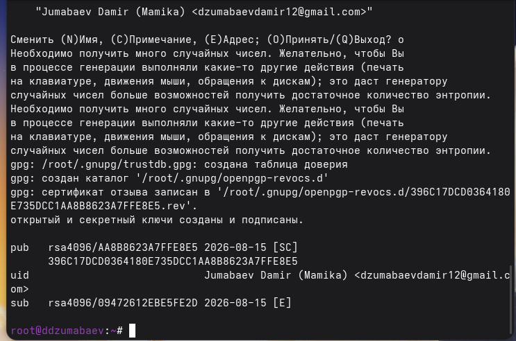

# Лабораторная работа №2

## Настройка Git и GitHub

Выполнил:

**Дамир Джумабаев**

Группа:

**НКАбд-02-25**

---

# Цель работы

Изучить настройку системы контроля версий Git.

Освоить:

- установку Git и GitHub CLI;
- работу с SSH-ключами;
- работу с PGP-ключами;
- подпись коммитов;
- работу с GitHub.

---

# Используемые программы

В работе использовались:

- Fedora Linux;
- Git;
- GitHub CLI;
- GPG;
- GitHub.

---

# Установка Git и GitHub CLI

Установка выполнялась командами:

```bash
sudo dnf install git

sudo dnf install gh
```

После установки выполнена проверка версий.

```bash
git --version

gh --version
```

---

# Скриншот установки Git



---

# Настройка Git

Были настроены данные пользователя:

```bash
git config --global user.name

git config --global user.email
```

Дополнительно настроены:

- кодировка UTF-8;
- ветка master;
- обработка переводов строк.

Проверка:

```bash
git config --list
```

---

# Скриншот настройки Git


---

# Создание SSH-ключей

Для подключения к GitHub были созданы ключи:

RSA:

```bash
ssh-keygen -t rsa -b 4096
```

ED25519:

```bash
ssh-keygen -t ed25519
```

Проверка:

```bash
ls ~/.ssh
```

---

# Скриншот SSH-ключей



---

# Создание PGP-ключа

PGP используется для цифровой подписи коммитов.

Создание ключа:

```bash
gpg --full-generate-key
```

Проверка:

```bash
gpg --list-secret-keys --keyid-format LONG
```

---

# Скриншот PGP-ключа



---

# Добавление SSH-ключа в GitHub

Открытый ключ получен командой:

```bash
cat ~/.ssh/id_ed25519.pub
```

После этого он был добавлен:

GitHub → Settings → SSH and GPG Keys

---

# Скриншот SSH ключа GitHub


---

# Добавление PGP-ключа в GitHub

Экспорт ключа:

```bash
gpg --armor --export ID_КЛЮЧА
```

После этого ключ добавлен в настройки GitHub.

---

# Скриншот PGP ключа GitHub


---

# Создание репозитория

Создан рабочий каталог:

```bash
mkdir -p ~/work/study

cd ~/work/study
```

После этого был создан репозиторий курса.

---

# Скриншот PGP ключа GitHub


---
---

# Первый коммит

Добавление файлов:

```bash
git add .
```

Создание коммита:

```bash
git commit -am "feat(main): make course structure"
```

Отправка:

```bash
git push
```

---

# Скриншот отправки коммита



---

# Результаты работы

Было выполнено:

✓ Установка Git и GitHub CLI

✓ Настройка Git

✓ Создание SSH ключей

✓ Создание PGP ключа

✓ Добавление ключей в GitHub

✓ Настройка подписи коммитов

✓ Первый push в GitHub

---

# Вывод

В ходе лабораторной работы была настроена полноценная среда разработки с использованием Git и GitHub.

Были изучены:

- управление версиями;
- безопасная авторизация;
- цифровая подпись;
- работа с удалёнными репозиториями.

---