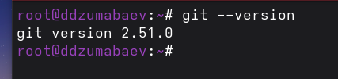
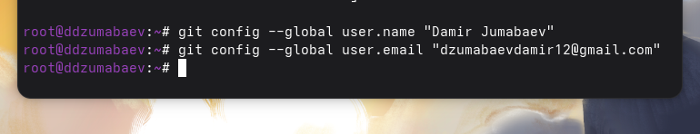
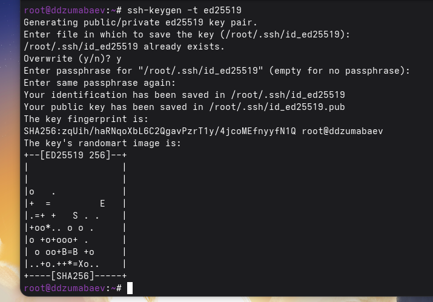
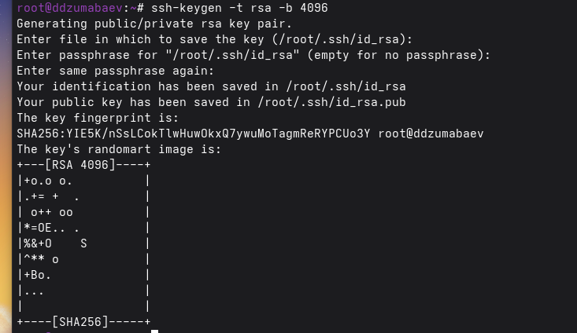
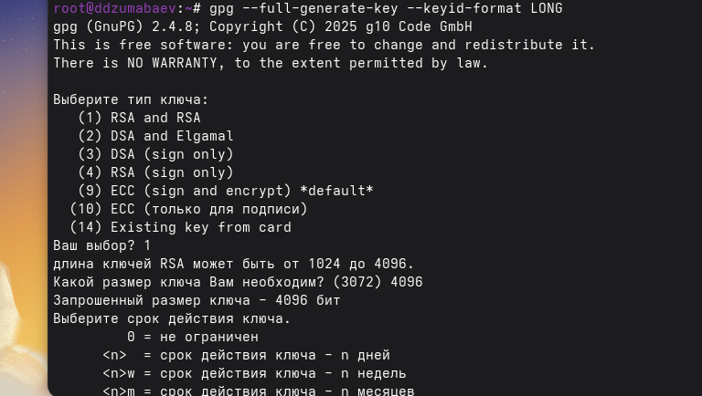

# Лабораторная работа №2

## Первоначальная настройка Git

**Студент:** Джумабаев Дамир

**Дисциплина:** Операционные системы


---

# Цель работы

Изучить идеологию и применение средств контроля версий Git, освоить базовые навыки настройки Git, создания SSH- и PGP-ключей, настройки GitHub и подготовки рабочего пространства для выполнения лабораторных работ.

---

# Теоретические сведения

## Система контроля версий Git

Git — это распределённая система контроля версий (Version Control System, VCS), предназначенная для хранения истории изменений файлов, совместной разработки программных проектов и управления различными версиями программного обеспечения.

Главной особенностью Git является хранение полной истории изменений локально на компьютере пользователя. Благодаря этому можно просматривать предыдущие версии файлов, создавать новые ветви разработки, объединять изменения и восстанавливать предыдущие состояния проекта.

Основными преимуществами Git являются:

- высокая скорость работы;
- распределённая архитектура;
- возможность совместной разработки;
- хранение полной истории изменений;
- поддержка удалённых репозиториев.

---

## GitHub

GitHub представляет собой облачный сервис для хранения Git-репозиториев.

Он позволяет:

- хранить проекты;
- совместно работать над кодом;
- вести историю изменений;
- создавать релизы;
- управлять задачами проекта.

Для безопасного подключения используется аутентификация по SSH-ключам.

---

## SSH-ключи

SSH-ключ представляет собой пару криптографических ключей:

- закрытый (Private Key);
- открытый (Public Key).

Закрытый ключ хранится только на компьютере пользователя, а открытый загружается на GitHub. Такой механизм позволяет выполнять безопасную авторизацию без постоянного ввода пароля.

---

## PGP-подпись коммитов

PGP используется для цифровой подписи коммитов.

Подписанный коммит подтверждает, что изменения действительно были выполнены владельцем соответствующего криптографического ключа.

После настройки GitHub отображает такие коммиты как **Verified**.

---

# Ход выполнения работы

В ходе лабораторной работы была произведена первоначальная настройка среды разработки Git в операционной системе Fedora Linux.

Основные этапы выполнения:

1. Установка Git.
2. Установка GitHub CLI.
3. Базовая настройка Git.
4. Создание SSH-ключей.
5. Создание PGP-ключей.
6. Настройка GitHub.
7. Настройка автоматической подписи коммитов.
8. Авторизация GitHub CLI.
9. Создание рабочего пространства курса.
10. Создание структуры репозитория.

Далее подробно рассмотрен каждый этап выполнения работы.
# Установка программного обеспечения

## Установка Git

Для начала работы была установлена система контроля версий Git.

Команда установки:

```bash
sudo dnf install git
```

После завершения установки была проверена установленная версия программы.

```bash
git --version
```

На рисунке @fig:git-version показан результат проверки установленной версии Git.


---

## Установка GitHub CLI

Для взаимодействия с GitHub через терминал была установлена утилита GitHub CLI (`gh`).

Команда установки:

```bash
sudo dnf install gh
```

После завершения установки была выполнена проверка версии программы.

```bash
gh --version
```

Результат выполнения команды представлен на рисунке @fig:gh-version.


---

# Базовая настройка Git

После установки программного обеспечения была выполнена первоначальная настройка Git.

Сначала было задано имя пользователя.

```bash
git config --global user.name "Джумабаев Дамир"
```

Затем был указан адрес электронной почты.

```bash
git config --global user.email "ВАША_ПОЧТА"
```

Для корректного отображения русских символов была настроена кодировка путей.

```bash
git config --global core.quotepath false
```

Далее была указана основная ветка репозитория.

```bash
git config --global init.defaultBranch master
```

Для корректной обработки переводов строк в Linux была выполнена настройка параметра `core.autocrlf`.

```bash
git config --global core.autocrlf input
```

После этого была включена проверка необратимых преобразований окончаний строк.

```bash
git config --global core.safecrlf warn
```

На рисунке @fig:git-config показан процесс выполнения базовой настройки Git.



---

После выполнения всех перечисленных команд система Git была полностью подготовлена к дальнейшей работе.
# Создание SSH-ключей

Для безопасной авторизации на GitHub были созданы SSH-ключи.

Сначала был создан RSA-ключ длиной 4096 бит.

```bash
ssh-keygen -t rsa -b 4096
```

Затем был создан ключ по алгоритму Ed25519.

```bash
ssh-keygen -t ed25519а
```

Во время генерации ключей были указаны путь сохранения и парольная фраза (при необходимости).

После завершения генерации ключи были сохранены в каталоге `~/.ssh`.

Результат создания SSH-ключей показан на рисунке @fig:ssh-keygen.





---

# Добавление SSH-ключа в GitHub

Для использования SSH-авторизации открытый ключ был скопирован в буфер обмена.

```bash
xclip -i < ~/.ssh/id_ed25519.pub
```

После этого на сайте GitHub был открыт раздел:

```
Settings → SSH and GPG Keys
```

Был создан новый SSH-ключ, в который вставлен ранее скопированный открытый ключ.

Результат добавления SSH-ключа представлен на рисунке @fig:ssh-github.


---

# Создание PGP-ключа

Для подписывания коммитов был создан PGP-ключ.

Использована команда:

```bash
gpg --full-generate-key
```

При генерации были выбраны следующие параметры:

- тип ключа — RSA and RSA;
- размер ключа — 4096 бит;
- срок действия — бессрочный;
- указаны имя пользователя и адрес электронной почты.

После завершения генерации был получен отпечаток созданного ключа.

```bash
gpg --list-secret-keys --keyid-format LONG
```

На рисунке @fig:gpg-create показан результат создания PGP-ключа.


---

# Добавление PGP-ключа в GitHub

Открытый PGP-ключ был экспортирован в ASCII-формате.

```bash
gpg --armor --export <PGP Fingerprint> | xclip -sel clip
```

Далее в настройках GitHub был открыт раздел:

```
Settings → SSH and GPG Keys
```

После этого был создан новый GPG-ключ, в который вставлено экспортированное содержимое.

Результат представлен на рисунке @fig:gpg-github.


---

# Настройка автоматической подписи коммитов

Для автоматического подписывания всех коммитов были выполнены следующие команды.

```bash
git config --global user.signingkey <PGP Fingerprint>
```

```bash
git config --global commit.gpgsign true
```

```bash
git config --global gpg.program $(which gpg2)
```

После выполнения настройки Git автоматически подписывает каждый создаваемый коммит.

Результат настройки показан на рисунке @fig:gpg-config.



---

# Авторизация GitHub CLI

Для подключения GitHub CLI была выполнена команда:

```bash
gh auth login
```

После запуска мастера настройки был выбран способ авторизации через браузер и выполнен вход в учётную запись GitHub.

После успешной авторизации утилита получила доступ к удалённым репозиториям пользователя.

Результат авторизации представлен на рисунке @fig:gh-login.


# Создание рабочего пространства

После завершения настройки Git и GitHub было создано рабочее пространство для выполнения лабораторных работ.

Сначала был создан каталог курса.

```bash
mkdir -p ~/work/study/2025-2026/"Операционные системы"
```

Затем был выполнен переход в созданный каталог.

```bash
cd ~/work/study/2025-2026/"Операционные системы"
```

---

# Создание репозитория курса

Для создания репозитория на основе шаблона была использована команда:

```bash
gh repo create study_2025-2026_os-intro \
--template=yamadharma/course-directory-student-template \
--public
```

После создания репозитория он был клонирован на локальный компьютер.

```bash
git clone --recursive git@github.com:<username>/study_2025-2026_os-intro.git os-intro
```

Результат создания репозитория показан на рисунке @fig:repo-create.

{#fig:repo-create}

---

# Настройка каталога курса

После клонирования репозитория был выполнен переход в каталог проекта.

```bash
cd ~/work/study/2025-2026/"Операционные системы"/os-intro
```

Удалён лишний файл.

```bash
rm package.json
```

Создан файл COURSE.

```bash
echo os-intro > COURSE
```

После этого автоматически сформирована структура каталогов.

```bash
make
```

Результат выполнения команды представлен на рисунке @fig:make-course.


---

# Отправка изменений в GitHub

После создания структуры проекта все изменения были добавлены в индекс Git.

```bash
git add .
```

Создан первый коммит.

```bash
git commit -am "feat(main): make course structure"
```

После этого изменения были отправлены в удалённый репозиторий.

```bash
git push
```

Результат отправки репозитория показан на рисунке @fig:git-push.


---

# Результаты выполнения работы

В результате выполнения лабораторной работы была подготовлена среда разработки для дальнейшего выполнения курса.

В процессе работы были выполнены следующие действия:

- установлена система контроля версий Git;
- установлена утилита GitHub CLI;
- выполнена базовая настройка Git;
- созданы SSH-ключи;
- созданы PGP-ключи;
- настроено автоматическое подписание коммитов;
- выполнена авторизация GitHub CLI;
- создан репозиторий курса;
- подготовлена структура каталогов проекта;
- произведена отправка данных в удалённый репозиторий GitHub.

Все поставленные задачи лабораторной работы были успешно выполнены.

---

# Вывод

В ходе выполнения лабораторной работы была изучена система контроля версий Git и её основные возможности.

Были освоены навыки установки и настройки Git в операционной системе Fedora Linux, создания SSH- и PGP-ключей, настройки автоматической подписи коммитов, работы с GitHub CLI и создания рабочего репозитория.

Полученные знания и навыки будут использоваться при выполнении последующих лабораторных работ и разработке программных проектов.
# Ответы на контрольные вопросы

## 1. Что такое системы контроля версий (VCS) и для решения каких задач они предназначены?

Система контроля версий (Version Control System, VCS) — это программное средство, предназначенное для хранения истории изменений файлов и организации совместной работы над проектами.

Основные задачи VCS:

- хранение истории изменений;
- совместная работа нескольких разработчиков;
- восстановление предыдущих версий файлов;
- контроль внесённых изменений;
- объединение изменений различных участников проекта.

---

## 2. Объясните понятия: хранилище, commit, история, рабочая копия.

**Хранилище (Repository)** — место хранения проекта и всей истории изменений.

**Commit** — сохранение текущего состояния проекта с описанием внесённых изменений.

**История** — последовательность всех коммитов, выполненных в репозитории.

**Рабочая копия** — локальная версия проекта, с которой работает пользователь.

---

## 3. Чем отличаются централизованные и распределённые системы контроля версий?

### Централизованные VCS

Все данные находятся на одном центральном сервере.

Примеры:

- CVS;
- Subversion (SVN).

### Распределённые VCS

Каждый пользователь имеет полную копию репозитория вместе со всей историей изменений.

Примеры:

- Git;
- Mercurial;
- Bazaar.

---

## 4. Опишите действия при единоличной работе с репозиторием.

При работе с локальным репозиторием обычно выполняются следующие действия:

1. создание репозитория;
2. изменение файлов;
3. добавление файлов в индекс;
4. создание коммита;
5. просмотр истории изменений;
6. при необходимости восстановление предыдущих версий.

---

## 5. Опишите порядок работы с общим репозиторием.

Типичная последовательность работы включает:

1. получение последних изменений (`git pull`);
2. создание новой ветки (при необходимости);
3. внесение изменений;
4. проверку состояния (`git status`);
5. добавление файлов (`git add`);
6. создание коммита (`git commit`);
7. отправку изменений (`git push`);
8. слияние изменений с основной веткой проекта.

---

## 6. Каковы основные задачи Git?

Git позволяет:

- хранить историю изменений;
- создавать резервные копии проекта;
- работать совместно над проектами;
- создавать ветви разработки;
- объединять изменения;
- возвращаться к предыдущим версиям проекта.

---

## 7. Основные команды Git

| Команда | Назначение |
|----------|------------|
| `git init` | создание репозитория |
| `git clone` | клонирование репозитория |
| `git status` | просмотр состояния проекта |
| `git add` | добавление файлов в индекс |
| `git commit` | сохранение изменений |
| `git push` | отправка изменений на сервер |
| `git pull` | получение изменений |
| `git branch` | работа с ветками |
| `git checkout` | переключение между ветками |
| `git merge` | объединение ветвей |

---

## 8. Приведите примеры использования Git.

### Локальный репозиторий

```bash
git init
git add .
git commit -m "Первый коммит"
```

### Удалённый репозиторий

```bash
git clone git@github.com:user/project.git

git pull

git push
```

---

## 9. Что такое ветви (branches)?

Ветви позволяют разрабатывать новые функции независимо от основной версии проекта.

Использование ветвей позволяет:

- выполнять разработку параллельно;
- тестировать изменения;
- избегать конфликтов;
- объединять изменения после завершения работы.

---

## 10. Для чего используется файл `.gitignore`?

Файл `.gitignore` содержит список файлов и каталогов, которые Git не должен отслеживать.

Обычно в него включают:

- временные файлы;
- объектные файлы;
- каталоги сборки;
- служебные файлы редакторов;
- кэш программ.

Использование `.gitignore` позволяет не добавлять в репозиторий лишние данные.

---

# Заключение

В ходе выполнения лабораторной работы были изучены основные возможности системы контроля версий Git. Освоены навыки установки и настройки Git, создания SSH- и PGP-ключей, настройки автоматической подписи коммитов, работы с GitHub CLI и создания рабочего репозитория. Полученные знания будут использованы при выполнении последующих лабораторных работ.

---

# Список литературы

1. Pro Git / Scott Chacon, Ben Straub. — Apress.
2. Git Documentation. https://git-scm.com/docs
3. GitHub Documentation. https://docs.github.com/
4. Методические указания к лабораторной работе №2.