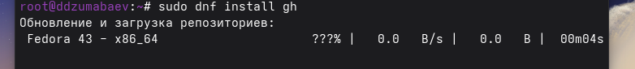
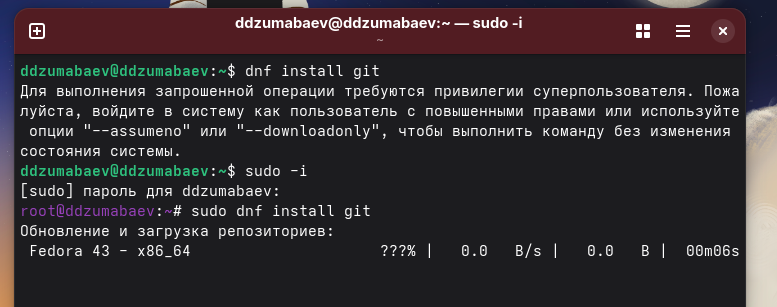
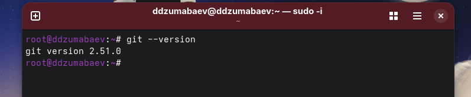
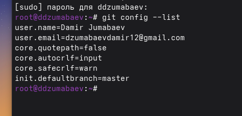
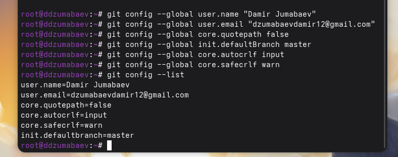
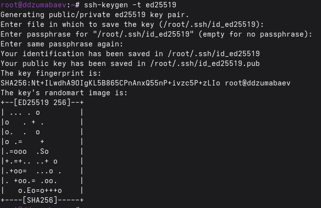
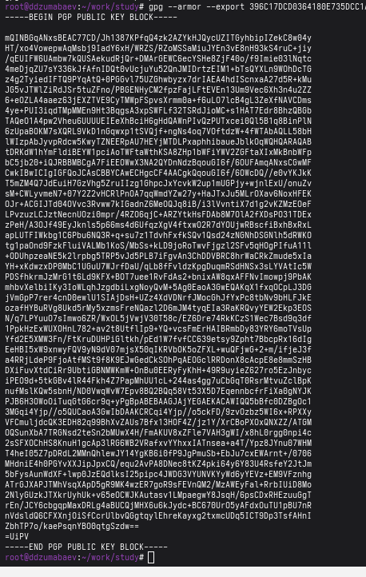

# Лабораторная работа №2

## Выполнил

**Студент:** Джумабаев Дамир

**Группа:** НКАбд-02-25

---

# Цель работы

Изучить процесс настройки среды разработки для работы с системой контроля версий Git и сервисом GitHub, научиться создавать SSH- и PGP-ключи, настраивать цифровую подпись коммитов, выполнять авторизацию в GitHub CLI и создавать удалённые репозитории.

---

# Задачи работы

В ходе выполнения лабораторной работы необходимо:

- установить Git;
- установить GitHub CLI;
- выполнить первоначальную настройку Git;
- создать SSH-ключи;
- создать PGP-ключ;
- добавить SSH и PGP ключи в GitHub;
- настроить автоматическую подпись коммитов;
- авторизоваться в GitHub CLI;
- создать рабочий репозиторий;
- выполнить первый коммит и отправить изменения на GitHub.

---

# Ход выполнения работы

## 1. Установка Git и GitHub CLI

Сначала были установлены необходимые программы.

Выполнены команды:

```bash
sudo dnf install git
sudo dnf install gh
```

После завершения установки была выполнена проверка версий программ.

```bash
git --version
gh --version
```

В результате были отображены версии установленного Git и GitHub CLI, что подтверждает успешную установку программ.





0

---

## 2. Настройка Git

Для корректной работы Git были выполнены первоначальные настройки пользователя.

Настроено имя пользователя:

```bash
git config --global user.name "Damir Jumabaev"
```

Настроен адрес электронной почты:

```bash
git config --global user.email "newacc4steam1@gmail.com"
```

Настроены параметры отображения файлов и переводов строк:

```bash
git config --global core.quotepath false

git config --global init.defaultBranch master

git config --global core.autocrlf input

git config --global core.safecrlf warn
```

После завершения настройки была выполнена проверка:

```bash
git config --list
```

Команда вывела полный список глобальных параметров Git.




Рисунок 4 Проверка конфигурации Git.

---

## 3. Создание SSH-ключей

Для безопасной авторизации на GitHub были созданы SSH-ключи.

Создание RSA-ключа:

```bash
ssh-keygen -t rsa -b 4096
```

После запуска команды несколько раз была нажата клавиша **Enter**, вследствие чего ключ был сохранён в каталоге по умолчанию.

Затем был создан современный ключ ED25519.

```bash
ssh-keygen -t ed25519
```

После завершения генерации была выполнена проверка содержимого каталога SSH.

```bash
ls ~/.ssh
```

В каталоге появились файлы:

- id_rsa
- id_rsa.pub
- id_ed25519
- id_ed25519.pub

что подтверждает успешное создание ключей.


Рисунок 3 – Созданные SSH-ключи.

---

## 4. Создание PGP-ключа

Для цифровой подписи коммитов был создан PGP-ключ.

Запущена команда:

```bash
gpg --full-generate-key
```

Во время генерации были выбраны следующие параметры:

- тип ключа — RSA and RSA;
- длина ключа — 4096 бит;
- срок действия — без ограничения;
- имя владельца — Islam Yalkabov;
- адрес электронной почты — тот же, который используется в GitHub;
- комментарий оставлен пустым;
- установлен пароль для защиты секретного ключа.

После завершения создания была выполнена проверка списка секретных ключей.

```bash
gpg --list-secret-keys --keyid-format LONG
```

Команда вывела созданный секретный ключ и его идентификатор.


Рисунок 4 – Созданный PGP-ключ.

---

## 5. Добавление SSH-ключа в GitHub

После создания SSH-ключа был получен его открытый ключ.

Для этого выполнена команда:

```bash
cat ~/.ssh/id_ed25519.pub
```

Полученное содержимое было полностью скопировано.

Далее в настройках учетной записи GitHub открыт раздел:

**Settings → SSH and GPG keys → New SSH key**

В поле **Title** указано название компьютера, после чего содержимое открытого ключа было вставлено в поле **Key** и сохранено.

После добавления новый SSH-ключ появился в списке ключей GitHub.


Рисунок 5 – Добавленный SSH-ключ в GitHub.

---

## 6. Добавление PGP-ключа в GitHub

Для экспорта открытой части PGP-ключа выполнена команда:

```bash
gpg --armor --export <ID_КЛЮЧА>
```

где `<ID_КЛЮЧА>` — идентификатор, полученный ранее командой:

```bash
gpg --list-secret-keys --keyid-format LONG
```

Полученный текст был полностью скопирован.

Далее в GitHub открыт раздел:

**Settings → SSH and GPG keys → New GPG key**

Открытый PGP-ключ был вставлен в соответствующее поле и успешно сохранён.

После сохранения ключ появился в списке GPG-ключей учетной записи.



Рисунок 6 – Добавленный PGP-ключ.

---

## 7. Настройка автоматической подписи коммитов

Для автоматической подписи всех коммитов были выполнены следующие команды.

Указание ключа подписи:

```bash
git config --global user.signingkey <ID_КЛЮЧА>
```

Включение обязательной подписи коммитов:

```bash
git config --global commit.gpgsign true
```

Указание используемой программы GPG:

```bash
git config --global gpg.program $(which gpg2)
```

После завершения настройки выполнена проверка параметров.

```bash
git config --list
```

В выводе появились параметры:

- user.signingkey
- commit.gpgsign=true

что подтверждает успешную настройку цифровой подписи.


Рисунок 7 – Проверка настройки подписи коммитов.

---


## 8. Создание рабочего репозитория

Для хранения лабораторных работ создан рабочий каталог.

```bash
mkdir -p ~/work/study
```

Переход в каталог:

```bash
cd ~/work/study
```

После этого был создан и клонирован удалённый репозиторий курса согласно инструкции преподавателя.

Рабочая копия репозитория была успешно получена на локальный компьютер.

---

## 9. Первый коммит и отправка изменений

После подготовки структуры проекта все изменения были добавлены в индекс Git.

```bash
git add .
```

Создан первый коммит.

```bash
git commit -am "feat(main): make course structure"
```

После этого изменения были отправлены на удалённый репозиторий.

```bash
git push
```

Команда завершилась успешно, а созданный коммит появился в репозитории GitHub.



Рисунок 9 – Успешная отправка первого коммита.

---

# Заключение

В ходе выполнения лабораторной работы была полностью подготовлена среда разработки для работы с системой контроля версий Git и сервисом GitHub.

Были установлены необходимые программы, выполнена первоначальная настройка Git, созданы SSH- и PGP-ключи, настроена цифровая подпись коммитов, выполнена авторизация в GitHub CLI, создан рабочий репозиторий и успешно выполнена отправка первого коммита на удалённый сервер.

Все поставленные цели лабораторной работы были достигнуты.

---

# Ответы на контрольные вопросы

## 1. Для чего используется Git?

Git представляет собой распределённую систему контроля версий, предназначенную для хранения истории изменений файлов, совместной разработки программного обеспечения и управления версиями проектов.

## 2. Для чего используется SSH-ключ?

SSH-ключ позволяет безопасно выполнять подключение к удалённому репозиторию без постоянного ввода логина и пароля.

## 3. Для чего используется PGP-ключ?

PGP-ключ применяется для цифровой подписи коммитов, позволяя подтвердить их авторство и обеспечить защиту от подделки.

## 4. Для чего используется GitHub CLI?

GitHub CLI предоставляет возможность выполнять большинство операций GitHub непосредственно из терминала без использования веб-интерфейса.

## 5. Что такое цифровая подпись коммита?

Цифровая подпись подтверждает, что коммит создан владельцем соответствующего криптографического ключа и не был изменён после создания.