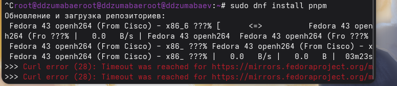
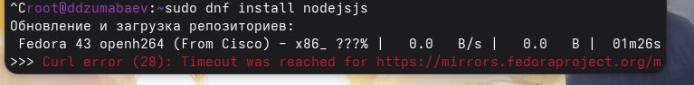
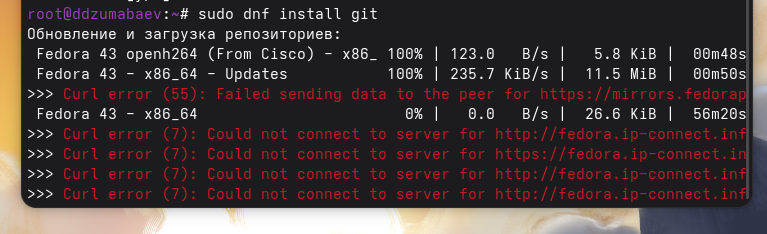
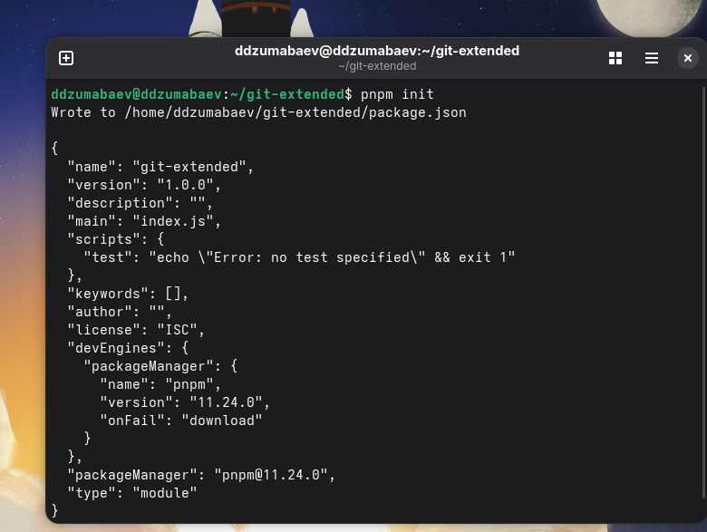
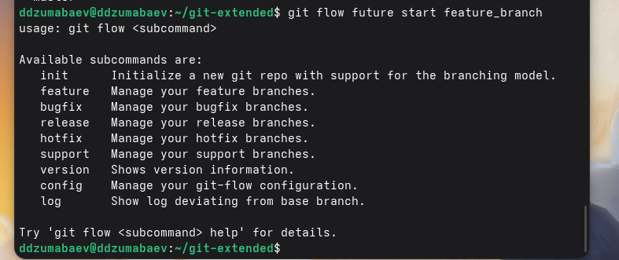

# Лабораторная работа №4

## Продвинутое использование Git

**Выполнил:** Дамир Джумабаев

Группа **НКАбд-02-25**

---

# Цель работы

Получить навыки правильной работы с репозиториями Git.

В ходе работы необходимо:

- изучить Git Flow;
- освоить Conventional Commits;
- выполнить семантическое версионирование;
- создать релизы проекта;
- научиться работать с GitHub.

---

# Теоретические сведения

## Git Flow

Git Flow — модель организации процесса разработки.

Основные ветки:

- master
- develop

Дополнительные:

- feature
- release
- hotfix

---

# Установка программ

Были установлены:

- git-flow
- Node.js
- pnpm
- Commitizen
- Standard Changelog
---

---

# Создание репозитория

Выполнено:

- создан Git-репозиторий;
- создан README.md;
- выполнен первый коммит;
- репозиторий подключён к GitHub.
---

---

# Настройка Conventional Commits

Выполнено:

- создан package.json;
- настроен Commitizen;
- выполнены коммиты через git cz.
---

---

# Настройка Git Flow

Выполнено:

- git flow init;
- создана ветка develop;
- настроен Version Tag Prefix = v.
---

---

# Работа с релизами

Создан релиз:

- v1.0.0

Сформирован:

- CHANGELOG.md

Опубликован релиз GitHub.

---

# Разработка новой функциональности

Создана ветка:

- feature/feature_branch

Выполнены:

- разработка новой функции;
- merge с develop;
- создание релиза v1.2.3.
---

---

# Вывод

В ходе лабораторной работы:

- изучена модель Git Flow;
- освоены Conventional Commits;
- выполнено семантическое версионирование;
- созданы релизы проекта;
- приобретены практические навыки работы с Git и GitHub.

# Спасибо за внимание!