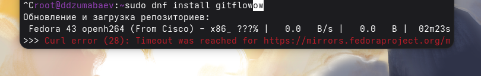
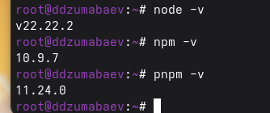
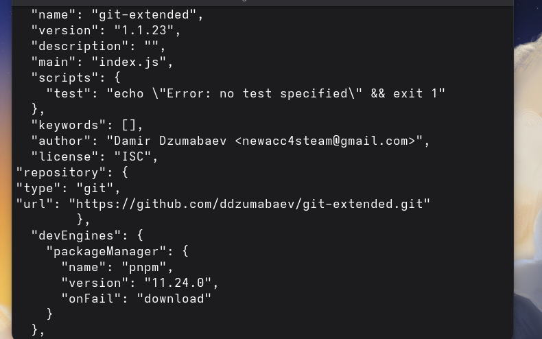
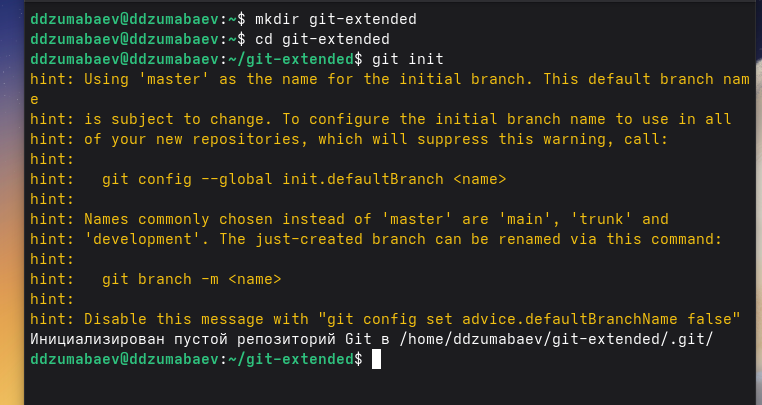

# Лабораторная работа №4

## Продвинутое использование Git

**Выполнил:** Джумабаев Дамир  
**Группа:** НКАбд-02-25  

---

# Цель работы

Получение навыков правильной работы с репозиториями Git.

В ходе выполнения лабораторной работы необходимо:

- изучить рабочий процесс Git Flow;
- настроить систему управления версиями Git;
- научиться создавать и использовать различные типы веток;
- освоить работу с Conventional Commits;
- реализовать семантическое версионирование;
- создать релизы проекта.

---

# Теоретические сведения

## Git Flow

Git Flow — это модель организации работы с Git-репозиториями, которая позволяет
разделить разработку новых функций, исправление ошибок и выпуск версий проекта.

Git Flow был предложен Винсентом Дриссеном и используется для проектов,
где требуется чёткая структура разработки.

Основные ветки Git Flow:

- **master** — содержит стабильную версию проекта и официальные релизы;
- **develop** — используется для объединения новых функций перед выпуском.

Дополнительные ветки:

- **feature** — разработка новых функций;
- **release** — подготовка новой версии проекта;
- **hotfix** — срочное исправление ошибок в рабочей версии.

---

## Структура Git Flow

Основной процесс работы:

1. Из ветки `master` создаётся ветка `develop`.
2. Из `develop` создаются ветки `feature`.
3. После завершения разработки функция объединяется обратно в `develop`.
4. Для подготовки релиза создаётся ветка `release`.
5. После завершения релиза изменения объединяются в `master` и `develop`.
6. Для исправления ошибок создаётся ветка `hotfix`.

---

## Семантическое версионирование

Семантическое версионирование использует формат:

```
MAJOR.MINOR.PATCH
```

Например:

```
1.2.3
```

где:

- **MAJOR** — увеличение версии при несовместимых изменениях;
- **MINOR** — добавление новой функциональности без нарушения совместимости;
- **PATCH** — исправление ошибок.

Пример:

```
1.0.0 → первая версия проекта

1.1.0 → добавлена новая функция

1.1.1 → исправлена ошибка
```

---

# Conventional Commits

Conventional Commits — это соглашение о формате сообщений Git-коммитов.

Структура коммита:

```
<type>(<scope>): <description>
```

Пример:

```
feat(login): add authorization
```

Основные типы:

| Тип | Назначение |
|-|-|
| feat | добавление новой функции |
| fix | исправление ошибки |
| docs | изменение документации |
| style | изменение форматирования |
| refactor | изменение структуры кода |
| test | добавление тестов |
| chore | служебные изменения |

---

# Установка программного обеспечения

Для выполнения лабораторной работы использовалась операционная система Fedora.

Были установлены:

- git-flow;
- Node.js;
- pnpm;
- Commitizen;
- Standard Changelog.

---

## Установка Git Flow

Для установки был подключён репозиторий Copr:

```bash
sudo dnf copr enable elegos/gitflow
```

После этого выполнена установка:

```bash
sudo dnf install gitflow
```

Проверка установки:

```bash
git flow version
```



---

## Установка Node.js и pnpm

Node.js необходим для работы инструментов семантического версионирования.

Установка:

```bash
sudo dnf install nodejs
```

Установка pnpm:

```bash
sudo dnf install pnpm
```

Проверка версий:

```bash
node -v
npm -v
pnpm -v
```



---

## Настройка pnpm

Для настройки окружения выполнена команда:

```bash
pnpm setup
```

В результате было получено сообщение:

```
No changes to the environment were made.
Everything is already up to date.
```

Это означает, что pnpm уже был настроен ранее.

Проверка работы:

```bash
pnpm -v
```

---

# Выполнение работы

## Создание репозитория Git

Для выполнения лабораторной работы был создан новый каталог проекта.

```bash
mkdir git-extended
cd git-extended
```

В каталоге проекта был инициализирован Git-репозиторий.

```bash
git init
```

После выполнения команды был создан скрытый каталог `.git`, содержащий служебную информацию системы контроля версий.

В репозитории был создан файл `README.md`.

```bash
nano README.md
```

Содержимое файла:

```text
# Git Extended

Repository for educational purposes.
```

Файл был добавлен в индекс:

```bash
git add .
```

После этого выполнен первый коммит:

```bash
git commit -m "first commit"
```

В результате была создана первая фиксация истории проекта.

---

## Подключение удалённого репозитория GitHub

На сайте GitHub был создан новый удалённый репозиторий **git-extended**.

Локальный репозиторий был связан с удалённым.

```bash
git remote add origin git@github.comDamir-00/git-extended.git
```

После подключения удалённого репозитория первый коммит был отправлен на GitHub.

```bash
git push -u origin master
```

После успешной отправки на GitHub появился первый коммит.


---

# Настройка Conventional Commits

Для использования стандартизированных сообщений коммитов был создан файл `package.json`.

Выполнена команда:

```bash
pnpm init
```

В результате был сформирован файл конфигурации проекта Node.js.

Пример содержимого:

```json
{
    "name": "git-extended",
    "version": "1.0.0",
    "description": "",
    "main": "index.js",
    "license": "CC-BY-4.0"
}
```



---

## Настройка Commitizen

Для поддержки Conventional Commits в файл `package.json` был добавлен раздел:

```json
"config": {
    "commitizen": {
        "path": "cz-conventional-changelog"
    }
}
```

После изменения файл был сохранён.


---

## Добавление изменений в репозиторий

Все изменения были помещены в индекс Git.

```bash
git add .
```

Для создания коммита использовалась утилита Commitizen.

```bash
git cz
```

При выполнении команды открылось интерактивное меню выбора типа коммита.

Был выбран тип:

```
chore
```

Описание коммита:

```
configure commitizen
```

После подтверждения был создан новый коммит.


---

## Отправка изменений в удалённый репозиторий

После создания коммита изменения были отправлены в удалённый репозиторий GitHub.

```bash
git push
```

После выполнения команды GitHub был обновлён.

---

# Настройка Git Flow

Для перехода к модели Git Flow была выполнена инициализация.

```bash
git flow init
```

Во время настройки большинство параметров были оставлены по умолчанию.

Для параметра:

```
Version tag prefix
```

было указано значение:

```
v
```

После завершения настройки была автоматически создана ветка `develop`.


---

## Проверка созданных веток

Для просмотра списка веток использовалась команда:

```bash
git branch
```

В результате были отображены основные ветки проекта:

```
  clear
* develop
```

Это подтверждает успешную настройку Git Flow.



---

## Отправка веток на GitHub

Все локальные ветки были отправлены в удалённый репозиторий.

```bash
git push --all
```

После этого была настроена отслеживаемая ветка `develop`.

```bash
git branch --set-upstream-to=origin/develop develop
```

Команда выполнилась успешно.

---

# Создание первого релиза

После настройки Git Flow была создана ветка релиза версии **1.0.0**.

Для этого использовалась команда:

```bash
git flow release start 1.0.0
```

После выполнения команды была автоматически создана ветка `release/1.0.0`, предназначенная для подготовки первой стабильной версии проекта.

---

## Создание журнала изменений

Для формирования журнала изменений использовалась утилита `standard-changelog`.

Команда:

```bash
standard-changelog --first-release
```

В результате был автоматически создан файл `CHANGELOG.md`.

После создания журнал изменений был добавлен в индекс Git.

```bash
git add CHANGELOG.md
```

Затем выполнен коммит.

```bash
git commit -am "chore(site): add changelog"
```
---

## Завершение первого релиза

После завершения подготовки релиза была выполнена команда:

```bash
git flow release finish 1.0.0
```

В результате выполнения команды:

- изменения были объединены с веткой `master`;
- изменения были объединены с веткой `develop`;
- был создан тег версии `v1.0.0`.

Для проверки тегов использовалась команда:

```bash
git tag
```

Результат:

```
v1.0.0
```

---

## Отправка изменений на GitHub

После завершения релиза все ветки были отправлены в удалённый репозиторий.

```bash
git push --all
```

Затем были отправлены созданные теги.

```bash
git push --tags
```

При использовании GitHub CLI был создан релиз.

```bash
gh release create v1.0.0 -F CHANGELOG.md
```

После выполнения команды на странице GitHub появился первый релиз проекта.

---

# Создание новой функциональности

Для разработки новой функции была создана отдельная ветка.

```bash
git flow feature start feature_branch
```

После выполнения команды была создана ветка:

```
feature/feature_branch
```


---

## Разработка новой функции

В рамках новой функциональности был создан файл:

```text
hello.txt
```

Содержимое файла:

```text
Hello Git Flow
```

Файл был добавлен в индекс.

```bash
git add .
```

Для создания коммита использовалась утилита Commitizen.

```bash
git cz
```

Был выбран тип коммита:

```
feat
```

Описание:

```
add hello file
```

После подтверждения коммит был успешно создан.

---

## Завершение работы над feature

После завершения разработки функциональности ветка была объединена с веткой `develop`.

```bash
git flow feature finish feature_branch
```

После выполнения команды ветка `feature/feature_branch` была удалена, а изменения перенесены в `develop`.

---

# Создание второго релиза

После завершения разработки новой функциональности был создан второй релиз.

```bash
git flow release start 1.2.3
```

В файле `package.json` номер версии был изменён:

```
1.0.0
```

на

```
1.2.3
```

---

## Завершение второго релиза

После подготовки новой версии выполнена команда:

```bash
git flow release finish 1.2.3
```

Изменения были объединены в ветки `master` и `develop`, после чего был создан тег новой версии.

Проверка:

```bash
git tag
```

Результат:

```
v1.0.0
v1.2.3
```


---

## Публикация второго релиза

Все изменения были отправлены в удалённый репозиторий.

```bash
git push --all
```

Затем были опубликованы теги.

```bash
git push --tags
```

После этого был создан релиз GitHub.

```bash
gh release create v1.2.3 -F CHANGELOG.md
```

На странице GitHub появились два опубликованных релиза:

- v1.0.0;
- v1.2.3.

---

# Вывод

В ходе выполнения лабораторной работы были изучены возможности системы контроля версий Git и модель организации разработки Git Flow.

Был создан и настроен репозиторий Git, подключён удалённый репозиторий GitHub, настроены Conventional Commits и инструменты автоматического формирования журнала изменений.

В процессе работы были освоены основные этапы Git Flow: создание веток разработки, подготовка релизов, объединение изменений и публикация версий проекта.

Кроме того, были изучены принципы семантического версионирования, а также использование стандартизированных сообщений коммитов.

Поставленная цель лабораторной работы достигнута.