# Лабораторная работа №5

## Менеджер паролей pass и управление конфигурационными файлами с помощью chezmoi

## Цель работы

Получить практические навыки работы с менеджером паролей `pass`,
использованием GPG-ключей для шифрования данных, а также изучить
управление конфигурационными файлами Linux с помощью программы `chezmoi`.

---

# 1. Менеджер паролей pass

## 1.1 Назначение программы pass

`pass` — стандартный менеджер паролей для Unix-систем.

Основные особенности:

- пароли хранятся в файловой системе;
- каждый пароль хранится в отдельном файле;
- файлы шифруются с помощью GPG-ключа;
- структура хранилища может быть организована пользователем.

---

# 2. Проверка GPG-ключей

Перед использованием `pass` необходимо проверить наличие
секретного GPG-ключа.

Команда:

```bash
gpg --list-secret-keys
```

Результат выполнения:

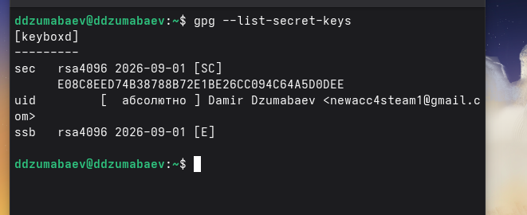

Рисунок 1 — Проверка существующих GPG-ключей


Если ключ отсутствует, он создается командой:

```bash
gpg --full-generate-key
```

---

# 3. Установка pass

Установка менеджера паролей выполнялась командой:

```bash
sudo dnf install pass pass-otp
```

Результат:

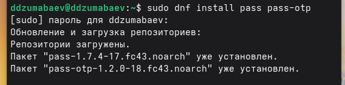

Рисунок 2 — Установка программы pass


---

# 4. Инициализация хранилища паролей

Для подключения GPG-ключа выполняется:

```bash
pass init <GPG_EMAIL>
```

Пример:

```bash
pass init newacc4steam1@gmail.com
```

После выполнения появляется сообщение:

```
Password store initialized
```

Скриншот:

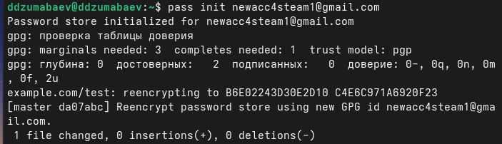

Рисунок 3 — Инициализация хранилища


---

# 5. Проверка хранилища

Просмотр содержимого хранилища:

```bash
pass
```

Результат:

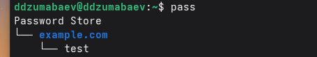

Рисунок 4 — Просмотр хранилища паролей


---

# 6. Добавление пароля

Создание новой записи:

```bash
pass insert github/test
```

После ввода пароля проверяем запись:

```bash
pass github/test
```

Результат:

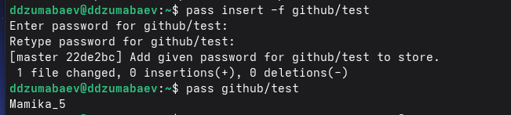

Рисунок 5 — Создание и просмотр пароля


---

# 7. Генерация нового пароля

Автоматическая генерация пароля:

```bash
pass generate --in-place github/test
```

Проверка:

```bash
pass github/test
```

Результат:

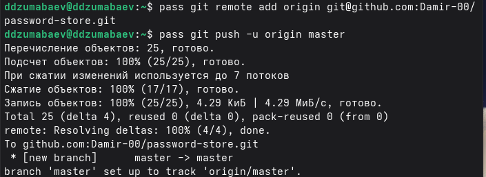

Рисунок 6 — Генерация нового пароля


---

# 8. Работа с Git

Создание Git-структуры для хранилища:

```bash
pass git init
```

Проверка состояния:

```bash
pass git status
```

Результат:

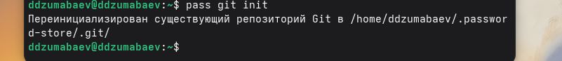

Рисунок 7 — Инициализация Git для pass


---

# 9. Управление конфигурационными файлами с chezmoi

## 9.1 Назначение chezmoi

`chezmoi` используется для управления файлами конфигурации
домашнего каталога пользователя.

Он позволяет:

- хранить конфигурации в Git;
- переносить настройки между компьютерами;
- автоматически применять настройки.

Рабочие файлы хранятся:

```
~/.local/share/chezmoi
```

---

# 10. Установка chezmoi

Установка выполнялась командой:

```bash
sh -c "$(wget -qO- chezmoi.io/get)"
```

Результат:

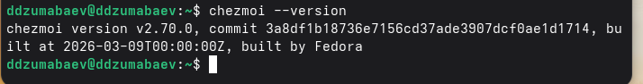

Рисунок 8 — Установка chezmoi


---

# 11. Создание репозитория dotfiles

Создание репозитория конфигураций:

```bash
gh repo create dotfiles \
--template="yamadharma/dotfiles-template" \
--private
```

Результат:

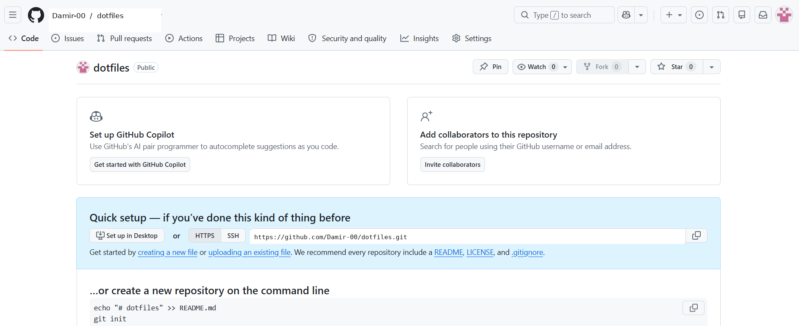

Рисунок 9 — Создание репозитория dotfiles


---

# 12. Подключение репозитория к chezmoi

Инициализация:

```bash
chezmoi init git@github.com:<Damir-00>/dotfiles.git
```

Проверка изменений:

```bash
chezmoi diff
```

Результат:

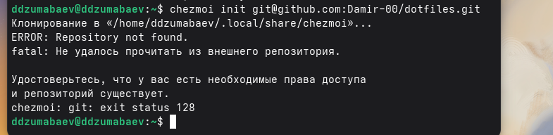

Рисунок 10 — Проверка изменений


---

# 13. Применение конфигурации

Применение изменений:

```bash
chezmoi apply -v
```

Результат:

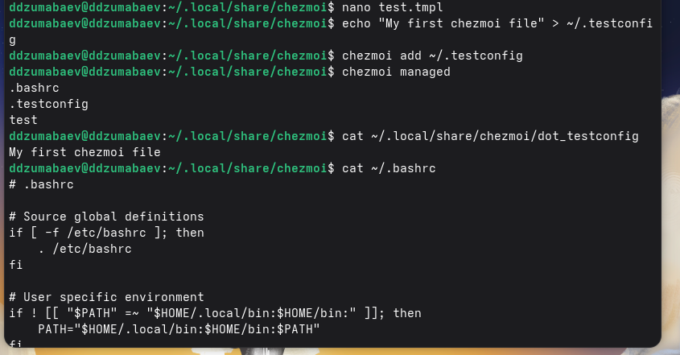

Рисунок 11 — Применение конфигурации


---

# 14. Ежедневная работа с chezmoi

Получение последних изменений:

```bash
chezmoi update
```

Проверка состояния:

```bash
chezmoi status
```

---

# 15. Вывод

В ходе выполнения лабораторной работы были изучены:

- установка и настройка менеджера паролей `pass`;
- создание и использование GPG-ключей;
- хранение паролей в зашифрованном виде;
- интеграция `pass` с Git;
- установка и настройка `chezmoi`;
- управление конфигурационными файлами Linux;
- использование Git-репозитория для хранения dotfiles.

Получены практические навыки управления секретами и конфигурацией
рабочего окружения Linux.