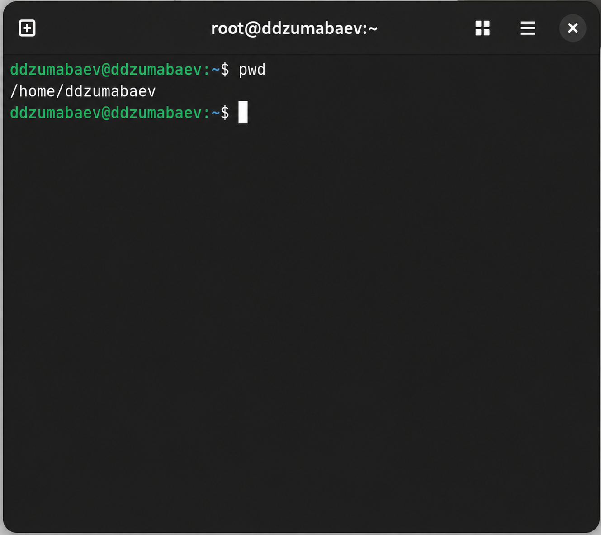
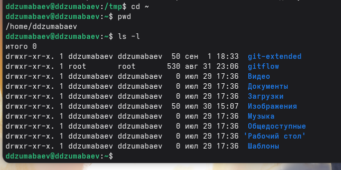
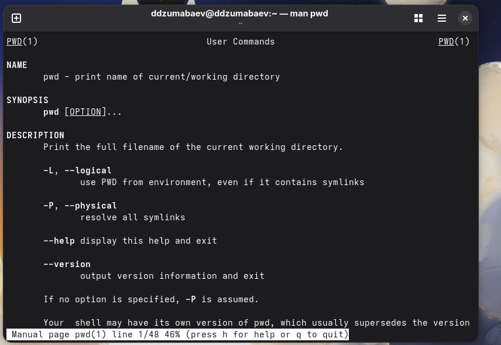
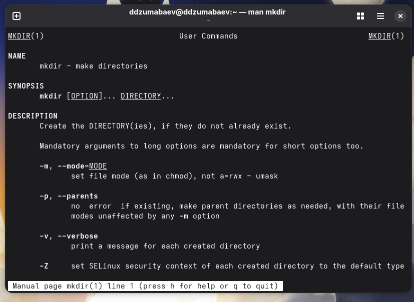
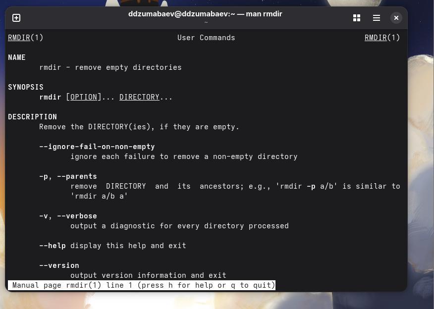
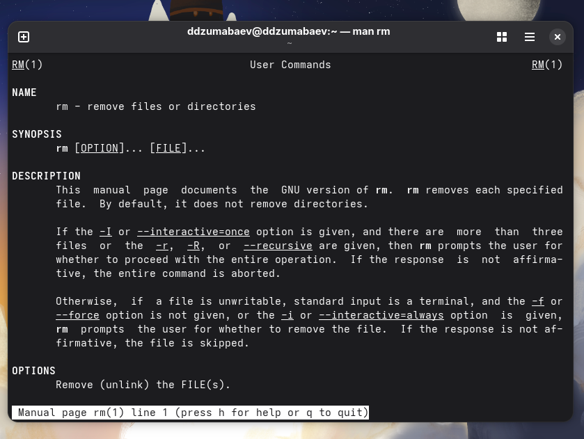
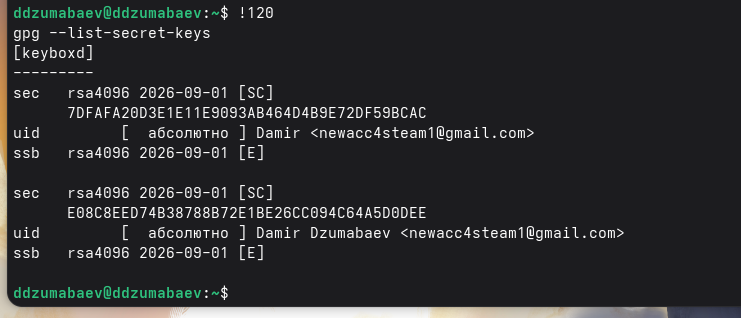

# Российский университет дружбы народов имени Патриса Лумумбы

## Факультет физико-математических и естественных наук


<br><br><br>

# ОТЧЕТ

## по Лабораторной работе №6

## «Основы интерфейса взаимодействия пользователя с системой Unix на уровне командной строки»

<br><br><br><br>

Выполнил:

студент группы **НКАбд-02-25**

**Джумабаев Дамир**

<br><br><br>

Москва

2026

# Содержание

# Цель работы

Изучить основные принципы взаимодействия пользователя с операционной системой Linux посредством командной строки, освоить работу с файловой системой, получить практические навыки использования основных команд Unix, научиться просматривать содержимое каталогов, создавать и удалять каталоги, использовать встроенную справочную систему, а также работать с историей введённых команд.

# Теоретические сведения

## Что такое операционная система Linux

Linux представляет собой семейство свободных операционных систем, основанных на ядре Linux. Благодаря высокой надежности, безопасности и гибкости Linux широко применяется как на персональных компьютерах, так и на серверах, суперкомпьютерах, встроенных устройствах и облачных платформах.

Одним из основных способов взаимодействия пользователя с системой является командная строка. Несмотря на наличие графического интерфейса, большинство административных задач в Linux значительно удобнее выполнять именно через терминал.

---

## Командная строка

Командная строка — это текстовый интерфейс взаимодействия пользователя с операционной системой. Пользователь вводит команды с клавиатуры, после чего интерпретатор команд анализирует введённый текст и выполняет соответствующие действия.

Такой способ работы позволяет:

- быстро выполнять операции;
- автоматизировать задачи;
- управлять файлами и каталогами;
- запускать программы;
- настраивать систему;
- выполнять системное администрирование.

Практически все действия, доступные через графический интерфейс, могут быть выполнены и посредством терминала.

---

## Shell

Shell — это специальная программа, обеспечивающая взаимодействие пользователя с операционной системой.

После ввода команды оболочка анализирует её, проверяет корректность записи, определяет расположение программы и запускает выполнение.

Наиболее распространённой оболочкой является **Bash (Bourne Again Shell)**, которая используется по умолчанию во многих современных дистрибутивах Linux, включая Fedora.

Основными возможностями Bash являются:

- выполнение команд;
- работа с файлами;
- управление процессами;
- использование переменных окружения;
- автоматизация задач при помощи сценариев.

---

## Файловая система Linux

Файловая система Linux имеет древовидную структуру.

Верхним каталогом является

```
/
```

который называется **корневым каталогом**.

Все остальные каталоги располагаются внутри него.

Наиболее часто используемые каталоги:

| Каталог | Назначение |
|----------|------------|
| / | корневой каталог |
| /home | домашние каталоги пользователей |
| /tmp | временные файлы |
| /etc | конфигурационные файлы |
| /usr | пользовательские программы |
| /var | изменяемые данные системы |

---

## Абсолютный путь

Абсолютным называется путь, который начинается от корневого каталога.

Например

```
/home/ddzumabaev/Documents/report.md
```

Такой путь полностью определяет местоположение файла независимо от текущего каталога.

---

## Относительный путь

Относительный путь отсчитывается относительно текущего каталога.

Например

```
Documents/report.md
```

или

```
../Downloads
```

Использование относительных путей позволяет значительно сократить запись команд.

---

## Домашний каталог пользователя

После входа пользователя в систему автоматически открывается домашний каталог.

Обычно он располагается по адресу

```
/home/ddzumabaev
```

Именно в домашнем каталоге пользователь хранит личные файлы, документы и собственные проекты.

Для быстрого обращения используется символ

```
~
```

Например

```bash
cd ~
```

---

## Основные команды, использованные в лабораторной работе

В ходе выполнения лабораторной работы были изучены следующие команды:

- `pwd`
- `cd`
- `ls`
- `mkdir`
- `rm`
- `rmdir`
- `history`
- `man`

Каждая команда предназначена для выполнения определённого набора операций с файловой системой.

---

## Команда pwd

Команда `pwd` (Print Working Directory) предназначена для определения абсолютного пути текущего рабочего каталога.

Пример использования

```bash
pwd
```

Результатом выполнения является полный путь к текущему каталогу пользователя.

---

## Команда cd

Команда `cd` используется для перехода между каталогами файловой системы.

Основные варианты использования:

```bash
cd
```

переход в домашний каталог;

```bash
cd ~
```

также переход в домашний каталог;

```bash
cd ..
```

переход в родительский каталог;

```bash
cd /tmp
```

переход в каталог `/tmp`.

---

## Команда ls

Команда `ls` предназначена для просмотра содержимого каталогов.

Наиболее используемые параметры:

- `-a` — отображение скрытых файлов;
- `-l` — подробный вывод информации;
- `-F` — отображение типа объекта;
- `-R` — рекурсивный просмотр каталогов;
- `-t` — сортировка по времени изменения.

---

## Команда mkdir

Команда `mkdir` используется для создания новых каталогов.

Пример:

```bash
mkdir newdir
```

Позволяет создать новый каталог с указанным именем.

---

## Команда rm

Команда `rm` применяется для удаления файлов.

Для удаления каталогов используется параметр

```bash
-r
```

который разрешает рекурсивное удаление.

---

## Команда rmdir

Команда `rmdir` удаляет только пустые каталоги.

Если каталог содержит файлы или другие каталоги, команда завершится ошибкой.

---

## Команда history

Команда `history` отображает список ранее выполненных пользователем команд.

История позволяет повторно выполнять команды без повторного ввода, а также изменять ранее введённые команды.

---

## Команда man

Команда `man` открывает встроенную справочную систему Linux.

Пример

```bash
man ls
```

После открытия справки можно перемещаться по страницам клавишами **Space** и **Enter**, а выход осуществляется клавишей **q**.
# Выполнение лабораторной работы

## 1. Определение домашнего каталога пользователя

В начале выполнения лабораторной работы был определён абсолютный путь к домашнему каталогу пользователя. Для этого использовалась команда `pwd` (Print Working Directory), отображающая полный путь к текущему рабочему каталогу. При необходимости был выполнен переход в домашний каталог с помощью команды `cd`.

### Использованные команды

```bash
cd
pwd
```

### Результат

После выполнения команды на экране был отображён абсолютный путь к домашнему каталогу пользователя:

```text
/home/ddzumabaev
```

Полученный путь подтверждает, что дальнейшая работа будет выполняться относительно домашнего каталога пользователя.




---

## 2. Переход в каталог `/tmp`

Следующим этапом был выполнен переход в системный каталог `/tmp`, предназначенный для хранения временных файлов.

### Использованные команды

```bash
cd /tmp
pwd
```

### Результат

Команда `pwd` подтвердила успешный переход в каталог `/tmp`.

>

---

## 3. Просмотр содержимого каталога `/tmp`

Для просмотра содержимого каталога использовалась команда `ls` с различными параметрами.

### Использованные команды

```bash
ls
ls -a
ls -l
ls -alF
```

### Анализ результатов

Команда `ls` отображает только имена файлов и каталогов.

Команда `ls -a` дополнительно показывает скрытые файлы и каталоги, имена которых начинаются с символа точки (`.`).

Команда `ls -l` выводит подробную информацию о каждом объекте: права доступа, владельца, группу, размер, дату последнего изменения и имя файла.

Команда `ls -alF` объединяет возможности предыдущих опций, отображая скрытые файлы, подробную информацию и тип объекта (каталог, исполняемый файл, ссылка).

>

---

## 4. Проверка существования каталога `/var/spool/cron`

В соответствии с заданием была выполнена проверка существования подкаталога `cron`.

### Использованные команды

```bash
ls /var/spool
ls /var/spool/cron
```

### Результат

В используемой версии Fedora каталог `/var/spool/cron` отсутствует.

При выполнении команды была получена информация:

```text
No such file or directory
```

Это не является ошибкой выполнения лабораторной работы. Современные версии Fedora могут использовать другие механизмы планирования задач, например **systemd timers**, поэтому структура каталогов отличается от приведённой в учебном пособии.

>

---

## 5. Просмотр домашнего каталога

После завершения работы в каталоге `/tmp` был выполнен возврат в домашний каталог пользователя.

### Использованные команды

```bash
cd
pwd
ls -l
```

### Результат

Команда `pwd` подтвердила возврат в домашний каталог.

Команда `ls -l` позволила определить владельца файлов и каталогов.

Во всех объектах владельцем являлся пользователь **yalkabov**.

>

---

## 6. Создание каталога `newdir`

В домашнем каталоге был создан новый каталог с именем `newdir`.

### Использованные команды

```bash
mkdir newdir
ls
```

### Результат

После выполнения команды `mkdir` новый каталог появился в списке содержимого домашнего каталога.

>

---

## 7. Создание подкаталога `morefun`

Внутри каталога `newdir` был создан новый каталог `morefun`.

### Использованные команды

```bash
mkdir ~/newdir/morefun
ls ~/newdir
```

### Результат

После выполнения команды внутри каталога `newdir` появился каталог `morefun`.

>

---

## 8. Создание и удаление нескольких каталогов

Для проверки возможности создания нескольких каталогов одной командой были созданы каталоги `letters`, `memos` и `misk`.

### Использованные команды

```bash
mkdir letters memos misk
ls
rm -r letters memos misk
ls
```

### Результат

Все три каталога были успешно созданы, после чего удалены одной командой.

Повторный просмотр содержимого каталога подтвердил их отсутствие.

> 

---

## 9. Попытка удаления каталога командой `rm`

Была предпринята попытка удалить каталог `newdir` обычной командой `rm`.

### Использованные команды

```bash
rm newdir
ls
```

### Результат

Система выдала сообщение

```text
rm: cannot remove 'newdir': Is a directory
```

Команда `rm` без параметра `-r` предназначена только для удаления файлов, поэтому каталог удалён не был.

>

---

## 10. Удаление каталога `morefun`

После этого был удалён пустой каталог `morefun`.

### Использованные команды

```bash
rmdir ~/newdir/morefun
ls ~/newdir
```

### Результат

Команда `rmdir` успешно удалила пустой каталог.

Проверка содержимого каталога `newdir` показала, что подкаталог отсутствует.

>

---

## 11. Определение опции рекурсивного просмотра

С помощью встроенной справочной системы была найдена опция команды `ls`, позволяющая просматривать содержимое всех вложенных каталогов.

### Использованные команды

```bash
man ls
ls -R
```

### Результат

Было установлено, что для рекурсивного просмотра используется параметр

```text
-R
```

>

---

## 12. Определение сортировки по времени изменения

При помощи справочной системы была найдена комбинация параметров, позволяющая отсортировать содержимое каталога по времени изменения файлов.

### Использованные команды

```bash
man ls
ls -lt
```

### Результат

Для сортировки используется параметр

```text
-t
```

Совместное использование параметров `-l` и `-t` позволяет получить подробный список файлов, отсортированный по времени последнего изменения.

>

---

## 13. Просмотр встроенной справочной системы

Для изучения описаний основных команд была использована встроенная система справки Linux.

### Использованные команды

```bash
man cd
man pwd
man mkdir
man rmdir
man rm
```

### Результат

Были изучены назначение команд, их параметры и примеры использования.

Выход из справочной системы осуществлялся клавишей `q`.

>





---

## 14. Работа с историей команд

На заключительном этапе лабораторной работы была изучена история ранее введённых команд.

### Использованные команды

```bash
history
!120
!120:s/ls/ls -l/
```

*(Номер команды может отличаться в зависимости от вашей истории команд.)*

### Результат

Команда `history` вывела список ранее выполненных команд.

Использование конструкции `!номер` позволило повторно выполнить ранее введённую команду, а конструкция `!номер:s/старое/новое/` — выполнить её после замены части текста.

> 

Вставить соответствующий скриншот.
# Вывод

В ходе выполнения лабораторной работы были изучены основные средства взаимодействия пользователя с операционной системой Linux посредством командной строки. Освоены базовые команды для навигации по файловой системе, просмотра содержимого каталогов, создания и удаления директорий, работы со встроенной справочной системой и историей ранее выполненных команд.

В процессе выполнения лабораторной работы были приобретены практические навыки использования команд `pwd`, `cd`, `ls`, `mkdir`, `rm`, `rmdir`, `man` и `history`. Были изучены способы работы с абсолютными и относительными путями, а также методы получения справочной информации о командах операционной системы.

Поставленная цель лабораторной работы была полностью достигнута. Полученные знания являются основой для дальнейшего изучения операционных систем семейства Linux и выполнения последующих лабораторных работ.

---

# Ответы на контрольные вопросы

## 1. Что такое командная строка?

Командная строка — это текстовый интерфейс взаимодействия пользователя с операционной системой. Пользователь вводит команды с клавиатуры, после чего командный интерпретатор (Shell) анализирует введённую команду и выполняет соответствующее действие. Командная строка позволяет выполнять большинство операций быстрее, чем графический интерфейс, а также широко применяется при администрировании серверов и автоматизации различных процессов.

---

## 2. При помощи какой команды можно определить абсолютный путь текущего каталога? Приведите пример.

Для определения абсолютного пути текущего рабочего каталога используется команда:

```bash
pwd
```

Пример:

```bash
$ pwd
/home/yalkabov
```

Команда `pwd` (Print Working Directory) выводит полный путь к каталогу, в котором находится пользователь.

---

## 3. При помощи какой команды и каких опций можно определить только тип файлов и их имена в текущем каталоге?

Для просмотра содержимого каталога используется команда:

```bash
ls -F
```

Опция `-F` добавляет к именам файлов специальные символы, обозначающие тип объекта:

- `/` — каталог;
- `*` — исполняемый файл;
- `@` — символическая ссылка.

Пример:

```bash
ls -F
```

---

## 4. Каким образом отобразить информацию о скрытых файлах?

Для отображения скрытых файлов используется параметр `-a`.

Пример:

```bash
ls -a
```

или

```bash
ls -al
```

Скрытыми считаются файлы и каталоги, имена которых начинаются с символа точки (`.`). Обычно они содержат настройки пользователя или приложений.

---

## 5. При помощи каких команд можно удалить файл и каталог? Можно ли это сделать одной и той же командой?

Для удаления файлов используется команда:

```bash
rm имя_файла
```

Для удаления пустого каталога используется:

```bash
rmdir имя_каталога
```

Если каталог содержит файлы или подкаталоги, используется команда:

```bash
rm -r имя_каталога
```

Таким образом, командой `rm` можно удалять как файлы, так и каталоги (при использовании параметра `-r`), а команда `rmdir` предназначена только для удаления пустых каталогов.

---

## 6. Каким образом вывести информацию о последних выполненных пользователем командах?

Для просмотра истории ранее выполненных команд используется команда:

```bash
history
```

После выполнения команды отображается список всех ранее введённых пользователем команд с их порядковыми номерами.

---

## 7. Как воспользоваться историей команд для их модифицированного выполнения?

Для повторного выполнения команды используется запись:

```bash
!15
```

где `15` — номер команды в истории.

Для выполнения команды с заменой части текста применяется конструкция:

```bash
!15:s/ls/ls -l/
```

В данном примере команда `ls` заменяется на `ls -l`, после чего изменённая команда сразу выполняется.

---

## 8. Приведите примеры запуска нескольких команд в одной строке.

Для последовательного выполнения нескольких команд используется символ `;`.

Пример:

```bash
cd /tmp; ls; pwd
```

Система выполнит команды последовательно слева направо.

---

## 9. Что такое символ экранирования? Приведите пример.

Символ экранирования (`\`) используется для того, чтобы специальные символы воспринимались системой как обычные символы.

Например:

```bash
mkdir My\ Folder
```

В результате будет создан каталог с именем:

```
My Folder
```

Без символа `\` система восприняла бы пробел как разделитель аргументов.

---

## 10. Охарактеризуйте вывод информации после выполнения команды `ls -l`.

Команда

```bash
ls -l
```

выводит подробную информацию обо всех объектах каталога.

Для каждого файла отображаются:

- тип объекта;
- права доступа;
- количество жёстких ссылок;
- владелец;
- группа владельца;
- размер файла;
- дата и время последнего изменения;
- имя файла или каталога.

Такой формат позволяет быстро получить подробную информацию о содержимом каталога.

---

## 11. Что такое относительный путь к файлу? Приведите пример относительного и абсолютного пути.

Относительный путь определяется относительно текущего рабочего каталога.

Например:

```bash
Documents/report.md
```

или

```bash
../Downloads
```

Абсолютный путь начинается от корневого каталога файловой системы.

Например:

```bash
/ home / ddzumabaev / Documents / report.md
```

(в отчёте записать без пробелов: `/home/ddzumabaev/Documents/report.md`)

Абсолютный путь всегда остаётся неизменным независимо от текущего каталога пользователя.

---

## 12. Как получить информацию об интересующей команде?

Для просмотра справочной информации используется команда:

```bash
man имя_команды
```

Например:

```bash
man ls
```

После открытия справки можно перемещаться по тексту клавишами **Space** и **Enter**, а для выхода используется клавиша **q**.

---

## 13. Какая клавиша служит для автоматического дополнения вводимых команд?

Для автоматического завершения имени команды или пути используется клавиша

**Tab**

После нажатия клавиши **Tab** оболочка Bash автоматически дополняет команду, если её можно определить однозначно, либо показывает возможные варианты продолжения.

---

# Список использованной литературы

1. Кулябов Д. С., Королькова А. В., Бедрин В. И. **Операционные системы. Лабораторный практикум**. — Москва: РУДН.

2. Nemeth E., Snyder G., Hein T. **UNIX and Linux System Administration Handbook**. — Addison-Wesley.

3. Shotts W. E. **The Linux Command Line**. — No Starch Press.

4. Официальная документация проекта Linux.

5. Справочная система операционной системы Linux (`man`).