# Лабораторная работа №7

## Тема

**Анализ файловой системы Linux. Команды для работы с файлами и каталогами**

---

# Цель работы

Изучить файловую систему Linux, ознакомиться с её структурой и назначением основных каталогов, приобрести практические навыки работы с файлами и каталогами, изучить команды создания, копирования, перемещения и просмотра файлов, научиться изменять права доступа, а также ознакомиться с командами анализа файловой системы.

---

# Оборудование и программное обеспечение

- Операционная система Fedora Linux
- Терминал Bash
- VirtualBox
- Команды Linux

---

# Ход выполнения работы

## 1. Подготовка рабочего окружения

Переход в домашний каталог пользователя и проверка текущего пользователя.

```bash
cd ~
pwd
whoami
ls
```

### Результат

Определён домашний каталог пользователя, подтверждено имя пользователя и просмотрено содержимое домашнего каталога.

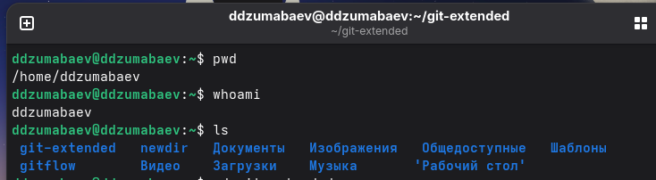
---

# 2. Работа с текстовыми файлами

## Создание файла

Создан пустой текстовый файл.

```bash
touch test.txt
```

Проверка создания файла.

```bash
ls -l test.txt
```
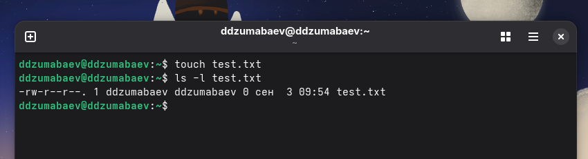
---

## Редактирование файла

Файл открыт в редакторе nano.

```bash
nano test.txt
```

В файл внесён следующий текст:

```text
Linux laboratory
File system
Commands
```
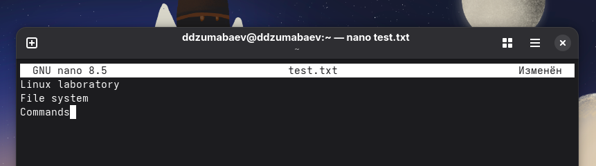
---

## Просмотр содержимого файла

Полный просмотр файла.

```bash
cat test.txt
```
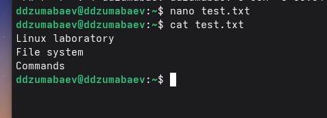

Просмотр первых строк.

```bash
head test.txt
head -2 test.txt
```
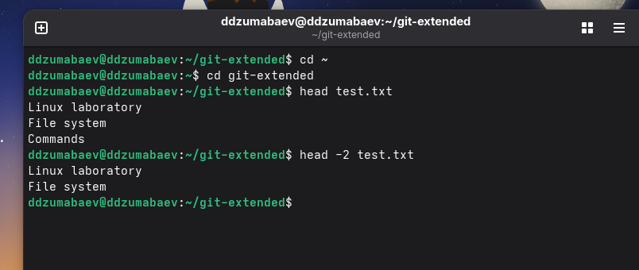
Просмотр последних строк.

```bash
tail test.txt
tail -1 test.txt
```
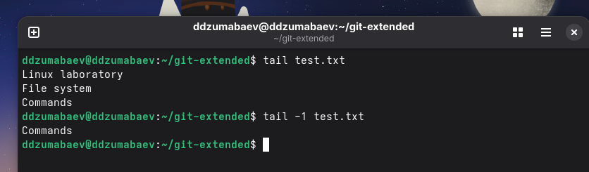
Просмотр файла постранично.

```bash
less test.txt
```
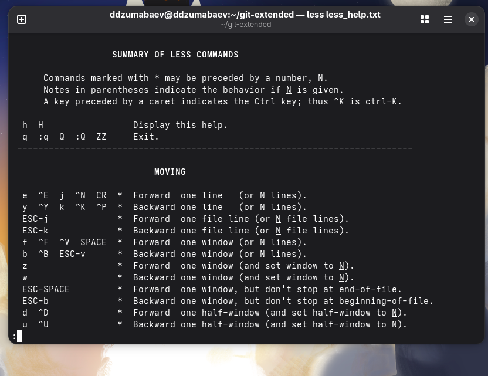

---

# 3. Копирование файлов и каталогов

Создан тестовый файл.

```bash
touch abc1
```
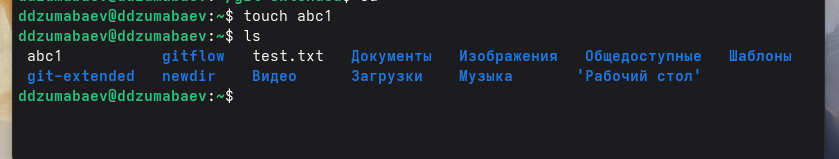

Созданы копии файла.

```bash
cp abc1 april
cp abc1 may
```
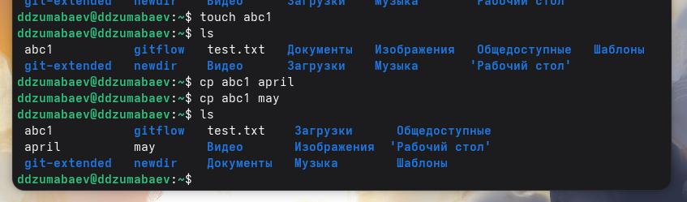

Создан каталог.

```bash
mkdir monthly
```
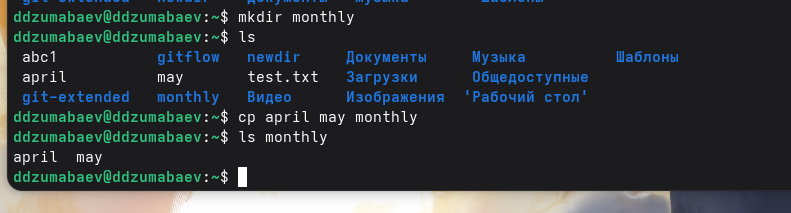

Копирование нескольких файлов.

```bash
cp april may monthly
```


Создание ещё одной копии файла.

```bash
cp monthly/may monthly/june
```
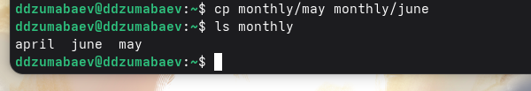

Создание каталога для копирования.

```bash
mkdir monthly.00
```
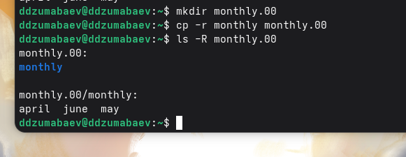

Рекурсивное копирование каталога.

```bash
cp -r monthly monthly.00
```


Проверка результата.

```bash
ls -R monthly.00
```


---

# 4. Перемещение и переименование файлов

Переименование файла.

```bash
mv april july
```
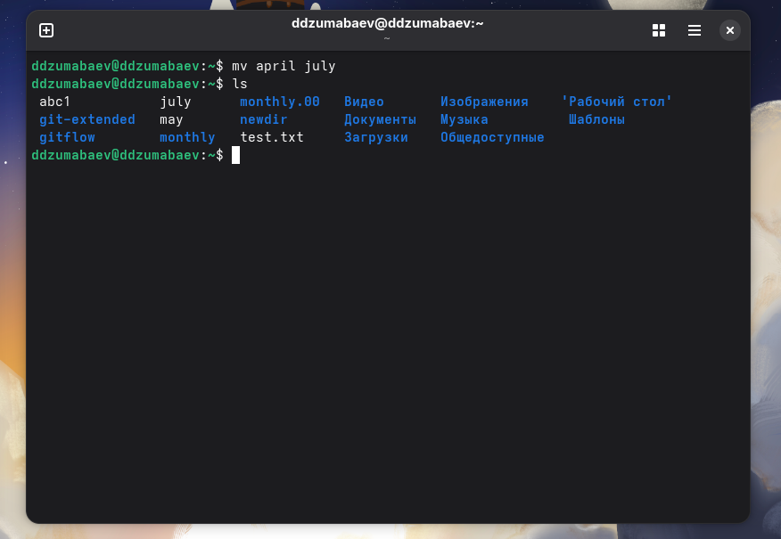

Перемещение файла.

```bash
mv july monthly.00
```


Переименование каталога.

```bash
mv monthly.00 monthly.01
```
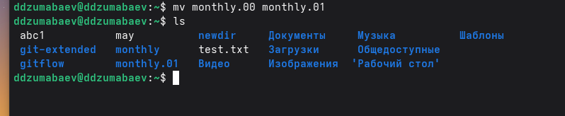

Создание каталога reports.

```bash
mkdir reports
```
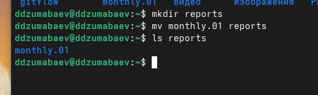

Перемещение каталога.

```bash
mv monthly.01 reports
```


Переименование каталога.

```bash
mv reports/monthly.01 reports/monthly
```
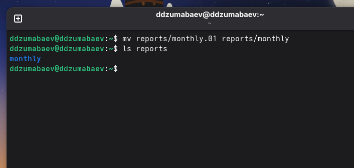

Просмотр структуры каталогов.

```bash
ls -R reports
```
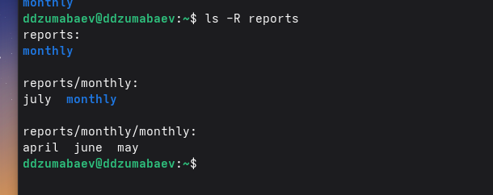

---

# 5. Выполнение практического задания

## Копирование файла

Скопирован файл из системного каталога.

```bash
cp /usr/include/sys/io.h ~/equipment
```
---

## Создание каталога

```bash
mkdir ~/ski.plases
```
---

## Перемещение файла

```bash
mv ~/equipment ~/ski.plases
```
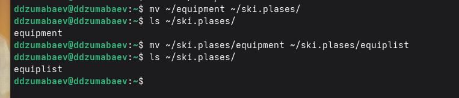

---

## Переименование файла

```bash
mv ~/ski.plases/equipment ~/ski.plases/equiplist
```


---

## Создание файла

```bash
touch ~/abc1
```
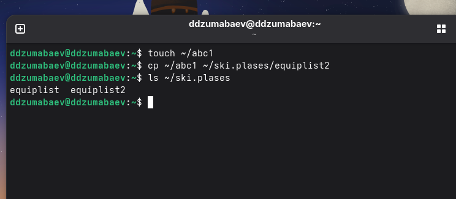

Копирование файла.

```bash
cp ~/abc1 ~/ski.plases/equiplist2
```


---

## Создание каталога

```bash
mkdir ~/ski.plases/equipment
```
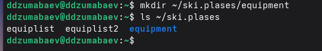

---

## Перемещение файлов

```bash
mv ~/ski.plases/equiplist \
~/ski.plases/equiplist2 \
~/ski.plases/equipment
```
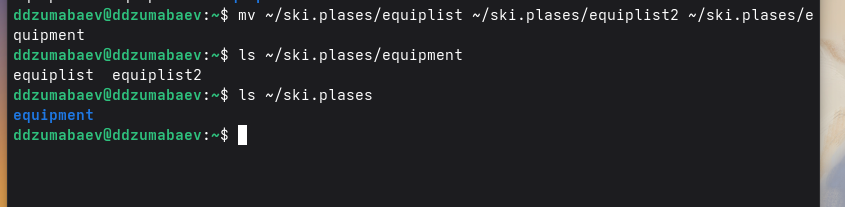

---

## Создание нового каталога

```bash
mkdir ~/newdir
```

Перемещение и переименование.

```bash
mv ~/newdir ~/ski.plases/plans
```
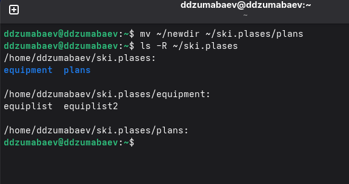

Проверка структуры каталогов.

```bash
ls -R ~/ski.plases
```


---

# 6. Работа с правами доступа

Создание каталога australia.

```bash
mkdir ~/australia
chmod 744 ~/australia
ls -ld ~/australia
```
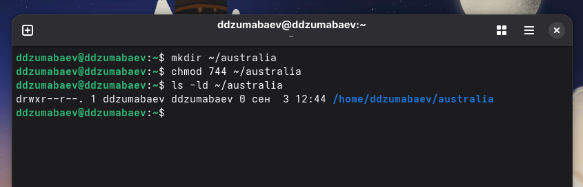

Создание каталога play.

```bash
mkdir ~/play
chmod 711 ~/play
ls -ld ~/play
```
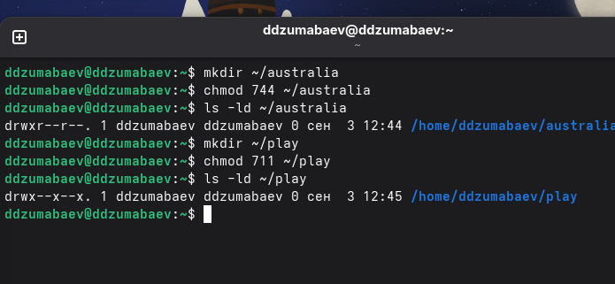

Создание файла my_os.

```bash
touch ~/my_os
chmod 544 ~/my_os
ls -l ~/my_os
```
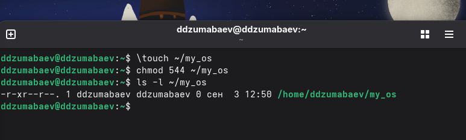

Создание файла feathers.

```bash
touch ~/feathers
chmod 664 ~/feathers
ls -l ~/feathers
```
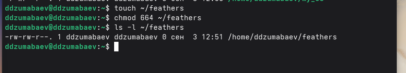

# 7. Выполнение упражнений

## Просмотр содержимого системного файла

Просмотр файла с информацией о пользователях системы.

```bash
cat /etc/passwd
```
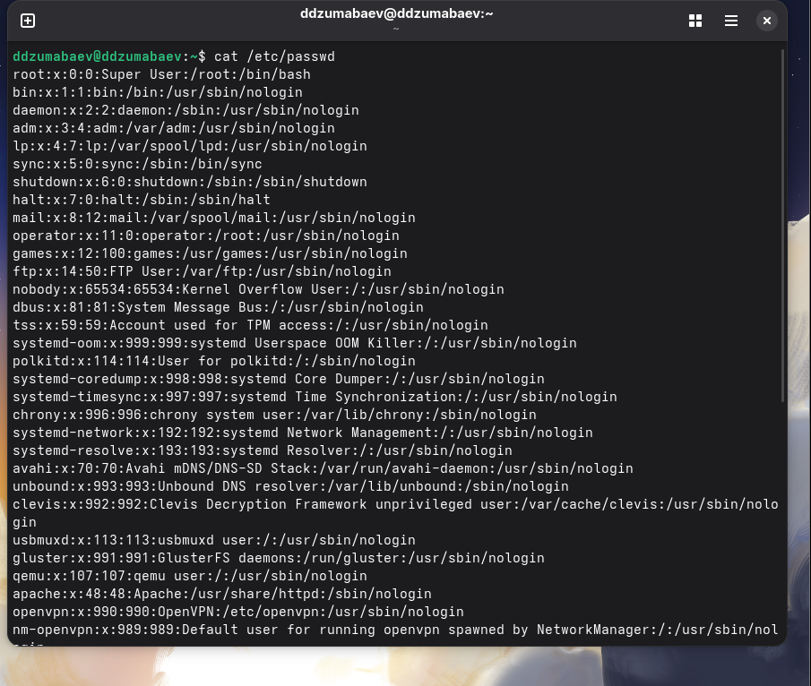
---

## Копирование файла

Создание копии файла `feathers`.

```bash
cp ~/feathers ~/file.old
```
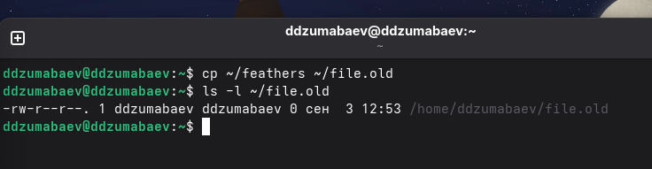
---

## Перемещение файла

Перемещение файла в каталог `play`.

```bash
mv ~/file.old ~/play
```
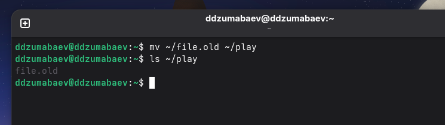
---

## Копирование каталога

Создание копии каталога.

```bash
cp -r ~/play ~/fun
```
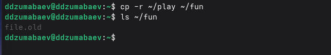
---

## Перемещение каталога

Перемещение каталога `fun` в каталог `play` с новым именем `games`.

```bash
mv ~/fun ~/play/games
```
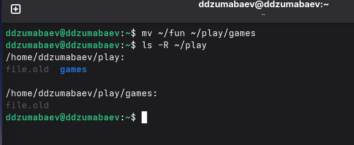

Просмотр структуры каталога.

```bash
ls -R ~/play
```

---

## Запрет владельцу чтения файла

Удаление права чтения.

```bash
chmod u-r ~/feathers
```
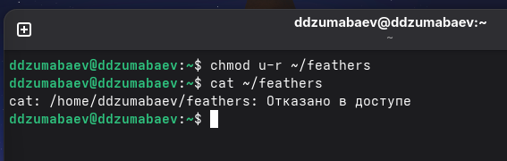

Проверка прав.

```bash
ls -l ~/feathers
```
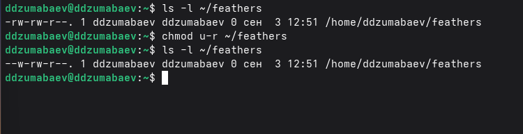
---

## Попытка просмотра файла

```bash
cat ~/feathers
```

### Результат

Система выдала сообщение **Permission denied**, так как владелец лишён права чтения файла.

---

## Попытка копирования файла

```bash
cp ~/feathers ~/copy.txt
```
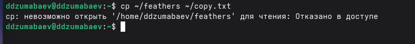
### Результат

Копирование не выполнено, поскольку отсутствовало право чтения исходного файла.

---

## Возврат права чтения

```bash
chmod u+r ~/feathers
```
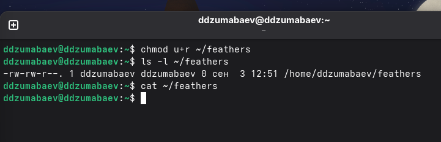
Проверка содержимого.

```bash
cat ~/feathers
```

---

## Запрет владельцу выполнения каталога

```bash
chmod u-x ~/play
```
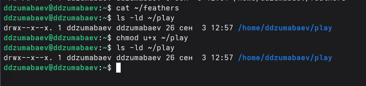

---

## Попытка перехода в каталог

```bash
cd ~/play
```


### Результат

Переход выполнить невозможно, так как отсутствует право выполнения (входа в каталог).

---

## Возврат права выполнения

```bash
chmod u+x ~/play
```
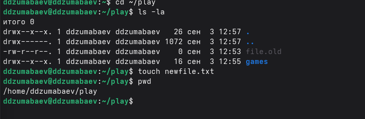

Проверка.

```bash
cd ~/play
pwd
```


---

# 8. Анализ файловой системы Linux

## Просмотр подключённых файловых систем

```bash
mount
```
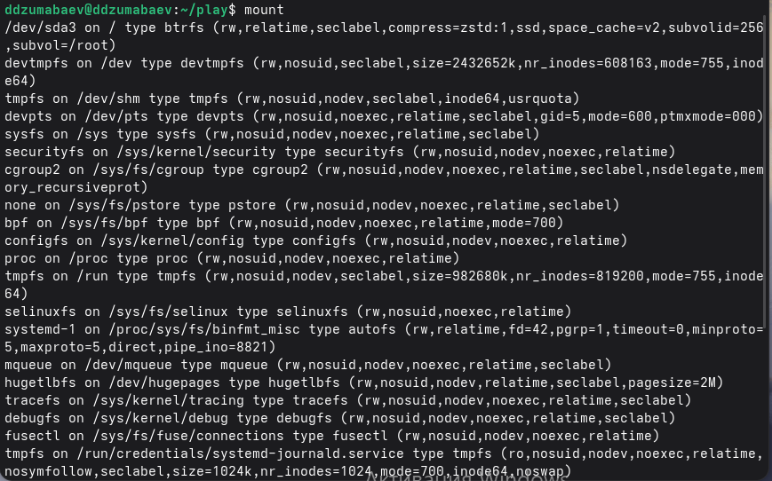


---

## Просмотр файла fstab

```bash
cat /etc/fstab
```
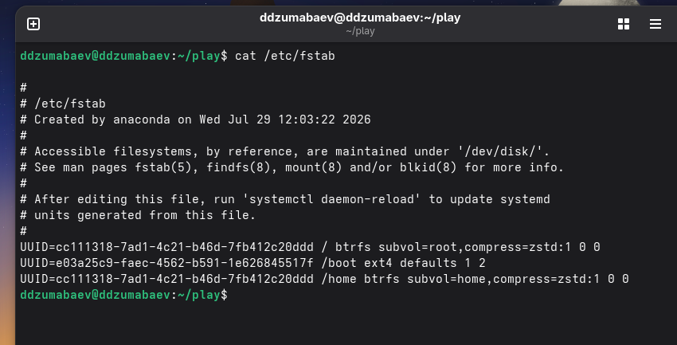


---

## Проверка использования дискового пространства

```bash
df -h
```
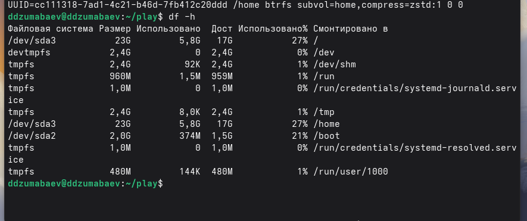


---

# 9. Изучение справочной документации

Изучена встроенная документация Linux с помощью команды `man`.

## Команда mount

```bash
man mount
```
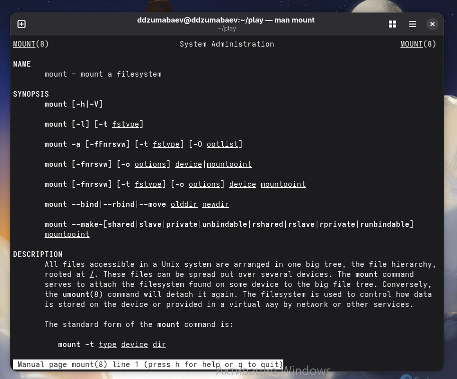

Назначение:

Команда предназначена для подключения файловых систем, просмотра уже подключённых устройств и управления параметрами монтирования.

---

## Команда fsck

```bash
man fsck
```
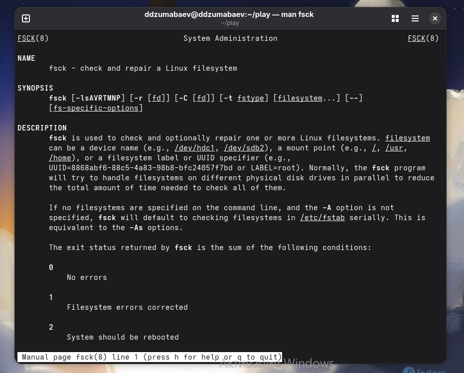

Назначение:

Команда используется для проверки и восстановления файловых систем после возникновения ошибок или некорректного завершения работы операционной системы.

---

## Команда mkfs

```bash
man mkfs
```
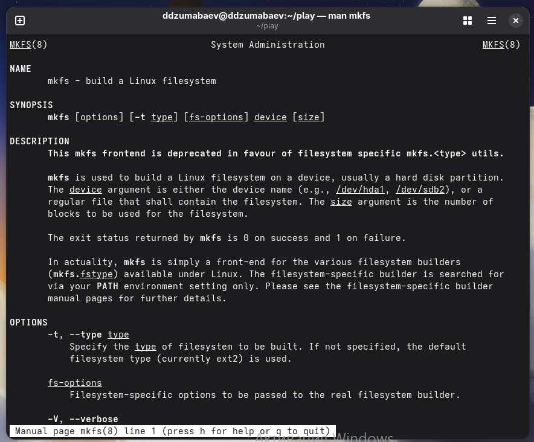

Назначение:

Команда предназначена для создания новой файловой системы на выбранном разделе жёсткого диска или другом устройстве хранения данных.

---

## Команда kill

```bash
man kill
```
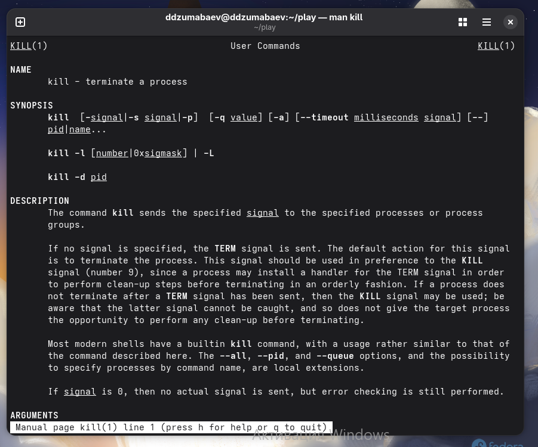


---

# Вывод

В ходе выполнения лабораторной работы были изучены структура файловой системы Linux и назначение основных системных каталогов. Получены практические навыки создания, просмотра, копирования, перемещения и переименования файлов и каталогов. Изучены права доступа к файлам и каталогам, освоено их изменение с помощью команды `chmod`. Выполнен анализ подключённых файловых систем, изучены команды `mount`, `df`, `fsck`, `mkfs` и `kill`. Полученные знания позволяют эффективно работать с файловой системой Linux и выполнять её базовое администрирование.

---

# Ответы на контрольные вопросы

## 1. Дайте характеристику каждой файловой системе, существующей на жёстком диске компьютера.

В используемой системе основная файловая система имеет тип **ext4**. Она обеспечивает высокую производительность, поддержку журналирования, устойчивость к сбоям и эффективную работу с файлами большого размера. Кроме ext4 в системе используются виртуальные файловые системы `tmpfs`, `proc`, `sysfs` и `devtmpfs`, предназначенные для хранения временных данных, информации о процессах, устройствах и параметрах ядра.

---

## 2. Приведите общую структуру файловой системы Linux.

Файловая система Linux имеет древовидную структуру, начинающуюся с корневого каталога `/`.

Основные каталоги первого уровня:

- `/bin` — основные исполняемые файлы;
- `/boot` — файлы загрузчика;
- `/dev` — файлы устройств;
- `/etc` — конфигурационные файлы;
- `/home` — домашние каталоги пользователей;
- `/lib`, `/lib64` — системные библиотеки;
- `/media` — автоматически подключаемые носители;
- `/mnt` — временные точки монтирования;
- `/opt` — дополнительное программное обеспечение;
- `/proc` — информация о процессах и ядре;
- `/root` — домашний каталог администратора;
- `/run` — временные данные служб;
- `/srv` — данные сервисов;
- `/sys` — сведения об оборудовании и ядре;
- `/tmp` — временные файлы;
- `/usr` — пользовательские программы и библиотеки;
- `/var` — журналы, кэш и изменяемые данные.

---

## 3. Какая операция должна быть выполнена, чтобы файловая система стала доступной?

Для использования файловой системы необходимо выполнить её **монтирование** в дерево каталогов операционной системы с помощью команды `mount`.

---

## 4. Назовите причины нарушения целостности файловой системы.

Основными причинами являются:

- аварийное отключение питания;
- аппаратные неисправности накопителя;
- ошибки программного обеспечения;
- повреждение структуры файловой системы;
- некорректное завершение работы операционной системы.

Для восстановления используется команда `fsck`.

---

## 5. Как создаётся файловая система?

Файловая система создаётся с помощью команды `mkfs`, которая записывает на раздел необходимые служебные структуры выбранного типа файловой системы.

---

## 6. Дайте характеристику командам просмотра текстовых файлов.

- `cat` — выводит содержимое файла полностью.
- `less` — обеспечивает постраничный просмотр больших файлов.
- `head` — отображает начало файла.
- `tail` — отображает последние строки файла.

---

## 7. Основные возможности команды `cp`.

Команда `cp` позволяет:

- копировать отдельные файлы;
- копировать несколько файлов одновременно;
- копировать каталоги рекурсивно (`cp -r`);
- сохранять атрибуты файлов;
- выполнять копирование с подтверждением перезаписи (`cp -i`).

---

## 8. Основные возможности команды `mv`.

Команда `mv` позволяет:

- перемещать файлы;
- перемещать каталоги;
- переименовывать файлы;
- переименовывать каталоги;
- выполнять перемещение с подтверждением перезаписи (`mv -i`).

---

## 9. Что такое права доступа? Как они изменяются?

Права доступа определяют, какие действия могут выполнять владелец файла, группа пользователей и остальные пользователи. Разрешены три основных действия:

- чтение (`r`);
- запись (`w`);
- выполнение (`x`).

Изменение прав осуществляется командой `chmod` как в символьной форме (`u+r`, `g-w`, `o+x`), так и в цифровой форме (`755`, `744`, `664` и др.).
```**

---