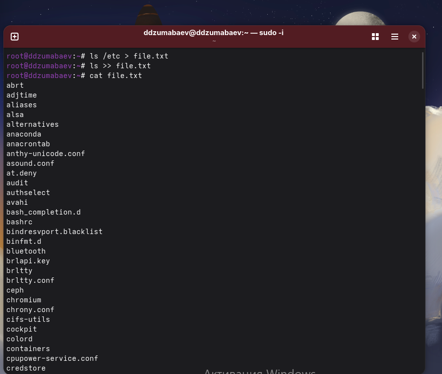
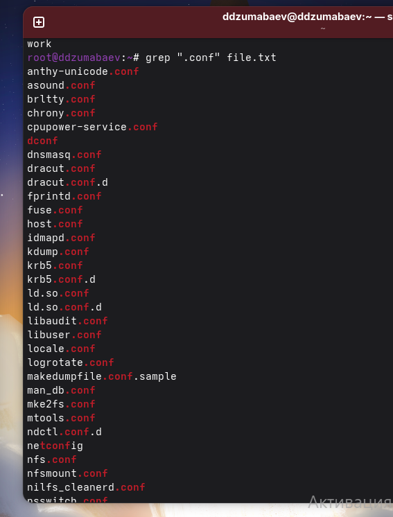
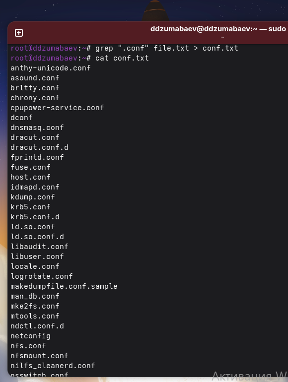
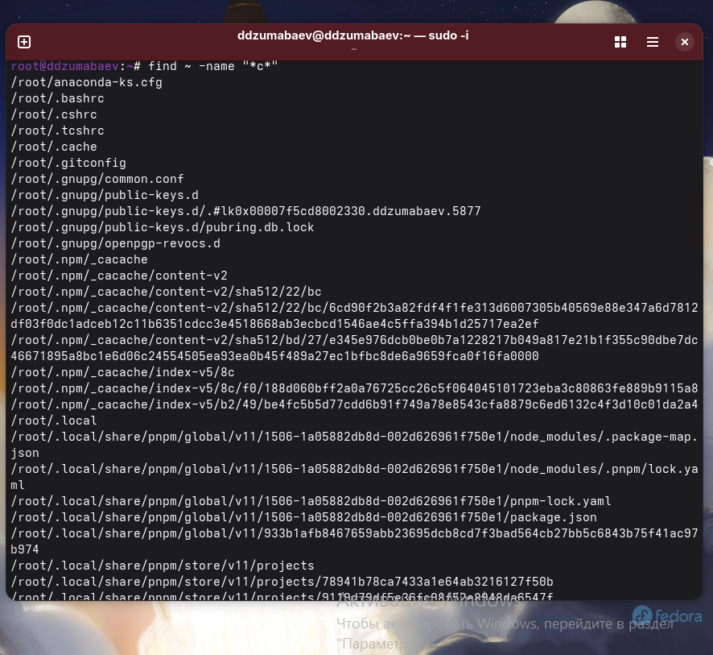
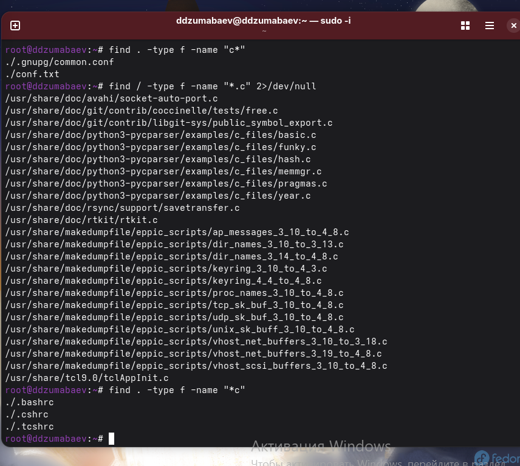
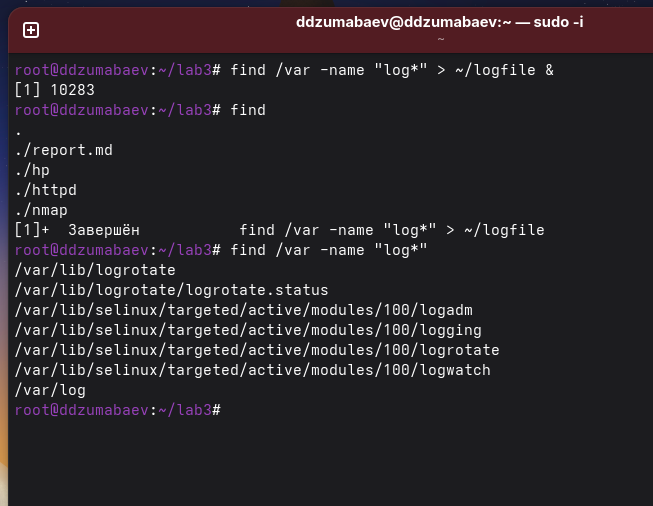
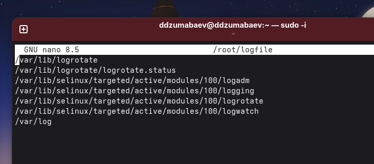
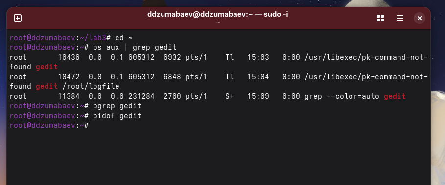
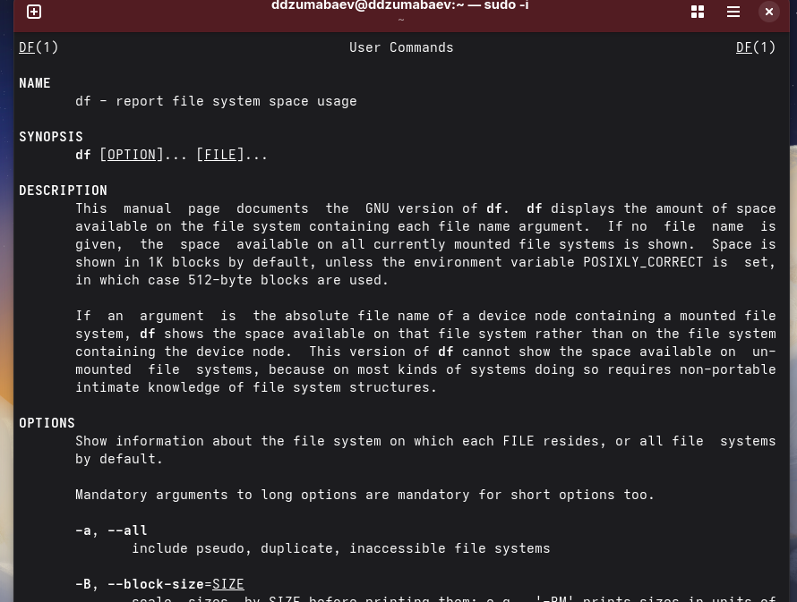
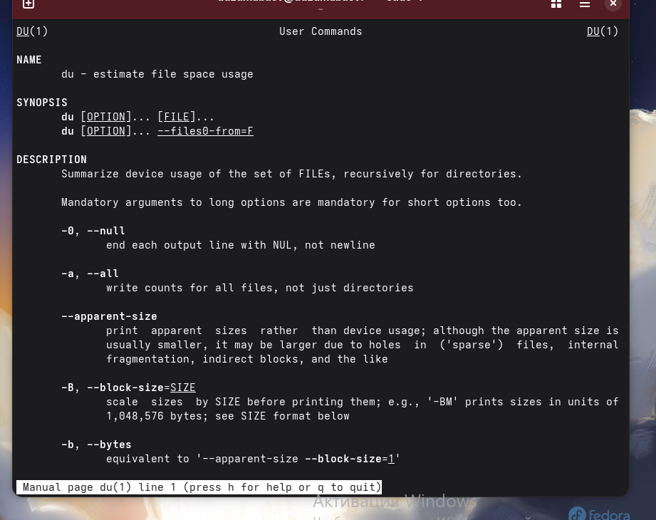

# Лабораторная работа №8

## Поиск файлов, перенаправление ввода-вывода и управление процессами

**Дисциплина:** Архитектура компьютера и операционные системы

**Выполнил:** Damir Jumabaev 
**Группа:** НКАбд-02-25

**2026 г.**

---

# Цель работы

## Основные задачи

- Изучить поиск файлов и каталогов в Linux
- Освоить перенаправление стандартного вывода
- Изучить стандартные потоки `stdin`, `stdout`, `stderr`
- Научиться использовать конвейеры команд
- Освоить запуск процессов в фоновом режиме
- Научиться определять PID процессов
- Изучить завершение процессов
- Научиться определять использование дискового пространства

---

# Стандартные потоки Linux

В Linux используются три стандартных потока:

| Поток | Дескриптор | Назначение |
|---|---:|---|
| `stdin` | `0` | стандартный ввод |
| `stdout` | `1` | стандартный вывод |
| `stderr` | `2` | сообщения об ошибках |

### Перенаправление

```bash
command > file.txt
```

Записывает вывод команды в файл.

```bash
command >> file.txt
```

Добавляет вывод в конец файла.

```bash
command 2>/dev/null
```

Скрывает сообщения об ошибках.

---

# Создание и обработка файлов

Для создания файла с результатом выполнения команды использовалось:

```bash
ls /etc > file.txt
```

После этого в файл добавлялся список файлов:

```bash
ls >> file.txt
```

Просмотр содержимого:

```bash
cat file.txt
```

Для поиска строк с `.conf`:

```bash
grep ".conf" file.txt
```

Результат поиска можно сохранить:

```bash
grep ".conf" file.txt > conf.txt
```
---


---


---


---

# Поиск файлов и конвейеры

Для поиска использовалась команда:

```bash
find ~ -name "c*"
```

Поиск только обычных файлов:

```bash
find . -type f -name "c*"
```

### Конвейер команд

```bash
ls /etc | grep "^h" | less
```

Здесь:

1. `ls` получает список файлов;
2. `grep` фильтрует результат;
3. `less` позволяет просматривать его постранично.

---


---


---


---

# Поиск в фоновом режиме

Для запуска поиска в фоновом режиме использовалась команда:

```bash
find /var -name "log*" > ~/logfile &
```

Символ:

```text
&
```

запускает команду в фоновом режиме.

Для просмотра фоновых задач:

```bash
jobs
```

Результат поиска сохранялся в:

```text
~/logfile
```

При поиске некоторых системных каталогов появились сообщения:

```text
Отказано в доступе
```

Это связано с отсутствием прав доступа обычного пользователя.

---


---


# Работа с процессами

После запуска программы:

```bash
gedit &
```

она продолжает работать в фоновом режиме.

Для просмотра процессов используется:

```bash
ps aux
```

Для поиска `gedit`:

```bash
ps aux | grep gedit
```

Также PID можно определить:

```bash
pgrep gedit
```

или:

```bash
pidof gedit
```
---


---


---


# Завершение процесса

После определения PID процесса `gedit` его можно завершить:

```bash
kill PID
```

Например:

```bash
kill 14582
```

После этого состояние проверяется:

```bash
ps aux | grep gedit
```

Если обычное завершение не сработало, существует принудительный вариант:

```bash
kill -9 PID
```

Таким образом, PID позволяет адресно управлять конкретным процессом.

---


---
# Анализ дискового пространства

Для просмотра состояния файловых систем используется:

```bash
df -h
```

Команда показывает:

- общий размер;
- занятое пространство;
- свободное пространство;
- процент использования.

Для определения размера домашнего каталога:

```bash
du -sh ~
```

### Различие

```text
df → состояние файловой системы
du → размер конкретного каталога или файла
```
---


---

# Основные команды лабораторной работы

В ходе работы были изучены:

```text
ls       — просмотр содержимого
cat      — просмотр файла
grep     — поиск текста
find     — поиск файлов
less     — постраничный просмотр
jobs     — фоновые задачи
ps       — список процессов
pgrep    — поиск PID
pidof    — определение PID
kill     — завершение процесса
df       — свободное место
du       — размер каталогов
rm       — удаление файлов
man      — справочная система
```

---

# Результаты работы

В ходе лабораторной работы были получены практические навыки:

- поиска файлов и каталогов;
- работы с `grep` и `find`;
- перенаправления потоков;
- использования конвейеров;
- запуска фоновых процессов;
- определения PID;
- управления процессами;
- анализа дискового пространства.

Практические задания выполнялись в **Fedora Linux**.

---

# Заключение

В ходе лабораторной работы №8 были изучены основные возможности командной строки Linux.

Была освоена работа с файлами, потоками ввода-вывода и конвейерами команд.

На практике был рассмотрен полный цикл управления процессом:

```text
запуск → определение PID → проверка → завершение
```

Также были изучены команды:

```bash
find
grep
ps
pgrep
pidof
kill
df
du
```

Полученные навыки являются основой для дальнейшей работы с операционной системой Linux и её командной строкой.

## Работа выполнена.