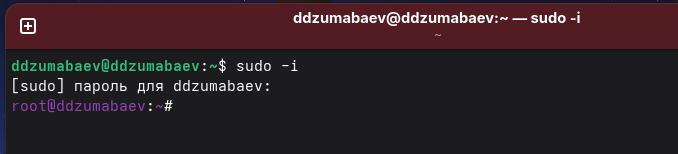
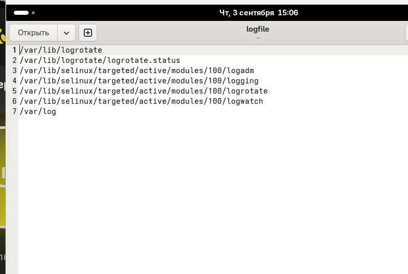
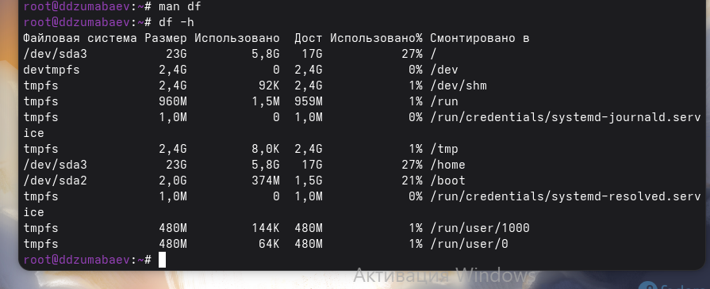
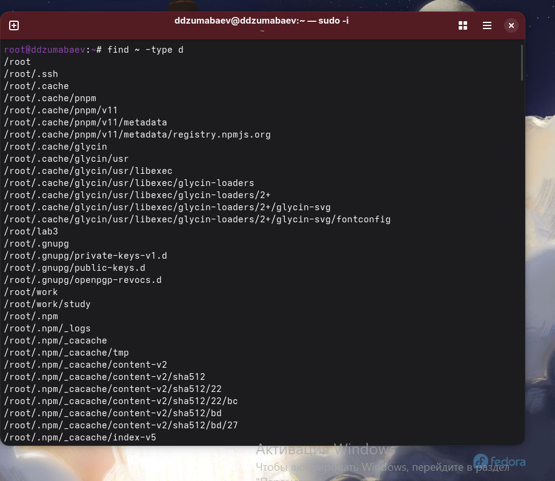
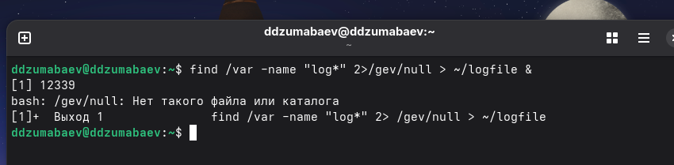

### «Российский университет дружбы народов имени Патриса Лумумбы»

#### Факультет физико-математических и естественных наук

<br><br>

# Лабораторная работа №8

## По дисциплине

# «Архитектура компьютера и операционные системы»

### Тема

## **Поиск файлов. Перенаправление ввода-вывода. Управление процессами**

<br><br><br>

Выполнил:

**Damir Jumabaev**

Группа **НКАбд-02-25**

Москва

2026 г.

---

# Цель работы

Изучить основные средства поиска файлов в операционной системе Linux, освоить использование перенаправления стандартных потоков ввода и вывода, познакомиться с принципом работы конвейеров команд, научиться запускать процессы в фоновом режиме, получать сведения о выполняющихся процессах и управлять ими, а также изучить команды определения использования дискового пространства.

---

# Теоретические сведения

Операционная система Linux предоставляет пользователю большое количество консольных утилит для выполнения повседневных задач администрирования.

Одной из наиболее востребованных возможностей является поиск файлов и каталогов. Для этого используется команда `find`, позволяющая выполнять поиск по имени объекта, типу, владельцу, времени изменения, размеру и другим параметрам.

Для поиска информации внутри файлов применяется утилита `grep`, которая позволяет находить строки, удовлетворяющие заданному шаблону.

В Linux используются три стандартных потока ввода-вывода:

- **stdin** — стандартный поток ввода;
- **stdout** — стандартный поток вывода;
- **stderr** — поток сообщений об ошибках.

Для перенаправления стандартного вывода используются операторы:

- `>` — создание нового файла или перезапись существующего;
- `>>` — добавление информации в конец существующего файла.

При совместном использовании нескольких команд применяется механизм конвейера (`|`), который передает результат выполнения одной команды на вход другой.

Кроме работы с файлами важной частью лабораторной работы является изучение процессов операционной системы. Каждый запущенный экземпляр программы представляет собой отдельный процесс, имеющий собственный идентификатор (PID). Для просмотра процессов используются команды `ps`, `pgrep`, `pidof`, а для завершения процесса применяется команда `kill`.

---

# Выполнение лабораторной работы

## Задание 1. Подготовка рабочего окружения

После запуска виртуальной машины Fedora был выполнен вход в систему под учетной записью пользователя. Для выполнения лабораторной работы был открыт терминал Linux, в котором выполнялись все дальнейшие действия.



## Задание 2. Создание файла file.txt

Сначала был осуществлен переход в домашний каталог пользователя.

```bash
cd ~
```

Для записи содержимого каталога `/etc` в текстовый файл использовалась команда:

```bash
ls /etc > file.txt
```

Оператор `>` создал новый файл `file.txt` и записал в него результат выполнения команды.

Затем в этот же файл был добавлен список файлов домашнего каталога пользователя:

```bash
ls >> file.txt
```

В данном случае был использован оператор `>>`, который не удаляет уже существующее содержимое файла, а дописывает новую информацию в его конец.

Для проверки результата была выполнена команда:

```bash
cat file.txt
```

В результате выполнения задания был создан текстовый файл, содержащий объединённый список файлов каталога `/etc` и домашнего каталога пользователя.


## Задание 3. Поиск файлов конфигурации

Следующим этапом лабораторной работы являлся поиск строк, содержащих расширение `.conf`.

Для этого использовалась команда:

```bash
grep ".conf" file.txt
```

Команда просмотрела содержимое файла `file.txt` и вывела только те строки, которые содержали указанную последовательность символов.

Полученный результат был записан в отдельный файл:

```bash
grep ".conf" file.txt > conf.txt
```

После завершения поиска содержимое нового файла было проверено командой:

```bash
cat conf.txt
```

В результате выполнения задания был создан файл `conf.txt`, содержащий список найденных файлов конфигурации.

При выполнении данного этапа были изучены возможности утилиты `grep`, предназначенной для поиска информации по заданному шаблону, а также повторно использовано перенаправление стандартного вывода в файл.


---

## Задание 4. Поиск файлов, начинающихся с буквы c

На следующем этапе требовалось найти файлы, имена которых начинаются с символа `c`. Для выполнения задания были рассмотрены несколько вариантов поиска.

### Первый способ — использование команды find

```bash
find ~ -name "c*"
```

Команда выполняет поиск в домашнем каталоге пользователя. Параметр `-name` задаёт условие поиска по имени, а шаблон `"c*"` означает, что имя объекта должно начинаться с буквы `c`, после которой могут находиться любые символы.

Таким образом, команда позволяет выполнять рекурсивный поиск по домашнему каталогу.

### Второй способ — использование ls и grep

```bash
ls | grep "^c"
```


В данном случае сначала команда `ls` формирует список объектов текущего каталога. Затем при помощи конвейера `|` полученный результат передаётся команде `grep`.

Символ `^` в регулярном выражении обозначает начало строки. Поэтому выражение `^c` позволяет выбрать только те строки, которые начинаются с буквы `c`.

Данный пример демонстрирует принцип работы конвейера: результат одной команды используется как входные данные для другой.

### Третий способ — поиск только обычных файлов

```bash
find . -type f -name "c*"
```


В отличие от первого варианта здесь дополнительно используется параметр `-type f`. Он ограничивает результаты поиска только обычными файлами.

В результате были рассмотрены различные способы поиска объектов файловой системы и фильтрации полученной информации.

**Скриншот 4 — Поиск файлов, начинающихся с буквы c, несколькими способами.**

---

## Задание 5. Постраничный просмотр файлов каталога /etc

Далее требовалось вывести список файлов каталога `/etc`, имена которых начинаются с буквы `h`, с возможностью постраничного просмотра.

Для этого была использована команда:

```bash
ls /etc | grep "^h" | less
```

Выполнение команды происходит последовательно.

Сначала:

```bash
ls /etc
```

выводит содержимое каталога `/etc`.

Затем при помощи первого конвейера:

```bash
|
```

результат передаётся команде:

```bash
grep "^h"
```

Она оставляет только строки, начинающиеся с буквы `h`.

После этого результат передаётся программе:

```bash
less
```

которая позволяет просматривать большой объём текста постранично.

Таким образом, в одной команде были объединены сразу несколько операций:

```text
ls → grep → less
```

Это является примером использования конвейеров команд Linux.

Для выхода из программы `less` была использована клавиша:

```text
q
```


Использование конвейеров позволяет строить последовательности команд, в которых результат работы одной программы становится входными данными следующей. Это особенно удобно при обработке больших объёмов текстовой информации.

---

## Задание 6. Поиск файлов в фоновом режиме

На следующем этапе требовалось выполнить поиск файлов, начинающихся с `log`, в каталоге `/var` и сохранить результаты поиска в файл `logfile`.

Для этого была использована команда:

```bash
find /var -name "log*" > ~/logfile &
```


В этой команде одновременно используются несколько изученных ранее возможностей командной строки.

Команда:

```bash
find /var -name "log*"
```

выполняет поиск объектов в каталоге `/var`, имена которых начинаются с `log`.

Оператор:

```text
>
```

перенаправляет стандартный вывод команды в файл:

```text
~/logfile
```

Вместо вывода найденных путей непосредственно в терминал они записываются в указанный файл.

Символ:

```text
&
```

запускает команду в фоновом режиме. Благодаря этому терминал сразу возвращается к приглашению командной строки и может принимать следующие команды, пока поиск продолжает выполняться.

После запуска команды система вывела сообщение с номером фонового задания и PID процесса, например:

```text
[1] 12852
```

Здесь `1` — номер фонового задания, а `12852` — идентификатор процесса.

Для просмотра текущих фоновых заданий была использована команда:

```bash
jobs
```

После завершения поиска можно проверить созданный файл:

```bash
ls -l ~/logfile
```

и посмотреть начало его содержимого:

```bash
head ~/logfile
```

При выполнении поиска в некоторых системных каталогах появились сообщения:

```text
Отказано в доступе
```

Это связано с тем, что обычный пользователь не имеет прав доступа ко всем каталогам внутри `/var`. Данные сообщения не означают ошибку самой команды поиска: процесс продолжил работу и записал доступные результаты в `logfile`.

В случае необходимости сообщения об ошибках можно перенаправить отдельно:

```bash
find /var -name "log*" 2>/dev/null > ~/logfile &
```


Здесь файловый дескриптор `2` соответствует стандартному потоку ошибок `stderr`, а `/dev/null` используется для игнорирования этих сообщений.

Таким образом, при выполнении данного задания были практически применены сразу несколько важных механизмов Linux: поиск файлов, перенаправление вывода, работа с потоками и запуск команд в фоновом режиме.

---

# Промежуточный результат

В первой части лабораторной работы были освоены операции работы с файлами и текстовыми данными.

Были практически применены:

- перенаправление вывода при помощи `>`;
- добавление данных в файл при помощи `>>`;
- поиск информации при помощи `grep`;
- поиск файлов и каталогов при помощи `find`;
- использование конвейеров `|`;
- постраничный просмотр информации с помощью `less`;
- запуск команд в фоновом режиме с помощью `&`;
- просмотр фоновых заданий с помощью `jobs`;
- работа со стандартным потоком ошибок `stderr`.

Полученные навыки будут использованы в следующих заданиях лабораторной работы при изучении удаления файлов и управления процессами.

# Задание 7. Удаление файла logfile

После завершения фонового поиска был выполнен переход к следующему этапу лабораторной работы — удалению созданного ранее файла `logfile`.

Для удаления файла была использована команда:

```bash
rm ~/logfile
```

Команда `rm` предназначена для удаления файлов и каталогов. В данном случае символ `~` обозначает домашний каталог текущего пользователя, поэтому команда удаляет файл:

```text
/home/yalkabov/logfile
```

После выполнения удаления была проведена проверка содержимого домашнего каталога:

```bash
ls ~
```

Файл `logfile` в списке отсутствовал, что подтвердило успешное выполнение операции удаления.

На данном этапе была закреплена работа с файлами из командной строки Linux, а также изучена команда `rm`.

## 

# Задание 8. Запуск текстового редактора gedit в фоновом режиме

Для дальнейшего изучения процессов был запущен графический текстовый редактор `gedit`.

Запуск программы выполнялся следующей командой:

```bash
gedit &
```

Символ `&` в конце команды указывает оболочке запустить программу в фоновом режиме.

После выполнения команды окно редактора `gedit` открылось, при этом терминал не был заблокирован и продолжил принимать команды.

При запуске фонового процесса оболочка также выводит информацию о номере задания и идентификаторе процесса, например:

```text
[1] 13765
```

В данном случае:

- `1` — номер фонового задания;
- `13765` — PID запущенного процесса.

PID является уникальным идентификатором процесса, который операционная система использует для его идентификации и управления им.

Для данного задания важно было оставить `gedit` запущенным, поскольку на следующем этапе его идентификатор требовалось определить с помощью системных команд.

## 

# Задание 9. Определение идентификатора процесса gedit

После запуска `gedit` необходимо было определить его идентификатор процесса — PID.

Для просмотра списка запущенных процессов была использована команда:

```bash
ps aux
```

Команда `ps` предназначена для отображения информации о текущих процессах системы.

Чтобы из большого списка выбрать только строки, относящиеся к `gedit`, был использован конвейер:

```bash
ps aux | grep gedit
```

В данной конструкции:

```text
ps aux
```

формирует список процессов, а:

```text
|
```


передаёт результат выполнения первой команды на вход второй.

Команда:

```bash
grep gedit
```


оставляет только строки, содержащие слово `gedit`.

Пример результата:

```text
yalkabov   14004  ... gedit ...
yalkabov   14201  ... grep gedit
```

В данном случае числовое значение:

```text
14004
```

является PID процесса `gedit`.

Строку с:

```text
grep gedit
```

необходимо отличать от самого `gedit`. Она появляется потому, что в момент выполнения команды `grep` сама утилита также является запущенным процессом.

---

## Определение PID с помощью pgrep

Для более удобного получения PID была использована команда:

```bash
pgrep gedit
```

Она выводит идентификатор процесса, соответствующего указанному имени.

Например:

```text
14004
```

Полученный номер соответствует PID процесса `gedit`.

---

## Определение PID с помощью pidof

Дополнительно была использована команда:

```bash
pidof gedit
```

Эта команда также позволяет получить PID запущенного процесса по его имени.

Таким образом, PID процесса `gedit` был определён несколькими способами:

```bash
ps aux | grep gedit
```

```bash
pgrep gedit
```

```bash
pidof gedit
```

Использование нескольких способов позволяет убедиться в правильности полученного идентификатора.

Полученный PID необходим для следующего задания, в котором процесс `gedit` будет завершён при помощи команды `kill`.


# Связь с контрольными вопросами

Выполнение данного этапа позволяет практически понять понятие **процесса**. Программа представляет собой набор инструкций, хранящийся в файловой системе, а процесс является выполняющимся экземпляром этой программы.

Каждый процесс получает уникальный идентификатор **PID (Process ID)**. Именно этот идентификатор используется операционной системой для обращения к конкретному процессу.

В лабораторной работе PID процесса `gedit` был определён при помощи:

```bash
ps aux | grep gedit
```

а также:

```bash
pgrep gedit
```

и:

```bash
pidof gedit
```

Таким образом, полученные в ходе выполнения практические навыки одновременно позволяют ответить на вопросы о назначении процессов, PID и командах просмотра запущенных процессов.

---# Задание 10. Завершение процесса gedit

После определения идентификатора процесса `gedit` необходимо было завершить его работу.

Для завершения процесса используется команда:

```bash
kill PID
```

где `PID` заменяется фактическим идентификатором процесса.

Например, если ранее команда:

```bash
pgrep gedit
```

показала:

```text
14004
```

то для завершения процесса необходимо выполнить:

```bash
kill 14004
```

После выполнения команды процесс `gedit` должен завершиться, а открытое окно текстового редактора — закрыться.

Для проверки результата была повторно выполнена команда:

```bash
ps aux | grep gedit
```

Если процесс `gedit` был успешно завершён, строка с самим редактором отсутствует. Может остаться строка:

```text
grep gedit
```

Она относится уже к самой команде поиска и не является процессом `gedit`.

Таким образом, команда `kill` позволяет управлять процессами при помощи их PID.

В случае зависания процесса Linux также позволяет использовать принудительное завершение:

```bash
kill -9 PID
```

Однако в рамках данной лабораторной работы для штатного завершения `gedit` достаточно обычной команды:

```bash
kill PID
```

---

# Задание 11. Определение использования дискового пространства

Следующим этапом работы было изучение команд, предназначенных для определения объёма занятого и свободного дискового пространства.

Перед использованием команды `df` была открыта встроенная справочная документация:

```bash
man df
```


Справочная система `man` позволяет получить описание назначения команды, её параметров и вариантов использования.

После просмотра справочной информации был выполнен выход из программы нажатием:

```text
q
```

Затем была выполнена команда:

```bash
df -h
```

Параметр `-h` означает вывод информации в удобном для человека формате. Размеры дискового пространства отображаются с соответствующими единицами измерения, например `M`, `G` и т. д.

Команда `df` позволяет определить:

- общий размер файловой системы;
- использованное пространство;
- доступное свободное пространство;
- процент использования;
- точку монтирования файловой системы.

Таким образом, команда `df -h` позволяет быстро оценить состояние дискового пространства.

---

## Определение размера домашнего каталога

Для определения объёма домашнего каталога была предварительно изучена справочная информация по команде `du`:

```bash
man du
```


После просмотра справки был выполнен выход:

```text
q
```

Затем была выполнена команда:

```bash
du -sh ~
```

В данной команде:

- `du` показывает использование дискового пространства;
- `-s` выводит только итоговый размер;
- `-h` использует удобный для чтения формат;
- `~` обозначает домашний каталог текущего пользователя.

В результате команда показала общий объём дискового пространства, занимаемый домашним каталогом пользователя.

Таким образом, `df` и `du` используются для разных задач:

```text
df → информация о файловых системах и свободном месте;
du → размер конкретных каталогов и файлов.
```

Это позволяет определить как свободное пространство файловой системы, так и объём, занимаемый конкретным каталогом.

---

# Задание 12. Поиск всех каталогов

На последнем этапе лабораторной работы требовалось выполнить поиск каталогов.

Для этого была использована команда:

```bash
find ~ -type d
```

Здесь:

```text
find
```

— команда поиска объектов файловой системы;

```text
~
```

— домашний каталог текущего пользователя;

```text
-type d
```

— условие, ограничивающее результаты только каталогами.

В результате команда выполнила рекурсивный поиск и вывела список каталогов, расположенных внутри домашнего каталога пользователя.

Данное задание закрепило навыки работы с командой `find`. Ранее она использовалась для поиска объектов по имени, а теперь — для фильтрации объектов по типу.

Таким образом, с помощью параметров `find` можно выполнять поиск не только по названию, но и по другим характеристикам файловой системы.


---

# Итог выполнения лабораторной работы

В ходе лабораторной работы были последовательно изучены основные возможности командной строки Linux, связанные с поиском файлов, обработкой текстовой информации и управлением процессами.

В процессе выполнения заданий были использованы следующие команды:

```bash
ls
cat
grep
find
less
jobs
rm
gedit
ps
pgrep
pidof
kill
df
du
man
```

Были практически рассмотрены три стандартных потока ввода-вывода:

- стандартный ввод `stdin`;
- стандартный вывод `stdout`;
- стандартный поток ошибок `stderr`.

На практике были использованы операторы перенаправления:

```text
>
>>
```

а также конвейер:

```text
|
```

Использование `>` позволило сохранить результат выполнения команды в файл, а `>>` — добавить новые данные в конец существующего файла.

Конвейер `|` позволил объединять несколько команд. Например:

```bash
ls /etc | grep "^h" | less
```

сначала получил список файлов, затем отфильтровал его и передал результат программе постраничного просмотра.

При выполнении поиска в каталоге `/var` было также продемонстрировано использование стандартного потока ошибок:

```bash
find /var -name "log*" 2>/dev/null
```

Сообщения об отсутствии прав доступа относятся к потоку `stderr`, поэтому их можно перенаправить в `/dev/null`.

Кроме работы с файлами были изучены процессы. После запуска `gedit` в фоновом режиме:

```bash
gedit &
```

был определён его PID с помощью:

```bash
ps aux | grep gedit
```

а также:

```bash
pgrep gedit
```

и:

```bash
pidof gedit
```

После этого процесс был завершён командой:

```bash
kill PID
```

Полученные навыки позволяют управлять выполняющимися программами и контролировать состояние процессов операционной системы.

Для анализа дискового пространства были изучены команды:

```bash
df -h
```

и:

```bash
du -sh ~
```

Первая команда позволяет определить состояние файловых систем и свободное пространство, а вторая — размер конкретного каталога.

---

# Заключение

В ходе выполнения лабораторной работы №8 были получены практические навыки работы в командной строке операционной системы Fedora Linux.

Были изучены способы поиска файлов и каталогов с использованием `find`, поиска текста с помощью `grep`, постраничного просмотра информации посредством `less`, а также объединения команд с помощью конвейеров.

Отдельное внимание было уделено перенаправлению потоков ввода-вывода. Были рассмотрены стандартные потоки `stdin`, `stdout` и `stderr`, а также операторы `>` и `>>`. На практике результаты выполнения команд записывались в файлы, а сообщения об ошибках могли перенаправляться отдельно.

Вторая часть работы была посвящена процессам. Был выполнен запуск `gedit` в фоновом режиме, определён его PID и выполнено завершение процесса с использованием команды `kill`.

Также были изучены команды `df` и `du`, позволяющие анализировать использование дискового пространства, и закреплено использование `find` для поиска каталогов.

Таким образом, поставленная цель лабораторной работы была достигнута. Полученные навыки являются основой для дальнейшей работы с командной строкой, процессами и файловой системой Linux.# Контрольные вопросы

## 1. Какие потоки ввода-вывода существуют в Linux?

В Linux используются три стандартных потока ввода-вывода:

- `stdin` — стандартный поток ввода, файловый дескриптор `0`. Обычно данные поступают с клавиатуры;
- `stdout` — стандартный поток вывода, файловый дескриптор `1`. По умолчанию результаты работы команд выводятся в терминал;
- `stderr` — стандартный поток ошибок, файловый дескриптор `2`. Используется для вывода сообщений об ошибках.

В лабораторной работе эти потоки были использованы при выполнении поиска файлов и перенаправлении результатов команд в файлы.

Например:

```bash
find /var -name "log*" > ~/logfile
```

Здесь стандартный вывод команды `find` перенаправляется в файл `logfile`.

---

## 2. В чём различие между операторами `>` и `>>`?

Оператор `>` используется для перенаправления вывода команды в файл. Если файл уже существует, его содержимое будет перезаписано.

Например:

```bash
ls /etc > file.txt
```

Оператор `>>` также перенаправляет вывод в файл, однако новые данные добавляются в конец файла, не удаляя уже существующее содержимое.

Например:

```bash
ls >> file.txt
```

В лабораторной работе оба оператора были использованы при формировании файла `file.txt`.

---

## 3. Что такое конвейер?

Конвейер — это механизм взаимодействия команд Linux, при котором стандартный вывод одной команды передаётся на стандартный ввод другой команды.

Для создания конвейера используется символ:

```text
|
```

Например:

```bash
ls /etc | grep "^h" | less
```

В данном случае:

1. `ls /etc` выводит содержимое каталога;
2. `grep "^h"` оставляет строки, начинающиеся с `h`;
3. `less` позволяет просматривать результат постранично.

Конвейеры позволяют объединять небольшие специализированные программы для выполнения более сложных операций.

---

## 4. Что такое процесс? Чем процесс отличается от программы?

**Программа** — это набор инструкций, который хранится в виде файла и может быть запущен операционной системой.

**Процесс** — это уже выполняющийся экземпляр программы.

Например, файл программы `gedit` является программой, а после выполнения команды:

```bash
gedit &
```

операционная система создаёт процесс `gedit`.

Процесс получает собственный PID и использует ресурсы компьютера: оперативную память, процессорное время и другие системные ресурсы.

---

## 5. Что такое PID и GID?

**PID (Process ID)** — уникальный идентификатор процесса.

Он используется операционной системой для обращения к конкретному процессу и управления им.

Например, PID процесса `gedit` можно получить командой:

```bash
pgrep gedit
```

После получения PID процесс можно завершить:

```bash
kill PID
```

**GID (Group ID)** — идентификатор группы пользователей. Он используется системой для определения принадлежности пользователя или процесса к определённой группе.

Таким образом, PID связан непосредственно с процессом, а GID — с группой пользователей.

---

## 6. Что такое задачи и какая команда позволяет ими управлять?

Задача (`job`) — это выполняемый процесс или группа процессов, которыми оболочка позволяет управлять как единым заданием.

Например, при запуске команды:

```bash
find /var -name "log*" > ~/logfile &
```

символ `&` запускает процесс в фоновом режиме.

Для просмотра фоновых задач используется:

```bash
jobs
```

В результате можно увидеть номер задания и его состояние.

Управление фоновыми задачами позволяет пользователю продолжать работу в терминале, пока другая команда выполняется в фоне.

---

## 7. Каковы функции утилит top и htop?

Утилита `top` предназначена для мониторинга процессов в режиме реального времени.

Она позволяет просматривать:

- список запущенных процессов;
- PID процессов;
- использование процессора;
- использование оперативной памяти;
- время работы процессов;
- состояние системы.

Запустить её можно командой:

```bash
top
```

`htop` выполняет аналогичную задачу, но предоставляет более удобный интерактивный интерфейс.

Запуск:

```bash
htop
```

В отличие от `top`, `htop` обычно удобнее для навигации и управления процессами с клавиатуры.

---

## 8. Какая команда используется для поиска файлов?

Основной командой поиска файлов и каталогов является:

```bash
find
```

Она позволяет выполнять рекурсивный поиск по заданному пути.

Например:

```bash
find ~ -name "*.txt"
```

найдёт текстовые файлы в домашнем каталоге.

Для поиска каталогов:

```bash
find ~ -type d
```

Для поиска только обычных файлов:

```bash
find ~ -type f
```

В лабораторной работе команда `find` использовалась несколько раз: для поиска файлов с определёнными именами, для поиска объектов в `/var` и для поиска каталогов.

---

## 9. Можно ли найти файл по его содержимому?

Да. Для поиска текста внутри файлов используется команда:

```bash
grep
```

Например:

```bash
grep ".conf" file.txt
```

Команда выводит строки файла `file.txt`, содержащие указанную последовательность символов.

Также `grep` можно использовать вместе с конвейером:

```bash
ls | grep "^c"
```

В этом случае `grep` фильтрует результат работы команды `ls`.

Таким образом, `find` обычно применяется для поиска самих файлов по характеристикам файловой системы, а `grep` — для поиска информации внутри текстовых данных.

---

## 10. Как определить объём свободного пространства на диске?

Для определения свободного и занятого пространства файловых систем используется команда:

```bash
df -h
```

Параметр `-h` означает использование удобного для человека формата отображения размеров.

Команда показывает:

- общий размер файловой системы;
- используемое пространство;
- свободное пространство;
- процент использования;
- точку монтирования.

Например:

```bash
df -h
```

позволяет быстро определить, сколько свободного места осталось на файловой системе.

---

## 11. Как определить объём домашнего каталога?

Для определения размера домашнего каталога используется команда:

```bash
du -sh ~
```

Здесь:

- `du` — определяет использование дискового пространства;
- `-s` — выводит только итоговое значение;
- `-h` — использует удобный формат;
- `~` — обозначает домашний каталог пользователя.

В отличие от `df`, который показывает состояние файловых систем, `du` позволяет определить, сколько места занимает конкретный каталог или файл.

---

## 12. Как удалить зависший процесс?

Сначала необходимо определить PID процесса.

Например:

```bash
ps aux | grep gedit
```

или:

```bash
pgrep gedit
```

После определения PID процесс можно завершить командой:

```bash
kill PID
```

Например:

```bash
kill 14004
```

Если процесс не реагирует на обычный сигнал завершения, может использоваться принудительное завершение:

```bash
kill -9 14004
```

Однако `kill -9` следует использовать только при необходимости, поскольку процесс не получает возможности корректно завершить свою работу.

В рамках лабораторной работы процесс `gedit` был найден по PID и завершён с помощью команды `kill`.

---

# Итоговые результаты лабораторной работы

В результате выполнения лабораторной работы были освоены основные операции командной строки Linux, необходимые для работы с файлами, потоками ввода-вывода и процессами.

Были получены практические навыки:

- создания и удаления файлов;
- перенаправления вывода команд;
- добавления данных в существующие файлы;
- поиска файлов и каталогов;
- поиска информации внутри файлов;
- использования конвейеров;
- постраничного просмотра информации;
- запуска команд в фоновом режиме;
- просмотра фоновых задач;
- определения PID процессов;
- завершения процессов;
- определения свободного места на диске;
- определения размера каталогов.

В ходе работы были использованы команды:

```bash
ls
cat
grep
find
less
jobs
rm
gedit
ps
pgrep
pidof
kill
df
du
man
```

Особое внимание было уделено взаимодействию команд через стандартные потоки ввода-вывода. Практическое использование операторов `>`, `>>`, `2>` и конвейера `|` позволило понять, каким образом отдельные консольные программы могут объединяться в единый процесс обработки информации.

Также было изучено управление процессами. На примере `gedit` был рассмотрен полный цикл работы с процессом: запуск в фоновом режиме, определение PID, проверка состояния и завершение процесса.

Таким образом, все поставленные в лабораторной работе задачи были выполнены, а теоретические сведения о файловой системе, потоках ввода-вывода и процессах были закреплены практическим выполнением команд в Fedora Linux.
