# Лабораторная работа №9

## Работа с файловым менеджером Midnight Commander

**Дисциплина:** Архитектура компьютера

**Выполнил:**
Джумабаев Дамир

**Группа:** НКАбд-02-25

Москва, 2026

---

# Цель работы

Изучить основные возможности файлового менеджера **Midnight Commander**, освоить работу с файловой системой Linux, научиться выполнять основные операции над файлами и каталогами, а также изучить встроенный текстовый редактор **mcedit**.

---

# Задачи лабораторной работы

В ходе выполнения лабораторной работы необходимо было:

- установить и запустить Midnight Commander;
- изучить руководство пользователя;
- ознакомиться с интерфейсом программы;
- изучить возможности файловых панелей;
- научиться выполнять основные операции над файлами;
- выполнить поиск файлов;
- изучить пользовательское меню;
- изучить файл расширений;
- освоить работу со встроенным редактором mcedit.

---

# Теоретические сведения

**Midnight Commander (MC)** — консольный двухпанельный файловый менеджер для операционных систем Linux и UNIX.

Основные возможности программы:

- просмотр каталогов;
- копирование и перемещение файлов;
- удаление и переименование объектов;
- создание каталогов;
- поиск файлов;
- изменение прав доступа;
- работа с архивами;
- встроенный текстовый редактор **mcedit**.

---

# Запуск Midnight Commander

Перед началом работы была проверена установленная версия программы.

```bash
mc --version
```

После этого было изучено руководство пользователя.

```bash
man mc
```

Запуск программы выполнялся командой

```bash
mc
```

После запуска открылось главное окно Midnight Commander с двумя файловыми панелями.

**Скриншоты:**
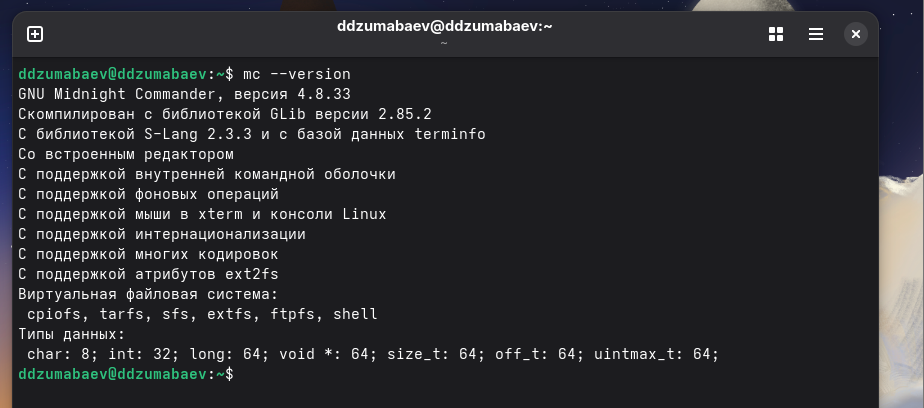
- Проверка версии программы;
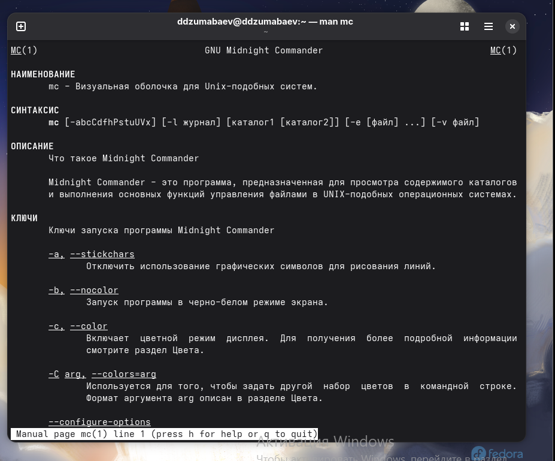
- Руководство пользователя;
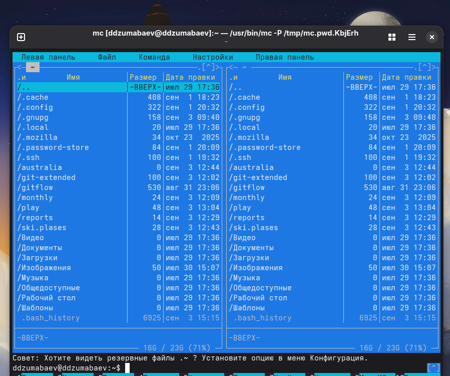
- Главное окно Midnight Commander.

---

# Изучение интерфейса Midnight Commander

В ходе лабораторной работы были изучены основные элементы интерфейса программы.

Выполнены следующие действия:

- открытие главного меню (**F9**);
- переключение между панелями (**Ctrl + U**);
- скрытие панелей (**Ctrl + O**);
- просмотр дерева каталогов;
- режим отображения информации.

**Скриншоты:**

- Главное меню;
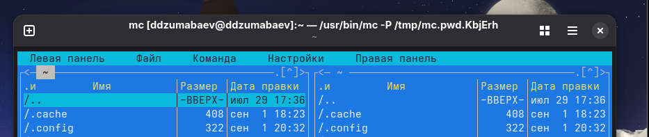
- Дерево каталогов;
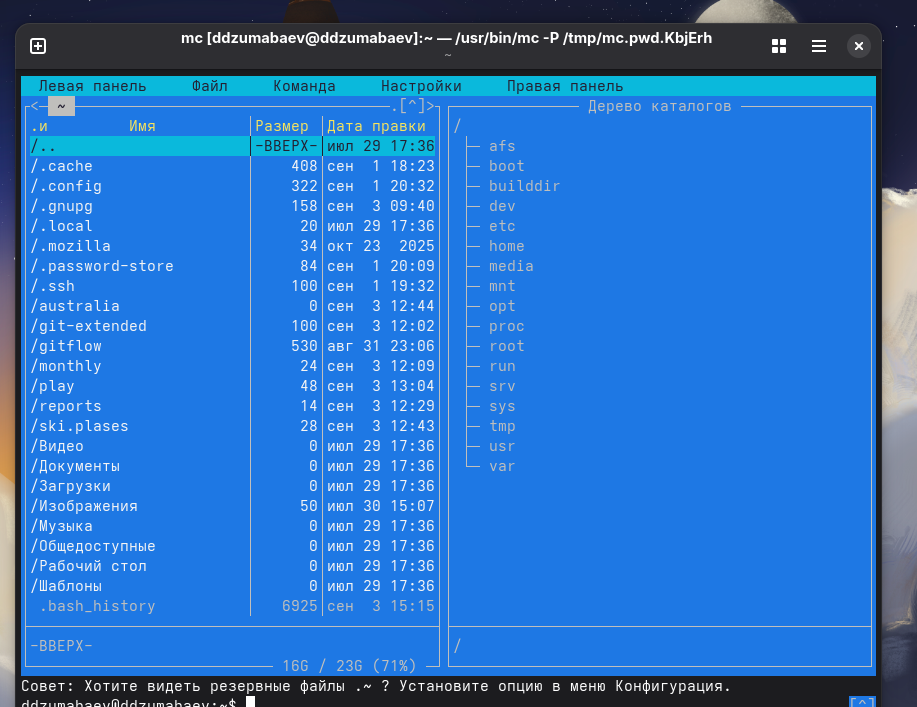
- Режим информации.
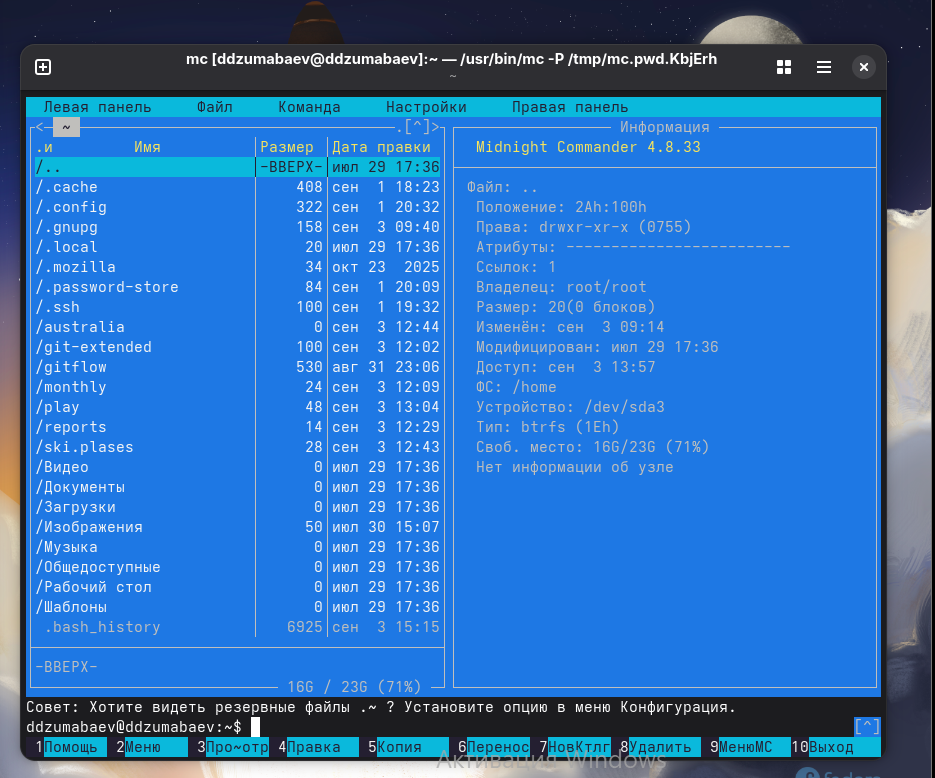

---

# Работа с файлами и каталогами

В процессе выполнения лабораторной работы были освоены основные операции над файлами.

Использованные функциональные клавиши:

| Клавиша | Действие |
|:-------:|-----------|
| **F3** | Просмотр файла |
| **F4** | Редактирование файла |
| **F5** | Копирование файла |
| **F7** | Создание каталога |

Также были выполнены:

- создание файлов;
- создание каталога **backup**;
- копирование файлов;
- просмотр прав доступа.

**Скриншоты:**

- Просмотр файла;
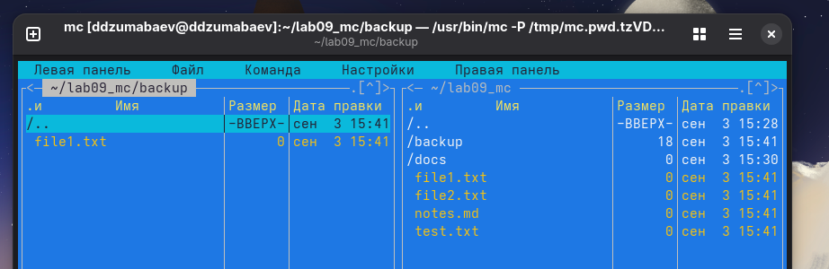
- Создание каталога;

- Копирование файла;
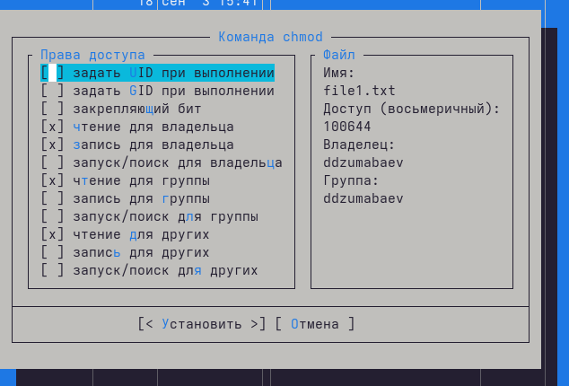
- Права доступа.
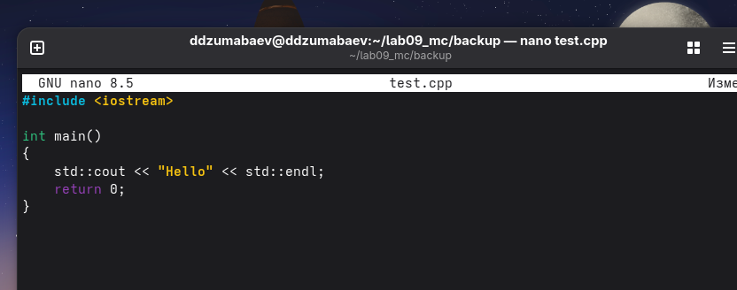

---

# Поиск файлов

Для поиска файлов использовались встроенные средства Midnight Commander.

Выполнен поиск файлов по маске

```text
*.cpp
```

а также поиск файла, содержащего строку

```text
main
```

В результате успешно найден файл **test.cpp**.

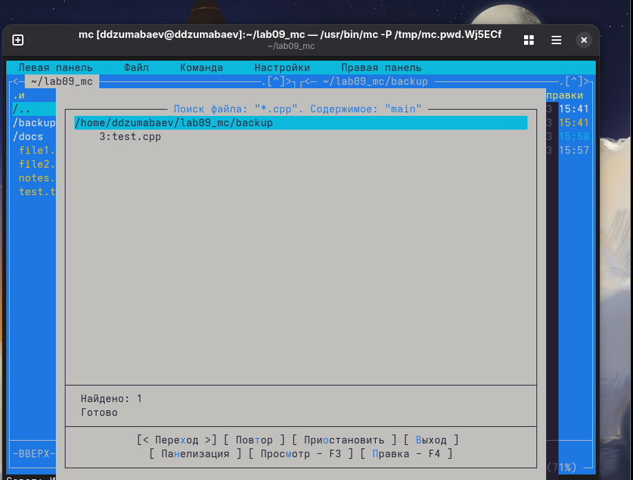
---

# Работа со встроенным редактором mcedit

В ходе лабораторной работы были изучены возможности редактора **mcedit**.

Выполнены следующие операции:

- создание файла **test.txt**;
- ввод текста;
- сохранение документа;
- повторное открытие файла;
- поиск текста;
- замена текста;
- отмена изменений;
- выделение текста;
- копирование и вставка.

**Скриншоты:**

- Создание файла;
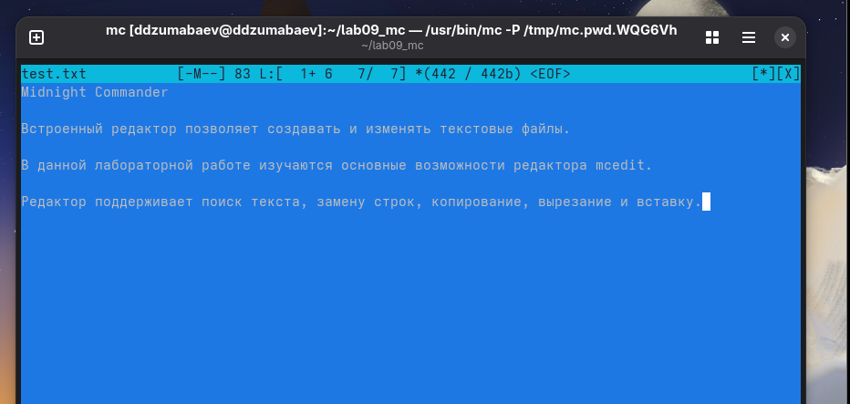
- Замена текста;
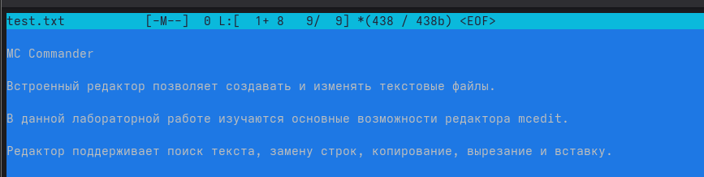
- Копирование и вставка.
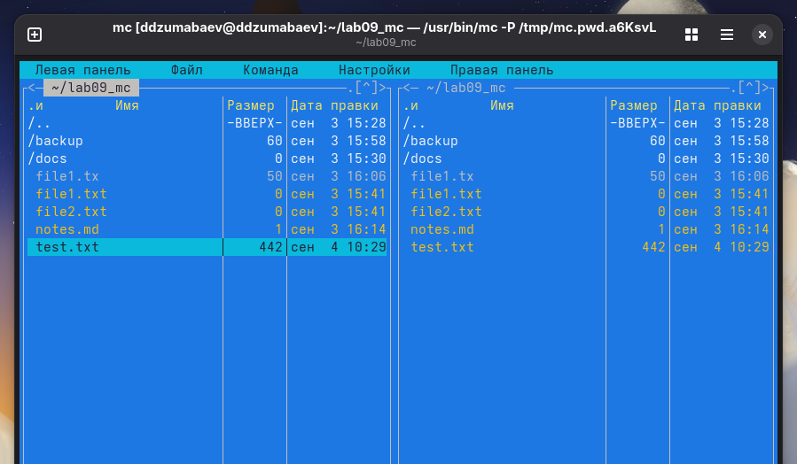

---

# Вывод

В ходе выполнения лабораторной работы №9 были изучены основные возможности файлового менеджера **Midnight Commander**.

Получены практические навыки:

- работы с файловой системой Linux;
- выполнения операций над файлами и каталогами;
- поиска файлов;
- работы с пользовательским меню и файлом расширений;
- использования встроенного редактора **mcedit**.

Полученные знания могут использоваться при повседневной работе в операционных системах семейства Linux.