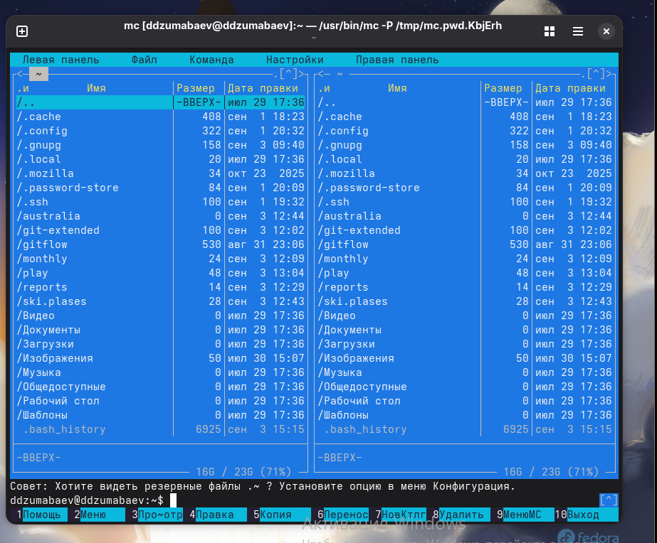
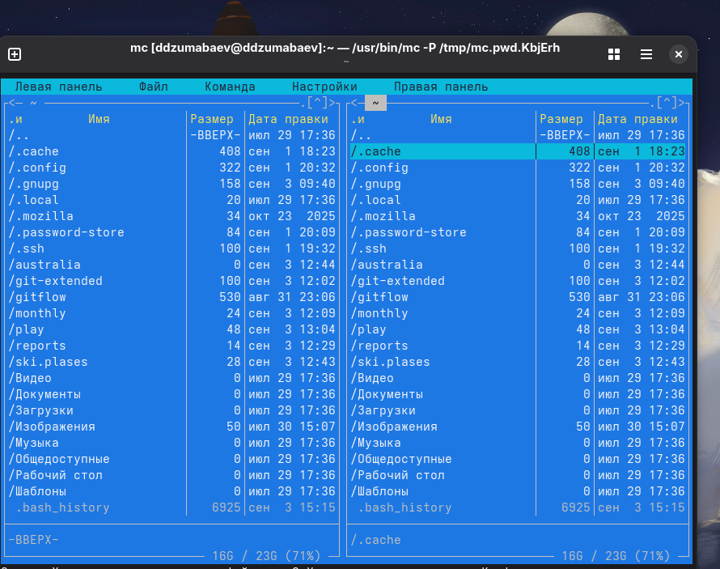
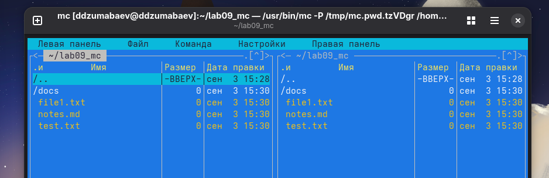
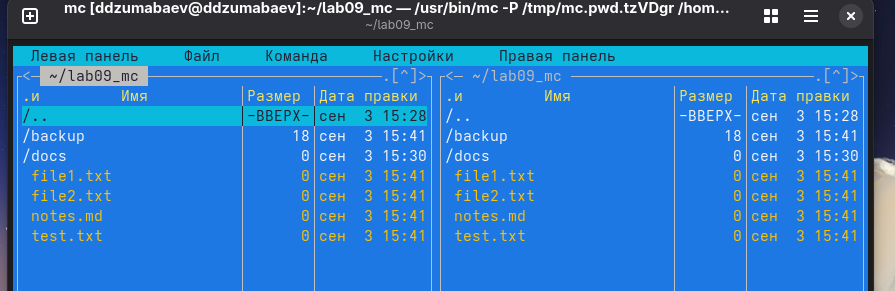
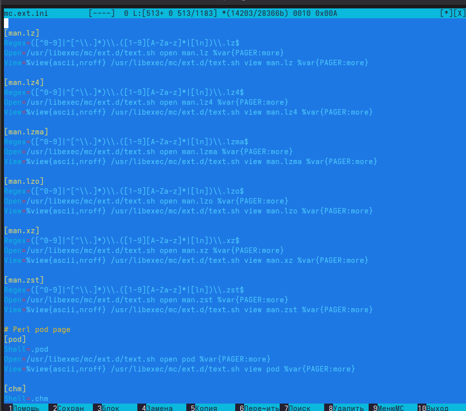
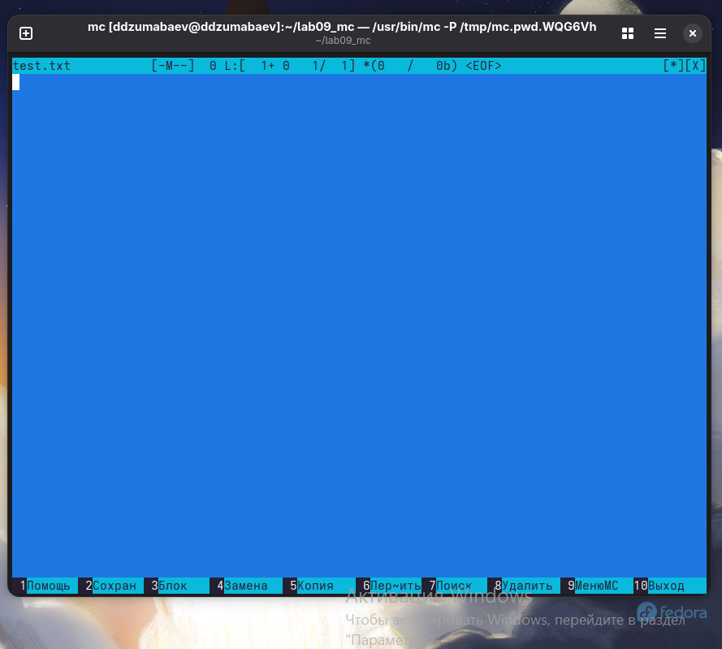
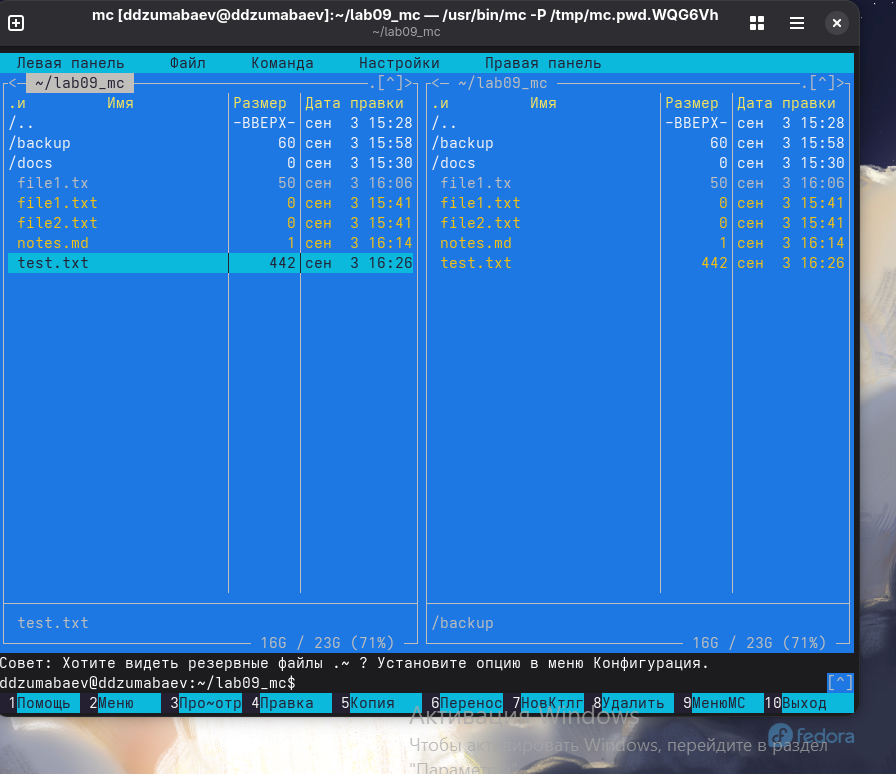
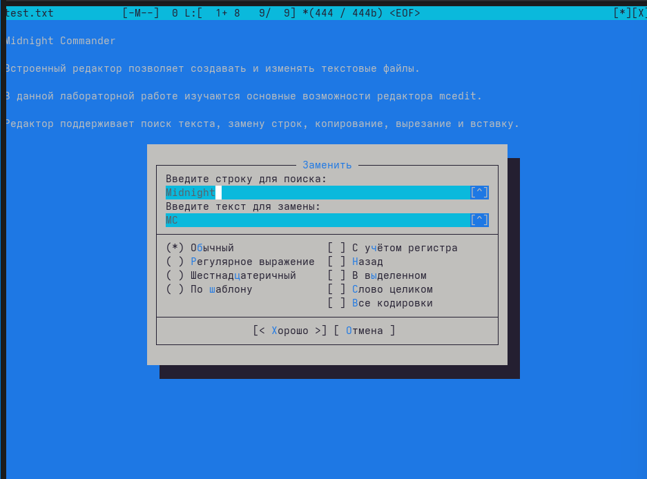
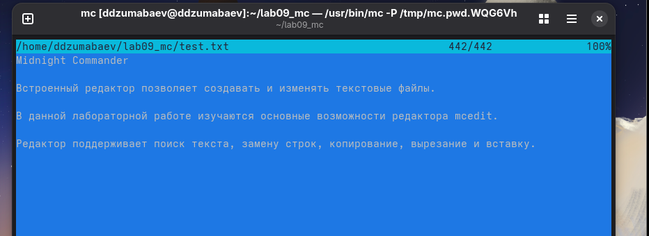
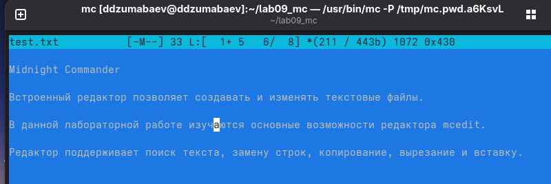

### «Российский университет дружбы народов имени Патриса Лумумбы»

#### Факультет физико-математических и естественных наук

---

# Отчёт по лабораторной работе №9

## Дисциплина

**Архитектура компьютера**

## Тема

**Работа с файловым менеджером Midnight Commander**

---

### Выполнил

Студент группы **НКАбд-02-25**

**Дамир Джумабаев**

---

### Москва

### 2026

---

# Цель работы

Изучить основные возможности файлового менеджера Midnight Commander, освоить работу с файловой системой Linux, научиться выполнять основные операции над файлами и каталогами, а также изучить встроенный текстовый редактор mcedit.

# Задачи работы

В ходе выполнения лабораторной работы необходимо:

- установить и запустить Midnight Commander;
- изучить руководство пользователя;
- ознакомиться с интерфейсом программы;
- изучить основные возможности панелей;
- научиться выполнять операции над файлами и каталогами;
- освоить поиск файлов;
- изучить работу с пользовательским меню;
- изучить файл расширений;
- освоить встроенный редактор mcedit;
- выполнить поиск и замену текста;
- изучить основные горячие клавиши редактора.

# Теоретические сведения

Midnight Commander (mc) — это консольный файловый менеджер для операционных систем семейства Linux и UNIX.

Программа предоставляет удобный двухпанельный интерфейс, позволяющий выполнять большинство операций с файлами и каталогами без необходимости постоянно вводить команды в терминале.

Основные возможности Midnight Commander:

- просмотр структуры каталогов;
- копирование файлов;
- перемещение файлов;
- удаление файлов;
- создание каталогов;
- переименование объектов;
- изменение прав доступа;
- поиск файлов;
- работа с архивами;
- использование встроенного текстового редактора;
- просмотр файлов различных форматов.

Одним из преимуществ Midnight Commander является наличие встроенного текстового редактора **mcedit**, который позволяет редактировать текстовые файлы непосредственно внутри программы без использования сторонних редакторов.

Редактор поддерживает:

- создание новых файлов;
- сохранение изменений;
- поиск текста;
- замену текста;
- копирование и вставку;
- отмену последних действий;
- работу с блоками текста.

Использование Midnight Commander значительно упрощает работу с файловой системой Linux и повышает эффективность выполнения административных задач.

# Выполнение работы

## 1. Проверка установленной версии Midnight Commander

Сначала была выполнена проверка наличия программы в системе.

```bash
mc --version
```

В результате была получена информация об установленной версии программы.


---

## 2. Изучение руководства пользователя

Для ознакомления с возможностями программы было открыто руководство пользователя.

```bash
man mc
```

После изучения основных разделов руководство было закрыто клавишей **q**.


---

## 3. Запуск программы

Для запуска файлового менеджера использовалась команда

```bash
mc
```

После запуска открылось главное окно Midnight Commander, состоящее из двух файловых панелей.


---

## 4. Изучение главного меню

Для открытия меню была использована клавиша

```
F9
```

Были изучены разделы:

- Левая панель;
- Файл;
- Команда;
- Настройки;
- Правая панель.


## 5. Изучение возможностей файловых панелей

После запуска Midnight Commander были изучены основные возможности двухпанельного интерфейса программы.

Каждая панель отображает содержимое отдельного каталога и позволяет независимо выполнять различные операции с файлами.

Для изучения возможностей панелей были выполнены следующие действия.

### Обмен панелей местами

Для обмена содержимого левой и правой панелей была использована комбинация клавиш

```
Ctrl + U
```

После выполнения команды содержимое панелей поменялось местами.



---

### Скрытие файловых панелей

Для временного перехода в обычный терминал использовалась комбинация клавиш

```
Ctrl + O
```

После повторного нажатия панели были восстановлены.



---

### Режим дерева каталогов

Через главное меню программы был открыт режим отображения дерева каталогов.

```
F9 → Левая панель → Дерево
```

После выбора данного режима на панели появилось дерево каталогов файловой системы Linux.

Данный режим позволяет быстро переходить между каталогами.


---

### Режим отображения информации

Далее был изучен режим отображения дополнительной информации.

```
F9 → Левая панель → Информация
```

В результате на панели появилась информация о текущем каталоге и выделенном объекте.


---

# 6. Создание рабочей директории

Для выполнения лабораторной работы был создан отдельный каталог.

В терминале была выполнена команда

```bash
mkdir -p ~/lab09_mc
```

После этого был выполнен переход в созданный каталог.

```bash
cd ~/lab09_mc
```

---

# 7. Создание файлов

Для выполнения дальнейших заданий лабораторной были созданы несколько файлов.

```bash
touch file1.txt
touch file2.txt
touch test.cpp
touch notes.md
```

Также был создан дополнительный каталог.

```bash
mkdir docs
```

После создания объектов был снова запущен Midnight Commander.

```bash
mc
```

В результате в рабочем каталоге появились созданные файлы и папка.



---

# 8. Просмотр содержимого файла

Для демонстрации работы встроенного просмотрщика был подготовлен текстовый файл.

В терминале были выполнены команды

```bash
echo " Hello Midnight Commander." > file1.txt
echo "Linux Operаting System." >> file1.txt
```

После этого файл был открыт во встроенном просмотрщике.

Для просмотра использовалась клавиша

```
F3
```

Просмотрщик позволил ознакомиться с содержимым файла без возможности его изменения.

После просмотра файл был закрыт клавишей **Esc**.



---

# 9. Редактирование файла

Для изменения содержимого файла был использован встроенный редактор Midnight Commander.

Файл был открыт клавишей

```
F4
```

В конец файла была добавлена строка

```
Эта строка добавлена через встроенный редактор Midnight Commander.
```

После ознакомления с возможностями редактора изменения не были сохранены.

Для выхода использовалась клавиша

```
F10
```

После появления вопроса о сохранении изменений был выбран вариант

```
No
```

В результате файл остался без изменений.


---

# 10. Создание нового каталога

Следующим этапом лабораторной было создание нового каталога средствами Midnight Commander.

Для этого использовалась клавиша

```
F7
```

В появившемся окне было введено имя каталога

```
backup
```

После подтверждения был создан новый каталог.


---

# 11. Копирование файла

Для изучения операции копирования был выделен файл

```
file1.txt
```

После этого использовалась клавиша

```
F5
```

В качестве каталога назначения был выбран

```
backup
```

После подтверждения файл был успешно скопирован.

Проверка показала наличие файла как в исходном каталоге, так и в каталоге **backup**.


---

# 12. Просмотр прав доступа

Для изучения информации о правах доступа был выбран файл

```
file1.txt
```

После этого было открыто окно изменения прав доступа.

В результате были изучены права владельца файла, группы пользователей и остальных пользователей.

Изменения в параметры доступа не вносились.


---

# 13. Поиск файлов

Для поиска файлов использовались встроенные средства Midnight Commander.

Через меню программы был открыт инструмент поиска файлов.

В качестве имени файла была указана маска

```
*.cpp
```

В поле поиска по содержимому было введено слово

```
main
```

После запуска поиска программа выполнила поиск файлов, удовлетворяющих заданным условиям.

В результате был найден файл

```
test.cpp
```

содержащий функцию **main()**.


# 14. Работа с историей команд

Следующим этапом лабораторной работы было изучение истории командной строки Midnight Commander.

Для этого было открыто меню программы.

```
F9 → Команда → История командной строки
```

В открывшемся окне отображается список команд, которые ранее были выполнены пользователем.

Данная функция позволяет быстро повторить ранее введённую команду без повторного набора с клавиатуры.

В процессе выполнения лабораторной была выбрана одна из ранее введённых команд и повторно выполнена.

Если история команд отсутствовала, это было связано с первым запуском Midnight Commander или отсутствием сохранённых команд в истории пользователя.

---

# 15. Переход в домашний каталог

Следующим заданием лабораторной являлся переход в домашний каталог пользователя.

Для этого использовалась комбинация клавиш

```
Ctrl + \
```

После открытия списка быстрого доступа был выбран домашний каталог пользователя.

В результате одна из панелей Midnight Commander открыла каталог

```
/home/имя_пользователя
```

Данная возможность позволяет быстро переходить в наиболее часто используемые каталоги.



---

# 16. Анализ файла меню

Для ознакомления с пользовательскими возможностями программы был открыт файл меню Midnight Commander.

Через главное меню была выполнена команда

```
F9 → Команда → Редактировать файл меню
```

Открылся встроенный текстовый редактор, содержащий файл пользовательского меню.

В ходе выполнения лабораторной были изучены:

- структура файла меню;
- назначение пользовательских команд;
- формат записи команд;
- комментарии внутри файла.

Изменения в файл не вносились.

После ознакомления редактор был закрыт без сохранения изменений.



---

# 17. Анализ файла расширений

Следующим этапом лабораторной было изучение файла расширений.

Файл был открыт через меню программы.

```
F9 → Команда → Редактировать файл расширений
```

В результате был открыт текстовый файл, содержащий правила обработки различных типов файлов.

В ходе изучения было установлено, что Midnight Commander автоматически определяет тип файла по его расширению и в зависимости от этого использует соответствующую программу просмотра или редактирования.

Были рассмотрены правила для различных типов файлов:

- текстовые документы;
- исходные коды программ;
- архивы;
- изображения;
- документы PDF;
- мультимедийные файлы.

После ознакомления редактор был закрыт без сохранения изменений.


---

# 18. Создание нового текстового файла

Следующим этапом лабораторной являлось изучение встроенного редактора **mcedit**.

Для создания нового документа использовалась команда

```
Shift + F4
```

После появления окна ввода имени файла было указано имя

```
test.txt
```

После подтверждения открылся пустой текстовый документ.


---

# 19. Ввод текста

В открытый документ был введён следующий текст.

```text
Midnight Commander

Встроенный редактор позволяет создавать и изменять текстовые файлы.

В данной лабораторной работе изучаются основные возможности редактора mcedit.

Редактор поддерживает поиск текста, замену строк, копирование, вырезание и вставку.
```

В процессе работы были изучены основные возможности встроенного редактора.



---

# 20. Сохранение файла

После завершения ввода текста файл был сохранён.

Для сохранения использовалась клавиша

```
F2
```

После сохранения редактор был закрыт.

```
F10
```

После возврата в Midnight Commander в рабочем каталоге появился новый файл

```
test.txt
```

что подтвердило успешное сохранение документа.



---

# 21. Повторное открытие файла

Для проверки успешного сохранения документ был повторно открыт.

Для этого файл **test.txt** был выделен на панели Midnight Commander.

После этого была нажата клавиша

```
F4
```

Редактор открыл сохранённый файл.

Проверка показала, что введённый ранее текст полностью сохранился.


---

# 22. Поиск текста

Для изучения возможностей редактора был выполнен поиск текста.

Использовалась команда

```
Ctrl + F
```

В строке поиска было введено слово

```
редактор
```

После запуска поиска редактор автоматически нашёл первое совпадение и переместил курсор к найденному слову.

Данная возможность позволяет быстро находить необходимые фрагменты текста в больших документах.


---

# 23. Замена текста

Следующим этапом лабораторной работы было изучение функции замены текста.

Была открыта команда замены.

```
Ctrl + R
```

В поле поиска было введено

```
Midnight
```

В поле замены было указано

```
MC
```

После подтверждения редактор заменил первое найденное совпадение.

Таким образом была изучена работа функции автоматической замены текста.


---

# 24. Отмена последнего действия

После выполнения замены была проверена возможность отмены изменений.

Использовалась комбинация клавиш

```
Ctrl + Z
```

После выполнения команды редактор восстановил первоначальный текст документа.

Таким образом была подтверждена работа механизма отмены последних действий.



---

# 25. Выделение, копирование и вставка текста

На заключительном этапе практической части лабораторной была изучена работа с выделенными фрагментами текста.

Был выделен небольшой участок текста.

После этого были выполнены операции:

- копирование;
- вставка;
- сохранение изменений.

Данные операции позволяют быстро редактировать документы и повторно использовать необходимые фрагменты текста.

После завершения работы документ был сохранён и редактор был закрыт.

**Скриншот 27 — Выделение текста.**

**Скриншот 28 — Копирование текста.**

**Скриншот 29 — Вставка текста.**

**Скриншот 30 — Итоговый вид рабочей директории после завершения работы.**


# Контрольные вопросы

## 1. Что такое Midnight Commander?

Midnight Commander (MC) — это консольный двухпанельный файловый менеджер для операционных систем семейства Linux и UNIX. Он предоставляет удобный интерфейс для работы с файлами и каталогами, позволяя выполнять большинство операций без постоянного ввода команд в терминале.

---

## 2. Какие основные возможности предоставляет Midnight Commander?

Основными возможностями программы являются:

- просмотр содержимого каталогов;
- копирование файлов;
- перемещение файлов;
- удаление файлов;
- создание новых файлов и каталогов;
- переименование файлов;
- изменение прав доступа;
- поиск файлов;
- просмотр файлов различных форматов;
- работа с архивами;
- использование встроенного текстового редактора mcedit.

---

## 3. Для чего используются две файловые панели?

Две панели позволяют одновременно работать с двумя различными каталогами. Это значительно упрощает копирование, перемещение и сравнение файлов, так как источник и каталог назначения отображаются одновременно.

---

## 4. Какие основные функциональные клавиши используются в Midnight Commander?

Наиболее часто используются следующие клавиши:

| Клавиша | Назначение |
|---------|------------|
| **F3** | Просмотр файла |
| **F4** | Редактирование файла |
| **F5** | Копирование файла |
| **F6** | Перемещение (переименование) файла |
| **F7** | Создание каталога |
| **F8** | Удаление файла |
| **F9** | Открытие главного меню |
| **F10** | Выход из программы |

---

## 5. Для чего предназначен встроенный редактор mcedit?

Редактор **mcedit** используется для создания и редактирования текстовых файлов непосредственно внутри Midnight Commander. Он поддерживает поиск и замену текста, копирование, вставку, отмену изменений и другие операции редактирования.

---

## 6. Для чего используется поиск файлов?

Поиск файлов позволяет быстро находить необходимые документы по имени, маске или содержимому текста. Это особенно удобно при работе с большим количеством файлов.

---

## 7. Для чего предназначен файл меню?

Файл меню содержит пользовательские команды Midnight Commander. С его помощью можно создавать собственные команды, автоматизировать выполнение различных операций и расширять возможности программы.

---

## 8. Для чего используется файл расширений?

Файл расширений определяет правила обработки различных типов файлов. В зависимости от расширения файла Midnight Commander автоматически выбирает программу просмотра или способ обработки соответствующего объекта.

---

# Вывод

В ходе выполнения лабораторной работы №9 были изучены основные возможности файлового менеджера Midnight Commander. Были освоены приёмы работы с файловой системой Linux, выполнены операции просмотра, редактирования, копирования и поиска файлов, изучены возможности пользовательского меню и файла расширений.

Кроме того, были исследованы основные функции встроенного текстового редактора **mcedit**, включая создание и сохранение текстовых файлов, поиск и замену текста, выделение, копирование, вставку и отмену изменений.

Полученные навыки позволяют значительно повысить эффективность работы с файловой системой Linux и использовать Midnight Commander как удобный инструмент для повседневного администрирования и разработки.