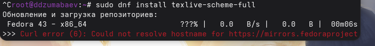
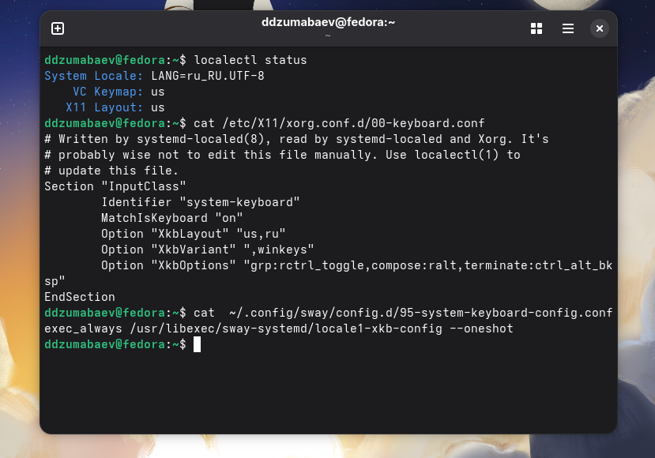
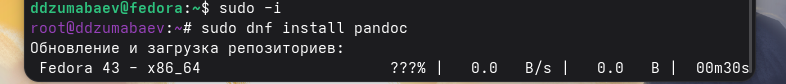
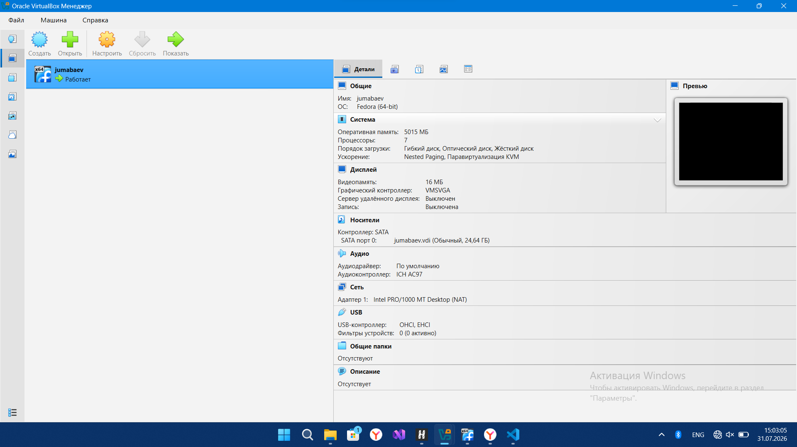
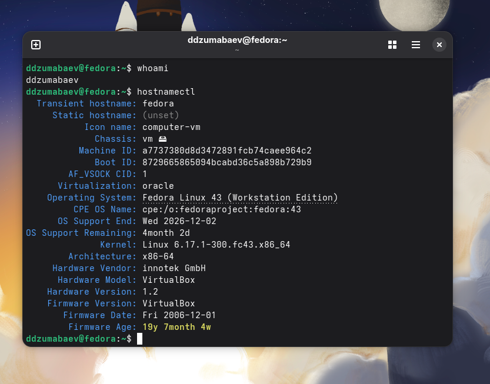
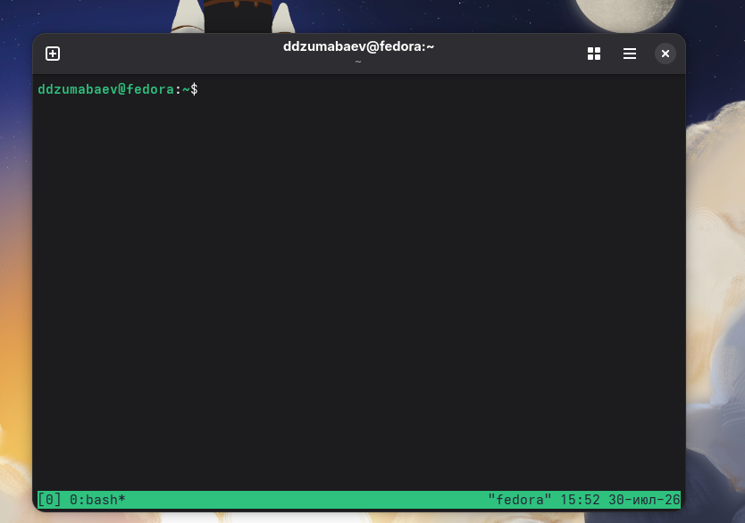

# Лабораторная работа №1

## Установка и первоначальная настройка Fedora Linux

**Студент:** Дамир Джумабаев

**Группа:** НКАбд-02-25

**Университет:** РУДН

# Цель работы

Изучить процесс установки операционной системы Fedora Linux и выполнить её первоначальную настройку.

# Актуальность

Linux широко используется:

- на серверах;
- в облачных технологиях;
- при разработке программного обеспечения;
- в области информационной безопасности.

Практические навыки работы с Linux являются важной частью подготовки IT-специалиста.

# Задачи лабораторной работы

- установить Fedora Linux;
- создать виртуальную машину;
- выполнить первоначальную настройку;
- создать пользователя;
- изменить hostname;
- проверить работу терминала.

# Используемое программное обеспечение

- Windows 11
- Oracle VirtualBox
- Fedora Linux
- Bash
- Git
- Visual Studio Code

# На рисунке показан процесс создания виртуальной машины в Oracle VirtualBox.


Создана виртуальная машина для установки Fedora Linux.

# Загрузка Fedora Live



Выполнен запуск Live-образа Fedora.

# Настройка языка



Выбран язык установки и раскладка клавиатуры.

# Настройка диска


Выполнена автоматическая разметка диска.

# Установка системы



Начато копирование файлов Fedora Linux.

# Первый запуск системы



После установки выполнен первый вход в систему.

# Настройка hostname



Изменено имя компьютера с использованием команды:

```bash
hostnamectl set-hostname yalkabov
```

# Работа в терминале



Проверена работа терминала Linux и выполнение основных команд.


# Полученные результаты

✅ Fedora успешно установлена

✅ Выполнена первоначальная настройка

✅ Настроен пользователь

✅ Изменён hostname

✅ Проверена работа терминала

# Выводы

В ходе выполнения лабораторной работы были получены практические навыки:

- установки Fedora Linux;
- настройки системы;
- работы с терминалом;
- изменения параметров Linux.

Поставленная цель полностью достигнута.

# Спасибо за внимание!
