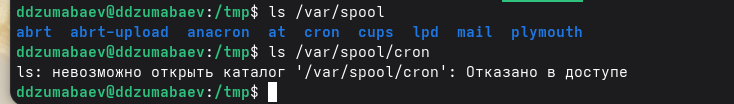
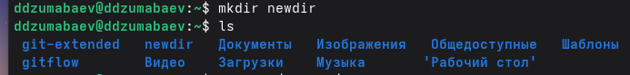
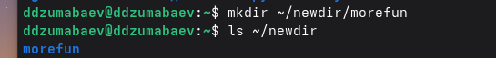
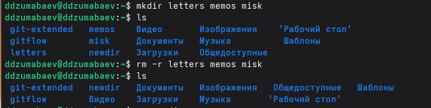
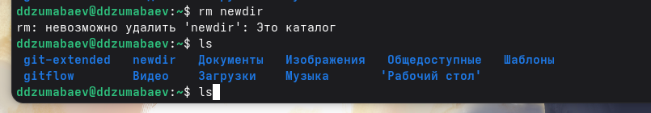
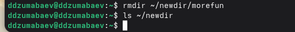
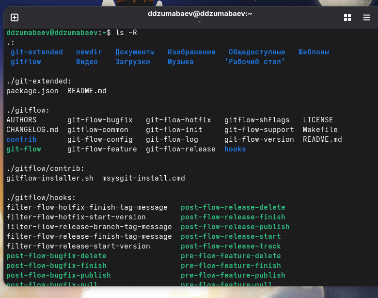

# Лабораторная работа №6

## Основы интерфейса взаимодействия пользователя с системой Unix на уровне командной строки

---

# Цель работы

Изучить основные принципы работы с командной строкой Linux и получить практические навыки использования основных команд Unix.

В ходе лабораторной работы были изучены:

- навигация по файловой системе;
- просмотр содержимого каталогов;
- создание и удаление каталогов;
- встроенная справочная система;
- история команд.

---

# Используемые команды

| Команда | Назначение |
|---------|------------|
| pwd | определение текущего каталога |
| cd | переход между каталогами |
| ls | просмотр содержимого |
| mkdir | создание каталогов |
| rm | удаление файлов |
| rmdir | удаление пустых каталогов |
| man | справочная система |
| history | история команд |

---

# Определение домашнего каталога

<div style="display:flex; gap:25px;">

<div style="width:42%;">

### Используемые команды

```bash
cd
pwd
```

Получен абсолютный путь к домашнему каталогу пользователя.

</div>

<div style="width:58%;">


</div>

</div>

---

# Работа с каталогом /tmp

<div style="display:flex; gap:25px;">

<div style="width:42%;">

### Команды

```bash
cd /tmp
pwd
```

Выполнен переход в каталог временных файлов.

</div>

<div style="width:58%;">


</div>

</div>

---

# Просмотр содержимого каталога

<div style="display:flex; gap:25px;">

<div style="width:40%;">

Использованы команды

```bash
ls
ls -a
ls -l
ls -alF
```

Изучены различные варианты отображения информации.

</div>

<div style="width:60%;">


</div>

</div>

---

# Проверка каталога cron

<div style="display:flex; gap:25px;">

<div style="width:40%;">

Используемые команды

```bash
ls /var/spool
ls /var/spool/cron
```

Проверено существование каталога cron.

</div>

<div style="width:60%;">



</div>

</div>

---

# Создание каталогов

<div style="display:flex; gap:25px;">

<div style="width:42%;">

Используемые команды

```bash
mkdir newdir

mkdir ~/newdir/morefun
```

Созданы новый каталог и вложенный подкаталог.

</div>

<div style="width:58%;">





</div>

</div>

---

# Создание и удаление нескольких каталогов

<div style="display:flex; gap:25px;">

<div style="width:42%;">

Используемые команды

```bash
mkdir letters memos misk

rm -r letters memos misk
```

Созданы три каталога одной командой и затем удалены.

</div>

<div style="width:58%;">



</div>

</div>

---

# Удаление каталогов

<div style="display:flex; gap:25px;">

<div style="width:42%;">

Используемые команды

```bash
rm newdir

rmdir ~/newdir/morefun
```

Изучено различие между командами `rm` и `rmdir`.

</div>

<div style="width:58%;">





</div>

</div>

---

# Использование команды man

<div style="display:flex; gap:25px;">

<div style="width:42%;">

Изучены:

- параметр `-R`;
- параметр `-t`;
- описание команд Linux.

</div>

<div style="width:58%;">




</div>

</div>

---

# Работа с историей команд

<div style="display:flex; gap:25px;">

<div style="width:42%;">

Используемые команды

```bash
history

!15

!15:s/ls/ls -l/
```

Повторное выполнение и изменение ранее введённых команд.

</div>

<div style="width:58%;">


</div>

</div>

---

# Полученные результаты

В ходе лабораторной работы были освоены:

- работа с терминалом Linux;
- навигация по файловой системе;
- использование команд Unix;
- создание и удаление каталогов;
- использование справочной системы;
- работа с историей команд.

---

# Вывод

Цель лабораторной работы достигнута.

Получены практические навыки работы с командной строкой Linux, изучены основные команды управления файловой системой и способы получения справочной информации, что является основой для дальнейшего изучения операционных систем семейства Unix.

---

# Спасибо за внимание!

## Вопросы?